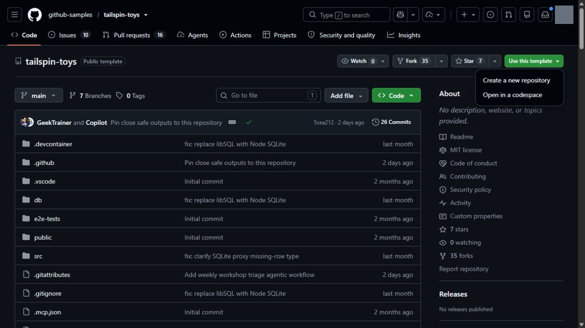
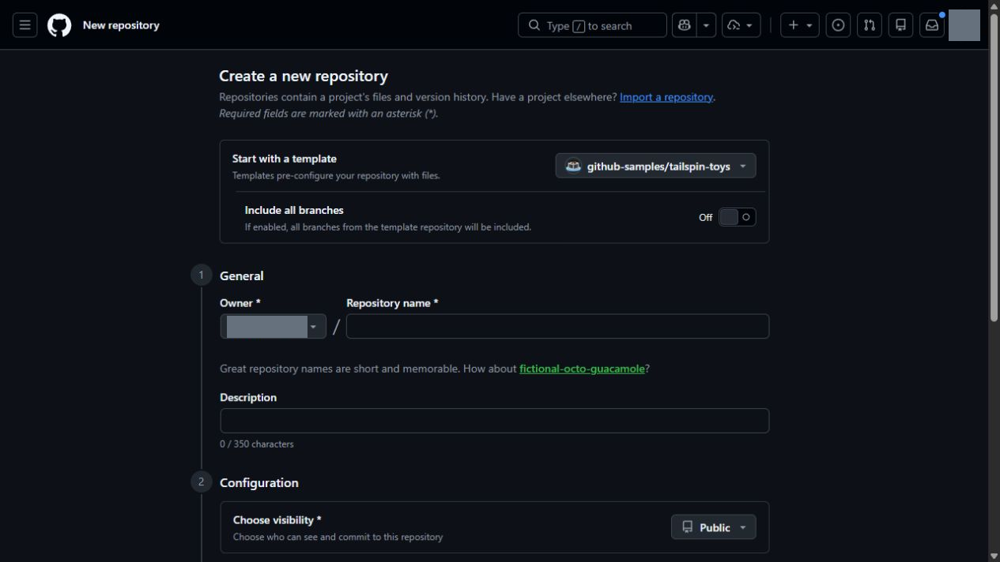

> **この章の進め方：** GitHub Web で演習コピーを準備し、次章で App に接続します。2026年9月13日にテンプレートメニューと作成フォームを確認しました。現在の取得先は修正済みの非公開テンプレートです。テンプレート複製 API とコピー先の8件の Issue 作成は確認済みで、Web フォームの送信完了は未検証です。[UI 確認表](../material/ui-check.md)も参照してください。


GitHub Copilot app は、Copilot と GitHub の両方を一元的に扱うデスクトップアプリです。Issue や pull request にすばやくアクセスでき、もちろん GitHub Copilot を使った開発も可能です。このワークショップでは、Astro で構築された Tailspin Toys アプリと GitHub Copilot app を使い、ローカル環境で作業します。始める前に、Node.js がローカルにインストールされていることを確認してから、Copilot app をインストールします。

このレッスンでは、次の内容を学習します。

- プロジェクトのテストを実行できるよう Node.js をインストールする。
- テンプレートから Tailspin Toys プロジェクトの自分用コピーを作成する。

## Node.js をインストールする

いくつかのレッスンでは、エージェントに機能を構築させ、Tailspin Toys のテストスイートをローカルで実行します。そのためには [**Node.js**][nodejs] が必要です。コピーしたリポジトリの `package.json` に加え、固定された依存関係の要求も満たすバージョンを使用してください。2026年9月13日の検証では **Node.js 24.19.0** を使用しました。

どのプラットフォームでも、公式インストーラーを使うのが最も簡単です。

1. Windows Terminal、macOS のターミナル、または普段使用しているターミナルを開きます。
2. 次のコマンドを実行し、Node.js のバージョンを確認します。配布テンプレートの `.nvmrc` は `24.19.0`、`engines.node` は `>=24.19.0 <25` です。上流本体の最低条件だけでは一部依存の要求を満たさなかったため、教材側で検証したバージョンを指定しています。

    ```shell
    node --version
    ```

3. 演習コピーの依存関係の要求を満たすことを確認できた場合は、次のセクションに進めます。講師は App の実行環境でも同じバージョンが選択されることを確認してください。

> [!TIP]
> Node.js がインストールされていない場合、または更新が必要な場合にのみ、以降の手順を実行してください。

4. [Node.js のダウンロードページ][node-download]を開きます。
5. 使用しているオペレーティングシステム向けの **LTS** ビルドをダウンロードします。
6. インストーラーを実行し、既定の設定を選択します。Windows では、**Add to PATH** を選択したままにします。
7. インストールが完了したら、新しいターミナルを開きます。
8. 新しいターミナルで次のコマンドを実行し、インストールを確認します。

    ```bash
    node --version
    ```

9. インストールしたバージョンが表示され、手順2の条件を満たすことを確認します。App がすでに起動していた場合は再起動し、古い環境変数を使い続けないようにします。

> [!TIP]
> コンテナーを使用する場合、[**Docker**][docker] があれば、Node.js をローカルにインストールする代わりにリポジトリの [dev container][dev-containers] を使用できます。dev container には Node.js が含まれているため、両方を用意する必要はありません。

## ラボ用リポジトリを設定する

Tailspin Toys プロジェクトの自分用コピーを使って作業します。[教材用の修正済み Tailspin Toys テンプレート](https://github.com/iwizsophy/dev-days-tailspin-template)から、[テンプレートからのコピー作成手順][template-repository]に沿って準備します。次のレッスンで、このリポジトリをアプリに接続します。

取得先は **iwizsophy/dev-days-tailspin-template**、教材対応版は **v2026.09.13** です。非公開のため、参加者は事前に講師からアクセス権を受け取ってください。上流の固定コミット `bae003609c8cff0c51d92658b8d3bd89450464f1` をコピーし、PR Readiness の YAML・MCP の設定修正と Node バージョン指定を適用済みです。参加者による事前パッチの適用は不要です。星評価・フィルターなどの解答は含めていません。

**Use this template** は配布元の現在の main をコピーします。講師は開催前に `workshop-source.json` の配布版と [sources.json](https://github.com/iwizsophy/dev-days-jp/blob/feature/issue-2-app-ui-verification/content/ja/sources.json) に記録したコミットの対応を確認してください。タグを指定してコピーするボタンではありません。教材リポジトリ `dev-days-jp` と、コードを変更する Tailspin Toys のコピーは別です。

> **講師向けの配布判定：** この版は機能検査を通過しましたが、依存監査に Critical を含む未解決の指摘があります。参加者への本番配布前に、配布元の `WORKSHOP.md` に記録した依存更新・再検証を完了してください。


以下の2枚は取得先変更前の GitHub Web の操作位置の例です。画像中の上流名ではなく、本文の **iwizsophy/dev-days-tailspin-template** を選んでください。

1. 新しいブラウザーウィンドウで、このラボの GitHub リポジトリ `https://github.com/iwizsophy/dev-days-tailspin-template` を開きます。
2. ラボ用リポジトリのページで **Use this template** ボタンを選択し、**Create a new repository** を選択して、リポジトリの自分用コピーを作成します。

    

3. **Start with a template** が `iwizsophy/dev-days-tailspin-template` であることを確認します。**Include all branches** は既定の Off のままにし、**Owner** に自分または許可された組織、**Repository name** に演習用の名前を指定します。**Choose visibility** はメンターの指定に従います。2026年9月13日のフォームでは初期値は Public でした。非公開の演習にする場合は Private を選択してください。

    

4. 任意項目の **Jumpstart your project with Copilot** の Prompt は、この教材では空欄のままにします。内容を確認して **Create repository** を選択します。
5. 作成したリポジトリのパス (**organization-or-user-name/repository-name**) を記録します。このラボで後ほど使用します。

> [!NOTE]
> コピー側の **Bootstrap template issues** ワークフローが成功すると、GitHub Issue のバックログが作成されます。すぐに見えない場合は、自分のコピーの **Actions** で実行結果を確認し、自動実行されなければ **Bootstrap template issues → Run workflow** を実行します。配布元テンプレート自身ではこの処理をスキップします。参照元へ Issue を作成しないでください。

<a id="cli-fallback"></a>

> **講師向け：** 緊急の作業保全が必要な場合だけ [対応手順](../material/emergency-cli.md#chapter-0) を参照してください。CLI の実装成功は、この章の App 操作の完了には数えません。

## まとめと次のステップ

準備が整いました。プロジェクトをコンピューター上でビルドしてテストできるように Node.js をインストールし、テンプレートから Tailspin Toys リポジトリの自分用コピーを作成しました。

次は GitHub Copilot app をインストールし、作成したリポジトリを接続して、ワークスペースを確認します。[レッスン 1「GitHub Copilot app のインストール」][next-lesson]に進んでください。

## リソース

- [Node.js のダウンロード][node-download]
- [テンプレートからのリポジトリの作成][template-repository]
- [GitHub Copilot app について][about-copilot-app]

[next-lesson]: 1-install-copilot-app.md
[nodejs]: https://nodejs.org/
[node-download]: https://nodejs.org/en/download
[docker]: https://www.docker.com/products/docker-desktop/
[dev-containers]: https://code.visualstudio.com/docs/devcontainers/containers
[template-repository]: https://docs.github.com/repositories/creating-and-managing-repositories/creating-a-repository-from-a-template
[about-copilot-app]: https://docs.github.com/copilot/concepts/agents/github-copilot-app
