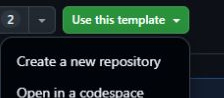
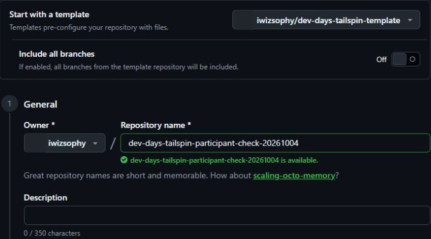
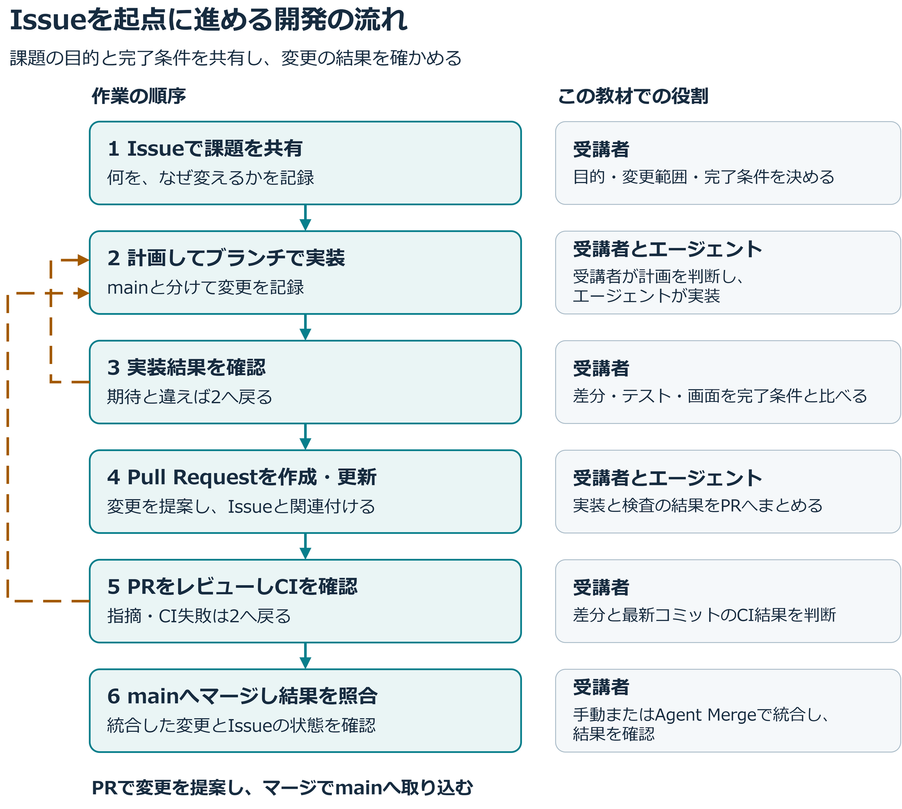

## 1.1 章の概要

GitHub Copilot appのエージェントと開発を進めるには、コードを実行する環境と、変更を管理する場所が必要です。この章では、実際に使われる実行環境を確認し、課題を読んで変更を進めるための準備ができているか判断する方法を学びます。

環境を確認できていれば、後の章でエラーが起きたときも、環境と実装を分けて調べやすくなります。コマンドの出力やリポジトリの所有者、用意された課題を確かめ、準備が整ったか自分で判断しましょう。

### 1.1.1 この章で学ぶこと

| 項番 | この章で行うこと | 期待される効果 |
| :---: | :--- | :--- |
| 1 | 実行されるNode.jsのバージョンを調べ、演習の要件と比べる | ビルドやテストに使う実行環境が要件を満たすか判断できる |
| 2 | テンプレートから自分用のリポジトリを作り、所有者を確認する | 教材を読むリポジトリと自分の演習用コピーを区別し、後の章でIssue、ブランチ、Pull Requestを操作する対象を判断できる |
| 3 | 演習用Issueがそろっているか確認する | 実装依頼の前に、演習用Issueの背景と受け入れ条件を確認できる |

## 1.2 取り組む前に

ブラウザーでGitHubにサインインし、自分のアカウントでリポジトリを作成できる状態にしてください。ローカルPCでは、普段使っているターミナルを開けることを確認します。

本教材ではNode.js 24系のLTS版、24.19.0以降を使用します。すでにこの条件を満たしていれば、再インストールは不要です。nvmなどでバージョンを管理している場合は、その管理方法に合わせて切り替えます。

演習に使うのは、[教材用のTailspin Toysテンプレート](https://github.com/iwizsophy/dev-days-tailspin-template)です。使用する教材のバージョンは[v2026.10.03](https://github.com/iwizsophy/dev-days-tailspin-template/releases/tag/v2026.10.03)で、星評価やフィルター機能の解答コードは含まれていません。教材リポジトリの`dev-days-jp`と、これからコードを変更するTailspin Toysのコピーを区別して進めます。

## 1.3 ケース

この章の題材は、ゲームを紹介するクラウドファンディングサイト「Tailspin Toys」の演習用コピーを準備する作業です。後の章では、このコピーでエージェントに変更の目的を伝え、生成されたコードとテストを確認し、レビューした変更を取り込みます。

| 項番 | 観点 | このケースで扱う内容 |
| :---: | :--- | :--- |
| 1 | 状況 | 演習では、教材用テンプレートから作成した各自のTailspin ToysリポジトリでIssue、ブランチ、Pull Requestを扱います。サイトのビルドやテストにはNode.jsを使います。 |
| 2 | 課題と理由 | 実行環境と変更対象を確認できていないと、後の演習でエラーの原因や作業対象を判断しにくくなります。各自が変更を管理できるコピーと、課題を読むためのIssueが必要です。 |
| 3 | 解決策 | 実際に実行されるNode.jsのバージョンを確認し、必要に応じて準備します。Tailspin Toysのテンプレートから自分用のリポジトリを作成し、演習用Issueがそろったことを確かめます。 |

<a id="nodejs-のインストールとバージョン確認"></a>
<a id="確認とインストール手順"></a>

### 1.3.1 Node.jsのバージョンを確認する

PCにインストールしたNode.jsのバージョンと、今のターミナルが実行するNode.jsのバージョンは一致するでしょうか。まずバージョンを確認するコマンドの出力を調べます。

1. Windows Terminal、macOS Terminalなど、普段使うターミナルを開きます。
2. 次のコマンドを実行します。

   ```shell
   node --version
   ```

3. Node.js 24系の24.19.0以降が表示されたら、[演習用リポジトリの作成](#演習用リポジトリの作成)へ進みます。コマンドが見つからない場合や、条件を満たさない場合は、次の手順で準備します。

<a id="インストールが必要な場合"></a>

#### 1.3.1.1 インストールが必要な場合

1. [Node.jsのダウンロードページ][node-download]を開きます。
2. 使用するOSに合わせて、Node.js 24系のLTS版、24.19.0以降をダウンロードします。
3. インストーラーを起動し、既定の設定で進めます。Windowsでは、**Add to PATH**が有効であることを確認してください。
4. インストール後、新しいターミナルを開き直します。
5. もう一度`node --version`を実行し、条件を満たすバージョンが表示されることを確認します。

Node.jsのインストール後、すでにGitHub Copilot appを起動している場合は、完全に終了して再起動します。新しい環境変数をAppに反映したうえで、エージェントに実装を依頼するセッションでもNode.jsのバージョンを確認してください。確認方法は、[第3章の実装前の環境確認](3-add-star-rating.md#実装前の環境確認)で扱います。

<a id="演習用リポジトリの作成"></a>
<a id="使用するテンプレート"></a>
<a id="github-web-での作成手順"></a>

### 1.3.2 テンプレートから演習用リポジトリを作る

後の章では、各自が作成したTailspin Toysの演習用リポジトリでIssueやPull Requestを扱います。作成前に、コピー元のテンプレートと作成先の所有者を確認しましょう。操作の詳細は[GitHub公式のテンプレートからの作成手順][template-repository]も参照できます。

1. ブラウザーで`https://github.com/iwizsophy/dev-days-tailspin-template`を開きます。
2. **Use this template** → **Create a new repository**を選択します。

   

3. 作成フォームで次の項目を設定します。

   | 項番 | 項目 | 設定する内容 |
   | :---: | :--- | :--- |
   | 1 | Start with a template | `iwizsophy/dev-days-tailspin-template`であることを確認する |
   | 2 | Include all branches | 既定のOff、チェックなしのままにする |
   | 3 | Owner | 自分のアカウントまたは演習用Organizationを選ぶ |
   | 4 | Repository name | 自分の演習用の名前を入力する。例は`dev-days-tailspin-toys` |
   | 5 | Choose visibility | 演習用リポジトリの公開範囲を選ぶ |

   

4. フォーム下部の任意項目**Jumpstart your project with Copilot**では、**Prompt**欄を空欄のままにします。
5. 入力内容を確認し、**Create repository**を選択します。
6. 作成したリポジトリの`owner/repo`を控えます。次章では、作成した演習用リポジトリをAppに接続します。

<a id="演習用issueの準備を確認する"></a>

### 1.3.3 演習用Issueを確認する

Tailspin Toysの演習用リポジトリの作成後に、GitHub Actionsで自動実行されるのが**Bootstrap template issues**ワークフローです。実行が終わると、そのリポジトリに演習で使う8件のIssueが作成されます。

1. 作成した演習用リポジトリの**Issues**タブを開き、8件の課題が表示されることを確認します。
2. 課題が表示されない場合は、同じ演習用リポジトリの**Actions**タブでワークフローの実行状況を確認します。
3. 必要に応じて**Bootstrap template issues** → **Run workflow**を実行し、終了後に**Issues**を開き直します。

作成された演習用Issueのタイトルには、フィルター機能やコーディング規約など、これから取り組む変更が表れています。演習用リポジトリのコードとIssueがそろったことを確認して、次へ進んでください。

<a id="完了の確認"></a>
<a id="振り返り"></a>

## 1.4 結果の整理と振り返り

Tailspin Toysを実行するNode.jsと、自分で変更できる演習用リポジトリを用意しました。次の項目を確認してください。

- `node --version`で、Node.js 24系の24.19.0以降を確認できた。
- テンプレートから自分のコピーを作成し、`owner/repo`を控えた。
- コピーのIssuesに、演習用の8件の課題が表示された。

「各自のコピーが必要な理由」と「インストール後にバージョンを確認する理由」を、自分の言葉で説明してみましょう。予想したバージョンと実際の出力が違った場合は、何を切り替えて解決したかも振り返ります。

<a id="次のステップ"></a>

次章ではGitHub Copilot appをインストールし、今回作成した演習用リポジトリを接続します。[第2章「GitHub Copilot appのインストール」][next-lesson]へ進んでください。

<a id="補足"></a>

## 1.5 補足

<a id="この教材で体験する開発の流れ"></a>

<a id="151-この教材で体験する開発の流れ"></a>

### 1.5.1 Issueを起点に変更を進める

Issueを起点に変更を進める「Issue駆動開発」では、変更の目的、解決したい課題、完了を判断する条件をIssueにまとめ、実装とレビューの共通の前提として使います。実装中の相談やPRとの関連付けもIssueに残すと、後から参加した人も「なぜこの変更をしたか」を追えます。実装を依頼する人は、課題を読んで条件を共有し、結果が課題を解決したかを判断します。

GitHub Copilot appは、エージェントの作業とGitHubのリポジトリ管理をまとめて扱うデスクトップアプリケーションです。Issueから実装を始め、差分やテスト結果を読み、Pull Requestを通じて変更を取り込めます。機能の全体像は[GitHub公式の説明][about-copilot-app]で確認できます。

Issueで作業を計画・相談・追跡する使い方は、[GitHub公式のIssueの説明][about-issues]も参照してください。

| 項番 | 用語 | この教材での役割 |
| :---: | :--- | :--- |
| 1 | main | 演習用リポジトリの既定ブランチ。確認を終えた変更をマージして集める先 |
| 2 | Issue | 変更の目的・課題・完了条件を共有する記録 |
| 3 | ブランチ | mainと分けて変更を記録する作業の履歴 |
| 4 | Pull Request（PR） | 変更をmainへ取り込むための提案。PR作成後、マージによって変更を取り込む |
| 5 | CI | GitHub Actionsなどによる自動検査。PRの最新コミットに対する結果を確認する |

ブランチで変更し、PRのレビューを経てマージする基本の流れは、[GitHub公式のGitHub flowの説明][github-flow]でも確認できます。下の図は、その流れにこの教材での役割と確認を加えたものです。



図の戻る矢印は、修正して確認を繰り返す箇所を示しています。受講者が期待結果との違いやレビューの指摘を見つけた場合は、エージェントへ修正を依頼し、変更後の差分・テスト・画面を再確認します。マージを判断する前には、PRの最新コミットに対するCIの成功も確かめてください。

PR作成後の修正も、同じブランチで進めます。追加のコミットをpushすると、修正内容は既存のPRへ反映されます。受講者は、更新後のPRで差分と最新コミットのCI結果を確認します。

たとえば、Tailspin Toysのゲーム一覧にフィルターを追加する課題では、利用者がカテゴリや出版社でゲームを探せるようにする理由と、条件の組み合わせをIssueで共有します。受講者はエージェントの計画を確認し、カテゴリ同士をOR、カテゴリと出版社をANDで組み合わせることなどを、実装後の判断基準にします。

PRとIssueを関連付けると、課題と解決のための変更を行き来できます。PR本文に`Closes #番号`などのキーワードを記載した場合は、そのPRをリポジトリの既定ブランチへマージすると、対応するIssueが自動で閉じられます。マージ後は、mainへ取り込まれた変更と関連するIssueの状態を照合します。関連付けの方法と自動で閉じる条件は、[GitHub公式のPRとIssueの関連付けの説明][linking-pr-issue]を参照してください。

第3章では、受講者が星評価の要件を直接伝え、実装から通常マージまでの基本を体験します。第4章からは用意されたIssueを起点に進め、第5〜7章では一つのフィルター課題を計画・実装、ブラウザー検証、マージに分けて扱います。図は課題一件の流れを示しており、章が変わるたびに新しいIssueやPRを作るという意味ではありません。

この教材で変更の目的と確認条件を伝えるのは受講者です。エージェントの完了報告を受けた後も、実際のコードや画面を確認し、必要なら修正を依頼します。環境を準備する段階から、説明と実際の結果を照合する習慣をつけましょう。

<a id="nodejsと実行環境"></a>

<a id="152-nodejsと実行環境"></a>

### 1.5.2 実際に使う実行環境を確認する

Node.jsを使う開発では、インストールの完了と、実行されるバージョンの確認は別の作業です。ターミナルで確認できるのは、そのターミナルが使うNode.jsです。エージェントにビルドやテストを任せる場合は、実装セッションが使うバージョンも調べ、プロジェクトの要件と比べてください。バージョン管理ツールを使っている場合も、コマンドの出力を確かめます。

演習用サイトTailspin ToysはAstroで構築されています。ローカルPCの[Node.js][nodejs]でTailspin Toysをビルドし、Vitestの単体テストとPlaywrightのE2Eテストを実行します。

Tailspin Toysの教材用テンプレートには[dev container][dev-containers]の設定もあります。[Docker Desktop][docker]などで別の環境を使う場合は、講師の案内に従ってください。

<a id="各自の演習用コピーを使う理由"></a>

<a id="153-各自の演習用コピーを使う理由"></a>

### 1.5.3 変更を管理するリポジトリを選ぶ

実務では、既存のプロジェクトで変更を進めるのか、テンプレートから新しいプロジェクトを始めるのかに合わせて、作業するリポジトリを選びます。コードの参照元、変更する対象、PRの取り込み先を区別しておくと、どこへ変更を共有するか確認できます。

テンプレートからの作成は、用意されたファイルを基に新しいプロジェクトを始める操作です。詳細は[GitHub公式のテンプレート説明][template-repository]を参照してください。

演習用Issueを起点に実装し、レビューした変更を自分の演習用リポジトリのmainへ取り込むため、各自のTailspin Toysのコピーを作ります。他の受講者の作業と分けて進められ、試した変更の履歴も自分で確認できます。

<a id="リソース"></a>

### 1.5.4 参考資料

- [Node.jsのダウンロード][node-download]
- [テンプレートからのリポジトリの作成][template-repository]
- [GitHub Copilot appについて][about-copilot-app]
- [GitHubのIssueで作業を計画・追跡する][about-issues]
- [ブランチ・PR・マージの基本][github-flow]
- [PRとIssueの関連付け][linking-pr-issue]

[next-lesson]: 2-install-copilot-app.md
[nodejs]: https://nodejs.org/
[node-download]: https://nodejs.org/en/download
[docker]: https://www.docker.com/products/docker-desktop/
[dev-containers]: https://code.visualstudio.com/docs/devcontainers/containers
[template-repository]: https://docs.github.com/en/repositories/creating-and-managing-repositories/creating-a-repository-from-a-template
[about-copilot-app]: https://docs.github.com/en/copilot/concepts/agents/github-copilot-app
[about-issues]: https://docs.github.com/en/issues/tracking-your-work-with-issues/learning-about-issues/about-issues
[github-flow]: https://docs.github.com/en/get-started/using-github/github-flow
[linking-pr-issue]: https://docs.github.com/en/issues/tracking-your-work-with-issues/using-issues/linking-a-pull-request-to-an-issue
