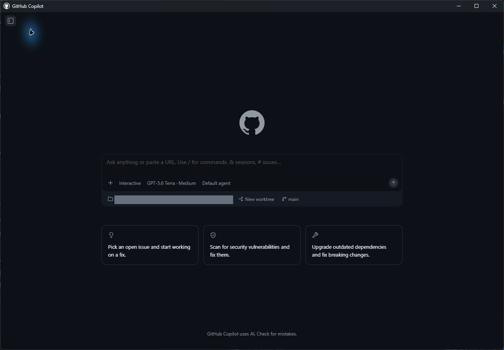
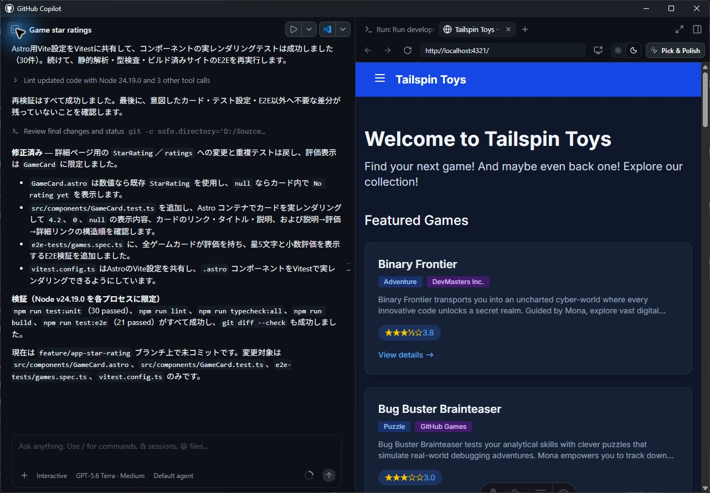

> **この章の進め方：** App で操作します。掲載画像には確認日・バージョン・操作例の対象を添えています。撮影範囲全体を残しているため、会話欄と操作パネルの位置を合わせて確認できます。ボタンや機能が見つからない場合は [UI が異なるときの確認](../material/ui-check.md)に沿って講師と確認してください。


前のレッスンでは、ワークスペースを確認し、クイックチャットを使いました。ここでは、**エージェントセッション**を開始し、プロジェクトに最初の変更を加えます。変更は小規模なものにします。ゲームのデータにはすでに星評価が含まれていますが、ホームページのゲームカードにはまだ表示されていません。エージェントに表示を依頼し、変更をレビューして、最初の pull request としてマージします。

このレッスンでは、次の内容を学習します。

- エージェントセッションを開始し、セッションの構成を理解する。
- プロジェクトに小規模で対象を絞った変更を加えるようエージェントに依頼する。
- ワークスペースの差分ビューで変更をレビューする。
- アプリをローカルで実行し、ブラウザーで変更を確認する。
- 最初の pull request を作成してマージする。

## シナリオ

Tailspin Toys の各ゲームには星評価を設定でき、ゲーム詳細ページにはすでに表示されています。一方、ホームページのゲームカードには、タイトル、カテゴリー、パブリッシャー、説明だけが表示されています。最初のセッションの準備運動として、各カードに既存の評価を表示するようエージェントに依頼します。小規模で自己完結した、最初のセッションに最適な変更です。

## セッションの構造

**セッション**とは、プロジェクトを対象としたエージェントとの会話です。作業場所はプロジェクトの追加方法やセッションの設定によって確認が必要です。2026年9月13日の Windows App 1.1.20 では、**Open folder** で追加したプロジェクトの読み取りセッションは既存の checkout を直接使用し、専用 worktree は作成されませんでした。すべてのセッションが自動的に分離されるとは扱わず、編集前に作業ディレクトリとブランチを確認してください。同じ checkout を使うセッションで同時に編集しないでください。セッションはリポジトリごとにサイドバーに表示されます。

セッション内には、エージェントとの**会話**、ファイルを調査および編集するときのエージェントの**ツールアクティビティ**、差分付きの**変更済みファイル**一覧という3つの要素が表示されます。

## セッションを開始して変更を依頼する

新しいセッションを開始し、プロジェクトの調査と機能の実装に取りかかります。[前のレッスン][prior-lesson]では、GitHub リポジトリからプロジェクトを追加しました。そのリポジトリ用の新しいセッションを作成し、変更を依頼します。

1. GitHub Copilot app に戻ります。アプリを閉じている場合は開きます。
2. サイドバーの **Projects** で、自分の演習用プロジェクトの横にある **+**（New session in …）を選択します。Windows App 1.1.20 でこの入口を確認しました。
3. **New** 画面の入力欄下部に、自分の演習用コピーのプロジェクト名が表示されていることを確認します。参照画像の名前と同じである必要はありません。

   

4. 次のプロンプトを使って変更を依頼します。

   ```plaintext
   ゲームカードに各ゲームの星評価を表示してください。Game 型には starRating があり、5点満点の数値、または未評価を示す null が入ります。src/components/GameCard.astro の各カードに表示し、null の場合は「No rating yet」と表示してください。変更は小さく保ち、カードの構造は組み替えないでください。
   ```

> [!NOTE]
> プロンプトに、Copilot が更新するファイル名が含まれていることに注目してください。Copilot が作業に含めるファイルを指定する必要はありませんが、方向性を示すことで、コードをすばやく生成し、トークン使用量を削減できます。

5. <kbd>Enter</kbd> を選択して、プロンプトを Copilot に送信します。

Copilot app がセッションを開始したら、作業場所とブランチを確認します。既存の checkout を直接使う場合は、今回の変更用ブランチで作業してください。エージェントはプロジェクトを調査し、新機能に必要なファイルを編集します。完了報告だけで判断せず、次の手順で実際の差分とテスト結果を確認します。

## 差分をレビューする

AI が生成したすべての変更は、どれほど小さくてもマージ前にレビューする必要があります。Copilot app 内で変更を確認します。

1. 実装セッションの入力欄の上にある **Changes**（Open changes）を選択します。Windows App 1.1.20 では右パネルに **Changes** が開き、未コミットのファイル数と差分が表示されました。パネル全体の表示切り替えは右上の **Toggle panel** です。

   

2. ゲームの詳細表示に使用される中心的なファイル `GameCard.astro` にコードが追加されていることを確認します。次のような小さなブロックが追加されているはずです。評価がある場合は表示し、`starRating` が `null` の場合は "No rating yet" を表示します。

   ```astro
   {game.starRating !== null ? (
       <span class="text-xs font-medium px-2.5 py-0.5 rounded bg-amber-900/60 text-amber-300" data-testid="game-rating">
           ★ {game.starRating} / 5
       </span>
   ) : (
       <span class="text-xs font-medium text-slate-500" data-testid="game-rating-empty">
           No rating yet
       </span>
   )}
   ```

> [!NOTE]
> Copilot は、すべての生成 AI ツールと同様に決定論的ではなく確率的に動作するため、実際のコードは上記と異なる場合があります。ただし、比較的よく似たものになります。

## 変更を確認する

コードを読むだけで動作すると判断せず、App の Run メニューからサイトを起動して、視覚的にも確認します。

> **確認済みの起動経路（Windows App 1.1.20）：** `.github/github-app.yml` を適用したセッションの Run メニューを使います。実行項目がない場合は、演習コピーの設定と適用状態を講師と確認してください。



2026年9月13日の実装では、既存の `StarRating` をカードから再利用し、`null` の場合だけカード内で `No rating yet` を表示しました。カードを実レンダリングするテストで `4.2`・`0`・`null` とリンク構造を確認し、単体30件・E2E21件・lint・型検査が成功しました。既存データの一覧表示もブラウザーで確認しています。評価には `Rating: X out of 5 stars` の読み上げ名も追加しました。検証用 PR #9 は App のエージェントが `gh` 経由で作成し、CI 全4ジョブが成功しています。App 固有の PR 作成ツールはアカウント連携エラーで失敗したため、以下の Create PR 経路の成功とは数えません。その後、My work → PR #9 → Ready to merge → Merge pull request で通常マージが成功し、次章の新規 worktree へ星評価が継承されました。詳細は [実走記録](../material/verification.md)を参照してください。

1. セッション上部の **Run options** で **Run development site** を選びます。ボタンが **Run Run development site** なら選択して起動します。**Stop Run development site** ならすでに起動中なので、もう一度押さず次へ進みます。

   

2. 起動後、**Browser** パネルに表示されたローカル URL を確認します。実走では `http://localhost:4321/` が自動表示されました。
3. ランディングページのゲームカードに星評価が表示されていることを確認します。未評価の扱いはテスト結果でも確認してください。
4. セッション上部の **Stop Run development site** を選択して停止します。停止後も Browser に最後の画面が残る場合があります。画面が残ることをサーバー稼働の証拠にはしません。

App 内のターミナルを開く場合は **Toggle panel** → **+**（Add tab）→ **Terminal** です。この入口の表示は確認しましたが、ターミナルへの直接入力による起動は今回の実走には含めません。

## 最初の pull request を作成してマージする

変更に問題がないことを確認できたので、リリースします。エージェントに pull request の作成を依頼し、github.com で自分でレビューしてマージします。今回は手動で管理します。後のレッスンでは、Copilot でこの作業の一部を自動的に処理する方法を確認します。

> **今回確認した PR の経路（Windows App 1.1.20）：** GitHub 連携セッションでは次章の PR #10 で **Create PR** による作成が成功しました。**My work** → 対象 PR → **Changes** で差分を表示でき、**Ready to merge** でチェック結果・未解決コメント・**Merge pull request**・マージ方法を確認できます。星評価のローカルフォルダー経路では App 固有の PR 作成が失敗したため、接続方法を区別してください。

1. 右上隅にある **Create PR** を選択します。
2. 求められた場合は **Sign in with your browser** を選択し、画面の指示に従って認証します。
3. Copilot が PR の作成を開始します。

PR が作成されると、Copilot はリポジトリで実行する必要があるワークフローを監視します。しばらくすると、右上のボタンが **Ready to merge** に変わります。これは PR をマージする準備が整ったことを示します。

4. チャットのすぐ上にある **PR** バブルを選択し、レビューペインで PR を開いて pull request を確認します。必要に応じて、ここで PR をレビューできます。
5. 準備ができたら **Ready to merge** を選択します。
6. 新しいダイアログウィンドウで **Merge pull request** を選択し、pull request をマージします。

これで Web サイトに新機能を反映できました。

<a id="cli-fallback"></a>

> **講師向け：** 緊急の作業保全が必要な場合だけ [対応手順](../material/emergency-cli.md#chapter-2) を参照してください。CLI の実装成功は、この章の App 操作の完了には数えません。

## まとめと次のステップ

最初のエージェントセッションを開始し、最初の変更をリリースしました。具体的には、次の作業を行いました。

- エージェントセッションを開始し、セッションの構成を学習した。
- ゲームカードに小規模で対象を絞った変更を加えるようエージェントに指示した。
- ワークスペースの差分ビューで変更をレビューした。
- アプリをローカルで実行し、ブラウザーで星評価を確認した。
- pull request を作成し、github.com で自分でマージした。

次は、アプリを使ってリポジトリにカスタム指示の標準を追加します。バックログ内の Issue の1つから作業を開始します。[レッスン 3「カスタム指示による Copilot のガイド」][next-lesson]に進んでください。

## リソース

- [GitHub Copilot app でのエージェントセッションの操作][agent-sessions]
- [GitHub Copilot app について][about-copilot-app]
- [GitHub Copilot app での Issue と pull request の管理][managing-issues-prs]

[prior-lesson]: 1-install-copilot-app.md#github-copilot-app-をインストールして構成する
[next-lesson]: 3-custom-instructions.md
[agent-sessions]: https://docs.github.com/copilot/how-tos/github-copilot-app/agent-sessions
[about-copilot-app]: https://docs.github.com/copilot/concepts/agents/github-copilot-app
[managing-issues-prs]: https://docs.github.com/copilot/how-tos/github-copilot-app/managing-issues-and-pull-requests
