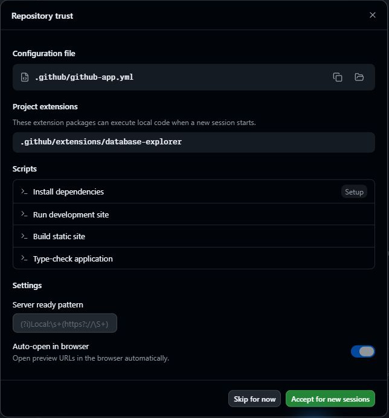
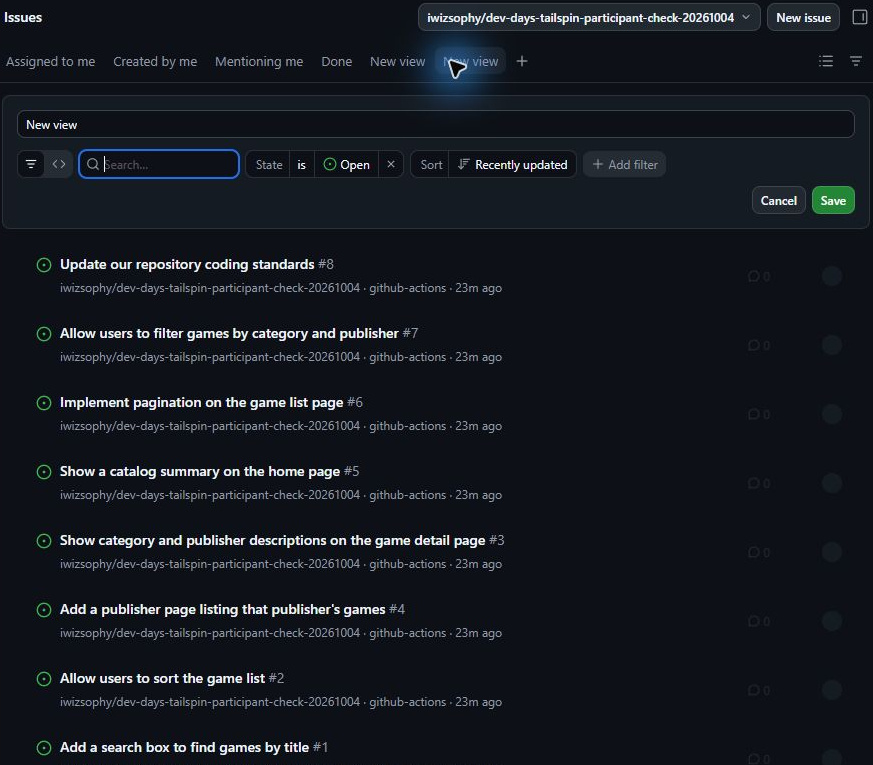

## 2.1 章の概要

前章では、Node.jsと演習用リポジトリを準備しました。この章ではGitHub Copilot appを導入し、コピーを接続します。課題を読む場所、相談する場所、実装を進める場所を確かめてから、コードの変更へ進みます。

画面に課題が表示されないとき、課題自体がないのでしょうか。それとも表示条件が違うのでしょうか。対象リポジトリと表示条件を確かめることで、次の章から自分の課題を選び、作業を始められるようにします。

## 2.2 この章で学ぶこと

| 到達した状態 | 自分でできること |
| :--- | :--- |
| AppにGitHubアカウントでサインインできる | 演習用リポジトリをAppに追加する |
| 接続時の設定を読んで承認できる | エージェントが利用する起動コマンドや設定を確認する |
| 対象と表示条件を確かめてIssueを表示できる | 課題の背景と受け入れ条件を読む |
| Chatsで相談できる | コードを変更する前に、疑問や考えを整理する |

## 2.3 取り組む前に

[前章][ex0]で作成したコピーの`owner/repo`を用意してください。Appには、そのリポジトリを利用できるGitHubアカウントでサインインします。

有効なCopilotプランと、演習に必要な利用枠を確認してください。公式ドキュメントでは全Copilotプランが対象です。Copilot BusinessまたはCopilot Enterpriseの組織では、CLI用とは別の**GitHub Copilot app**ポリシーが有効である必要があります。利用条件は[公式の概要][about-copilot-app]、Gitのインストールなどの前提は[公式の開始手順][getting-started]を参照してください。

Appは最新版を使用します。すでにインストールしている場合は更新してから始めます。

## 2.4 体験すること

<a id="github-copilot-app-をインストールして構成する"></a>

### 2.4.1 Appをインストールしてサインインする

インストーラーの対象OSは、Windows、macOS、Linuxです。自分のOSに合わせて進めてください。

1. [GitHub Copilot appのダウンロードページ][download-app]を開きます。
2. 使用するOS向けの最新版をダウンロードし、画面の案内に従ってインストールします。
3. Appを起動し、**Sign in to GitHub**を選択します。ブラウザーが開いたら認証を完了させます。
4. **Connect your repositories**が表示されたら、ここでは選択せずに進みます。この教材では、初期設定後に演習用リポジトリを追加します。
5. **Continue**を選択します。テーマの選択画面が表示されたら、好みのテーマを選び、**Finish**で初期設定を終えます。

<a id="プロジェクト接続とリポジトリ設定の確認"></a>

### 2.4.2 演習用リポジトリを接続する

接続する前に、Appの利用アカウントとコピーの所有者を確認します。Repository trustの承認では、リポジトリ内の設定や拡張を新しいセッションで利用するか判断します。どの設定を使うか、内容を読んでから承認しましょう。

1. サイドバーの**Projects**横の**`+` → Add GitHub repository**を選びます。
2. 前章で控えた自分の`owner/repo`を検索して追加します。
3. **Review repository content**が表示されたら、設定や拡張を開いて内容を確認します。テンプレートには、後の演習で使う起動コマンドやMCPの設定が含まれています。
4. **Repository trust**で対象が自分のコピーであることと、承認する内容を確認し、**Accept for new sessions**を選択します。

   

5. 入力欄へ進めたことを確認します。準備中の表示がある場合は完了を待ちます。実装用の新しいworktreeは次章で開始します。

入力欄が表示されない場合や、GitHubとの連携でエラーが出る場合は、対象リポジトリ、承認状態、サインインしたアカウントを確認してください。必要に応じて講師と確認します。

<a id="バックログ-issue-の確認"></a>

### 2.4.3 対象と表示条件を確かめてIssueを読む

Projectsでプロジェクトを選ぶことと、Issuesの表示対象を選ぶことは別の操作です。Issues上部の対象を確認して、自分のコピーの課題を表示します。

1. サイドバーの**Issues**を開きます。
2. 画面上部のリポジトリ選択欄で、自分の演習用コピーだけを選択します。他のリポジトリが選ばれている場合は解除します。
3. 表示条件を確認します。自動生成された課題は未割り当てなので、**Assigned to me**では表示されません。**Nothing here**と表示される場合は、タブ右の**`+` → New view**を選択します。
4. **State: Open**、追加の検索条件なしで**Save**します。New viewの入口が見えない場合は、右側のIssue詳細を閉じてから操作してください。

   

5. 8件の課題が表示されることを確認します。後の演習では、次の課題を使います。

   | Issueのタイトル | 取り組む内容 |
   | :--- | :--- |
   | Update our repository coding standards | コーディング規約とドキュメント標準 |
   | Allow users to filter games by category and publisher | フィルター機能 |
   | Add a search box to find games by title | タイトル検索 |

6. 任意のIssueを開き、背景と受け入れ条件を読みます。この章では内容を確認し、実装は後の章で始めます。

一覧が空だった場合は、表示条件を変えた前後を比べてください。リポジトリが選べない場合は、[接続手順](#プロジェクト接続とリポジトリ設定の確認)を見直します。GitHub Webにも課題がない場合は、[前章のIssue準備](1-prerequisites.md#演習用issueの準備を確認する)を確認します。

<a id="クイックチャットquick-chatを試す"></a>

### 2.4.4 Chatsで質問する

Chatsは、ブランチやworktreeを作らずに質問やアイデア出しをする場所です。履歴を保存して、後から読み返せます。ここではAppの仕組みについて相談します。

1. サイドバーの**Chats**を右クリックし、**New chat**を選択します。
2. 入力欄の下で対象が**Chat**、モードが**Interactive**であることを確認します。
3. 次のプロンプトを入力して送信します。

   ```plaintext
   GitHub Copilot app は worktree をどのように使いますか？
   日本語で簡潔に説明してください。説明だけを行い、ファイル変更、
   リポジトリ操作、コマンド実行はしないでください。
   ```

4. 日本語の回答を読み、処理終了後にステータスが**Idle**へ戻ることを確認します。
5. 回答の中で「別の作業フォルダー」「ブランチ」「マージ」がどのようにつながるか、読み取ってみましょう。分からない点は同じチャットで質問します。

回答はエージェントによる説明です。次章では実装セッションの作業場所を確認し、説明と実際の動作を比べます。Chatsとセッションの違いは[GitHub公式のセッション説明][agent-sessions]も参照してください。

<a id="完了の確認"></a>
<a id="振り返り"></a>

## 2.5 結果の整理と振り返り

Appを導入し、課題を読んだり相談したりする準備ができました。次の状態を確認してください。

- 自分のGitHubアカウントでサインインし、演習用コピーを接続できた。
- 設定を読んで承認し、Issuesにコピーの8件の課題を表示できた。
- Chatsで質問し、回答を読み返せる状態になった。

「Assigned to meが空でも課題がないとは限らない理由」と「Chatsでの相談と実装セッションの違い」を説明してみましょう。設定の承認では何を確認したかも振り返ると、次章で作業対象を確かめてから編集を始められます。

<a id="次のステップ"></a>

次は、ゲームカードに星評価を表示する変更を依頼します。[第3章「最初のエージェントセッションの実行」][next-lesson]へ進んでください。

<a id="補足"></a>

## 2.6 補足

<a id="appとworktreeの役割"></a>

### 2.6.1 Appとworktreeの役割

[GitHub Copilot app][about-copilot-app]は、エージェントによる開発を進めるデスクトップアプリケーションです。GitHub Copilot CLIを基盤とし、リポジトリ、ブランチ、CIと連携します。Issueの選定から実装依頼、差分のレビュー、PRの作成とマージまでをまとめて扱えます。

実装セッションを始めるときは、新しいworktreeなどの実行場所を選んでください。worktreeは、同じリポジトリの別ブランチを別の作業フォルダーで扱う仕組みです。星評価とフィルターを別々に試す場合も、作業中のファイルを分けられます。ただし、完了した変更を次の作業で使うには、マージ後の状態の引き継ぎが必要です。各章で結果を確かめてから、次の機能へ進みます。実行場所の選択肢は[公式のセッション開始手順][agent-sessions]を参照してください。

<a id="ワークスペースと課題一覧の見方"></a>

### 2.6.2 作業領域を使い分ける

| 領域 | 主な役割 |
| :--- | :--- |
| Projects | プロジェクトと実装セッションを管理する |
| Chats | 作業ツリーやブランチを作らずに相談する |
| Issues | 対象リポジトリの課題を検索し、実装を始める |
| Pull requests | 差分やCI結果を確認し、変更を取り込む |
| Automations | 手動やスケジュールで実行する自動化タスクを管理する。第9章で使う |
| Customize | MCP、Plugins、Skills、Extensionsなどの設定やInstalledを開く |

相談にはChats、コードの変更にはProjectsのセッション、取り込み前の確認にはPull requestsを使います。GitHubと連携する一覧の役割は[公式のIssue・PR管理手順][managing-issues-prs]も参照できます。

接続時に設定画面を通過したことと、ビルドやテストが成功したことは別です。実装後はコードの差分、画面、検査結果をそれぞれ確認します。

<a id="チャット一覧のコンテキストメニュー確認"></a>

### 2.6.3 会話を整理するメニュー

完了したチャットをChats一覧で右クリックすると、名前の変更やアーカイブなどの操作を確認できます。メニューの項目を読み、会話を整理する方法を確かめてみましょう。この演習ではメニューの確認までとし、共有や削除は行いません。

<a id="リソース"></a>

### 2.6.4 参考資料

- [GitHub Copilot appについて][about-copilot-app]
- [GitHub Copilot appの開始手順][getting-started]
- [GitHub Copilot appでのエージェントセッション][agent-sessions]

[ex0]: 1-prerequisites.md
[next-lesson]: 3-add-star-rating.md
[about-copilot-app]: https://docs.github.com/en/copilot/concepts/agents/github-copilot-app
[getting-started]: https://docs.github.com/en/copilot/get-started/quickstart-copilot-app
[agent-sessions]: https://docs.github.com/en/copilot/how-tos/github-copilot-app/agent-sessions
[managing-issues-prs]: https://docs.github.com/en/copilot/how-tos/github-copilot-app/managing-issues-and-pull-requests
[download-app]: https://gh.io/app
