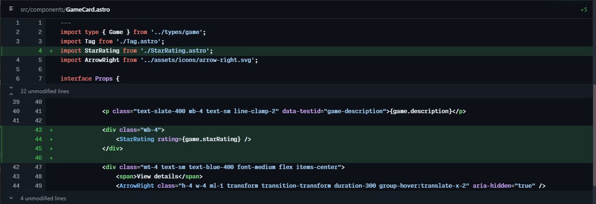
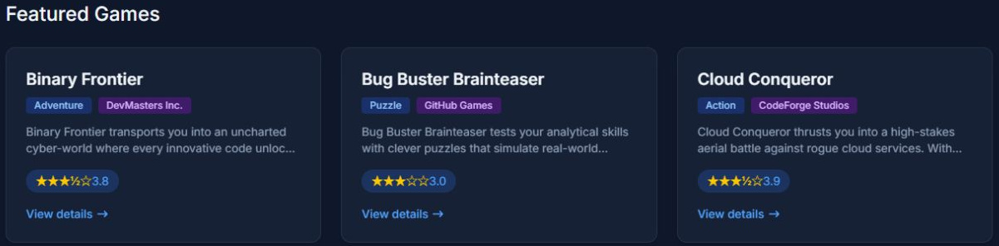
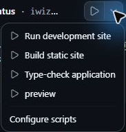
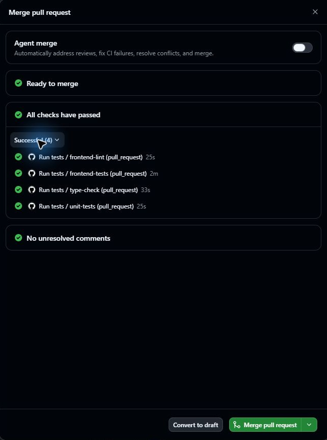

## 3.1 章の概要

第2章では、GitHub Copilot appのIssuesで演習用リポジトリの課題を読み、相談用のChatsでエージェントにworktreeの仕組みを質問しました。この章では、前章で接続したTailspin Toysの演習用プロジェクトで実装用のエージェントセッションを開始し、最初のコード変更を行います。

演習用サイトTailspin Toysでは、各ゲームのデータに星評価の値があり、ゲームの詳細ページにも表示されています。一方、トップページの一覧カードには星評価がありません。既存の評価値と表示部品を使い、一覧カードにも星評価を表示する変更をエージェントに依頼します。利用者が一覧でゲームを選ぶときの情報を増やします。

エージェントに依頼した内容と生成された差分を比べるには、変更の範囲を絞る方法が有効です。ゲームカードに星評価を加える小さな表示の変更でも、0点と未評価の区別、既存リンクの維持など、判断が必要な条件を含みます。依頼、レビュー、動作確認、PRのマージまでを一通り体験しましょう。

## 3.2 この章で学ぶこと

| 到達した状態 | 自分でできること |
| :--- | :--- |
| 作業対象と実行場所を確認できる | 演習用リポジトリのmainを基にした新しいworktreeで編集を始める |
| 小さな変更の仕様と確認条件を伝えられる | 星評価と未評価の表示方法、既存のカード構造とリンクを保つ条件をエージェントに伝える |
| 差分、画面、テストを合わせて判断できる | 依頼を満たすか確認し、不足があれば修正を依頼する |
| CIを読んで手動マージできる | レビューした変更を自分の演習用リポジトリのmainへ取り込む |

## 3.3 取り組む前に

[前章][prior-lesson]でAppに接続したTailspin Toysの演習用リポジトリを使います。教材用テンプレートに含まれる設定をAppで承認し、そのプロジェクトの入力欄へ進めることを確認してください。実装を始めるセッションでは、Node.jsのバージョンも確認します。

本章の作業場所は、Tailspin Toysの演習用リポジトリのmainを基に作る新しいworktreeです。Appでローカルリポジトリを実行場所に選ぶと、既存の作業フォルダーを使います。編集前にエージェントの作業対象となるプロジェクト、作業ディレクトリ、ブランチを確かめ、同じcheckoutを使う複数セッションでは同時に編集しないようにします。

## 3.4 体験すること

実装を依頼する前に、Tailspin Toysのゲームカードで0点と未評価をどのように表示し分けるか考えてみましょう。エージェントが生成したコードを読む際も、次の手順でその予想と結果を比べます。

<a id="セッションを開始する"></a>

### 3.4.1 セッションと環境を確認する

Appに接続したTailspin Toysの演習用プロジェクトで、新しい実装セッションを開始してください。エージェントの作業場所を確認してから変更を依頼します。

1. GitHub Copilot appを開きます（起動済みの場合はそのまま進めます）。
2. サイドバーの **Projects** で、演習用プロジェクトを右クリックし、メニューの **`+` New session** を選択します。

3. **New** 画面の入力欄下部に、自分の演習用プロジェクト名が表示されていることを確認します。実行場所は **New worktree**、開始元は **main** を選びます。モードは、応答を読みながら指示を加える **Interactive** で進めます。

   

   Interactive・Plan・Autopilotの違いは[公式のモード説明][agent-sessions]で確認できます。

<a id="実装前の環境確認"></a>

#### 3.4.1.1 実装前の環境確認

ローカルPCのターミナルとAppの実装セッションでは、実行するNode.jsが異なる場合があります。これからエージェントがテストやビルドを行うセッションでのNode.jsのバージョン確認は、環境を原因とするエラーかを判断するための手がかりです。

1. 機能の実装を依頼する前に、次のプロンプトを送信します。

   ```plaintext
   このセッションで node --version を実行し、コマンドの出力をそのまま報告してください。
   作業ディレクトリと現在のブランチも確認してください。
   ファイル変更、追加インストール、PR作成はしないでください。
   ```

2. ツールの実行結果で、**Node.js 24系の24.19.0以降**が使われていることを確認します。作業ディレクトリとブランチも、今回のworktreeのものか確かめます。コマンドが見つからない場合や要件を満たさない場合は、[前章までのNode.jsの準備](1-prerequisites.md#確認とインストール手順)を見直します。Node.jsを切り替えた後はAppを再起動し、このセッションで再確認してから実装へ進みます。

エージェントの説明に書かれたNode.jsのバージョンを、ツールのコマンド出力と照合します。環境の確認ができたら、同じ実装セッションで星評価の表示を依頼します。

<a id="星評価の実装を依頼する"></a>

### 3.4.2 星評価の実装を依頼する

1. 環境を確認した実装セッションの入力欄に次のプロンプトを入力し、星評価の表示をエージェントに依頼します。

   ```plaintext
   ゲームカードに各ゲームの星評価を表示してください。
   Game 型には starRating があり、5点満点の数値、または未評価を示す null が入ります。
   src/components/GameCard.astro の各カードに表示し、null の場合は「No rating yet」と表示してください。
   0は評価値として表示し、未評価と区別してください。
   詳細ページの既存の評価表示と関連コンポーネントを確認し、再利用できるものを使ってください。
   変更は小さく保ち、カードの構造やゲーム詳細へのリンクは組み替えないでください。
   通常データを変更せず、GameCardの実際のレンダリング結果で4.2、0、5、nullの表示とリンク構造をテストしてください。
   利用するNode.jsのバージョン、変更内容、実行したテストと結果を報告してください。
   PR作成とマージは、後で指示するまで行わないでください。
   ```

2. <kbd>Enter</kbd> キーを押して、プロンプトを送信します。

エージェントが行うのは、Tailspin Toysのコードの調査と、ゲームカードへの星評価表示に必要な変更です。完了報告を受けたら、次の手順で実際の差分とテスト結果を読み、依頼した仕様と照合してください。

<a id="差分とテストをレビューする"></a>

### 3.4.3 差分とテストをレビューする

エージェントが生成した星評価の変更は、マージ前に受講者がレビューします。実装セッションのChangesで対象ファイルと差分を読み、星評価を加えるために何が変わったか確かめましょう。

1. 会話入力欄の上部にある **Changes**（Open changes）を選択します。変更されたファイルの一覧とコード差分を確認します。

   

2. ゲームカードの描画を担う `src/components/GameCard.astro` に、星評価を表示する変更があることを確認します。

<a id="値の意味からレビューする"></a>

#### 3.4.3.1 値の意味からレビューする

ゲームの星評価を`if (game.starRating)` のように値の真偽だけで分けると、JavaScriptでは `0` も偽として扱われます。そのため、0点が未評価と表示される実装になっていないか確認します。Tailspin Toysの星評価データでは`null`が未評価です。数値と未評価の区別を明示してください。

| 入力 | 期待する意味と確認内容 |
| :--- | :--- |
| `4.2` | 小数を含む評価を5点満点として表示する |
| `0` | 0点という評価を表示し、No rating yetにしない |
| `5` | 上限の評価を表示する |
| `null` | No rating yetを表示し、数値の評価を表示しない |

ゲームカードへの変更後も、既存のタイトルや説明、ゲーム詳細へのリンクが保たれているか確認します。星の形や色だけに意味を任せず、テキストや読み上げ用の名前からも評価値が分かることを確かめましょう。数値表示と `No rating yet` が同時に出ないこともレビューの対象です。

星評価の表示を検査するテストのコードも、実装セッションのChangesで読みます。テスト内に条件式だけをコピーして検査しても、実際のGameCardにその実装が使われたことは確認できません。星評価の境界値を渡してコンポーネントをレンダリングし、その出力に期待した表示とリンクがあるかを検査する必要があります。テストが不足していれば、同じ実装セッションで次のように追加指示をエージェントへ送ります。

```plaintext
テストがGameCard.astroの実際のレンダリング結果を検査しているか確認してください。
4.2、0、5、nullについて、表示される内容と表示されない内容を確認し、ゲーム詳細へのリンクも検査してください。
通常のCSVやDBは変更せず、テスト用データを使ってください。
不足を修正し、lint、型検査、単体テスト、E2E、buildの結果を報告してください。
PRはまだ作成しないでください。
```

<a id="ブラウザーで動作を確認する"></a>

### 3.4.4 ブラウザーで動作を確認する

Appで星評価を実装したセッションのRunメニューから、Tailspin Toysの開発サーバーを起動してください。ブラウザーでゲームカードの表示を確認し、利用者に見える結果を、依頼した仕様と比べます。

> [!NOTE]
> `.github/github-app.yml` が適用されたセッションのRunメニューを使用します。メニューに実行項目が表示されない場合は、演習用コピーの設定内容と適用状態を講師と一緒に確認してください。



Tailspin Toysの通常データに含まれる21件のゲームはすべて数値評価を持つため、そのデータを使う画面だけでは`null`の表示を確認できません。ゲームカードの画面と、テスト用データによる境界値の検査を合わせて判断します。

<a id="開発サーバーの起動と停止手順"></a>

#### 3.4.4.1 開発サーバーの起動と停止手順

1. 星評価を実装したセッション上部の **Run options** から **Run development site** を選択します。

    - ボタンが **Run Run development site** と表示されている場合は、クリックして起動します。
    - すでに **Stop Run development site** と表示されている場合は稼働中ですので、そのまま次の手順へ進んでください。

   

2. Runのターミナルに表示されたローカルURLを開きます。Browserパネルが自動で開かない場合は、表示されたURLを別ブラウザーで開いてください。ポート番号は自分の実行結果を使います。
3. Tailspin Toysのトップページの21件のカードに星評価が表示され、タイトル、説明、詳細へのリンクが保たれていることを確認します。通常画面で出現しない `null` と境界値は、前節のレンダリングテストの結果で確認します。
4. 任意のカードから詳細ページへ移動し、評価値が一覧と一致することを確認します。一覧へ戻れることも確かめてください。
5. 確認後、セッション上部の **Stop Run development site** を選択します。Runのターミナルで **Shell session ended** などの終了表示を確認してください。停止後もブラウザーには直前の画面が残る場合があるため、その画面だけで稼働中と判断しないようにします。

<a id="最初の-pull-request-を作成してマージする"></a>

### 3.4.5 最初のPull Requestを作成してマージする

星評価の動作確認を終えた変更を、PRで自分の演習用リポジトリのmainへ取り込みます。この章で使うのは手動マージです。後の章では、同じ確認を経てエージェントにマージを任せる方法も体験します。

星評価のPRは実装に使ったセッションから作成し、差分やCIの結果をApp内で確認できます。作成済みのPRをAppのサイドバーから開く入口は**Pull requests**です。機能の説明は[GitHub公式のPR管理手順][managing-issues-prs]も参照してください。

1. 星評価を実装したセッションの画面右上にある **Create PR** を選択します。
2. ブラウザー認証を求められた場合は、**Sign in with your browser** を選択し、画面の指示に従って認証します。
3. Copilotがpull requestの作成処理を開始します。
4. 作成されたPRのリポジトリが自分の演習コピーで、取り込み先が **main** であることを確認します。本章では **Agent mergeをOff** にして、手動でマージするところまで進めます。
5. 同じ実装セッションのチャット欄のすぐ上にある **PR** バブルを選択し、レビューペインで作成されたpull requestの内容を最終確認します。
6. **Ready to merge** を選択し、ダイアログのCI結果を確認します。このボタンの表示だけでは、CI全成功とは判断できません。**Checks are running** や実行中のジョブがあれば待ち、すべてのジョブの成功を確認します。表示が更新されない場合は画面を開き直し、必要に応じてGitHub Webの同じPRでも照合してください。

   

7. 差分、テスト結果、未解決のレビュー指摘を確認したうえで、**Merge pull request** を選択してmainへマージします。
8. AppとGitHub Webで対象PRが **Merged** になったことを確認します。次章では、マージ済みのmainから新しいworktreeを開始します。

これで星評価の変更が自分の演習用リポジトリのmainへ取り込まれました。公開サイトへのデプロイは本章では扱いません。

<a id="完了の確認"></a>
<a id="振り返り"></a>

## 3.5 結果の整理と振り返り

Tailspin Toysのゲームカードへの星評価表示をエージェントに依頼し、レビューした変更を自分の演習用リポジトリのmainへ取り込みました。確認したことを整理しましょう。

| 確認した根拠 | 判断したこと |
| :--- | :--- |
| 作業ディレクトリとブランチ | 今回のworktreeで編集していること |
| Changes | 既存表示とリンクを保ち、星評価だけを加えていること |
| 通常データの画面 | 利用者が一覧で評価を読め、詳細ページへ移動できること |
| レンダリングテスト | 4.2、0、5、nullを仕様に沿って表示し分けること |
| PRのCIとMerged | 用意された検査に成功し、変更をmainへ取り込んだこと |

「0とnullを分ける理由」「通常の21カードだけでは確認できないこと」「Ready to mergeの表示後に読む情報」を、自分の言葉で説明してみましょう。

最初に予想したゲームカードの表示と、エージェントが生成した実装は一致しましたか。追加指示をエージェントに送った場合は、何が不足し、修正後にどの根拠を得られたかを振り返ります。次の課題でも、依頼、差分、画面、テストのつながりを追います。

<a id="次のステップ"></a>

次章の題材は、エージェントとコードの書き方を共有するカスタム指示です。[第4章「カスタム指示によるCopilotのガイド」][next-lesson]へ進んでください。

<a id="補足"></a>

## 3.6 補足

<a id="小さな変更から始める理由"></a>

### 3.6.1 小さな変更から始める理由

この章で変更する前のTailspin Toysでは、各ゲームに星評価のデータが保持されており、ゲーム詳細ページにも表示されています。一方、ホームページの一覧カードにはタイトル、カテゴリー、パブリッシャー、説明文のみが表示されており、星評価は含まれていません。

Tailspin Toysの一覧カードにも既存の星評価を表示する課題は、対象を絞って取り組めます。データを増やす変更と表示の変更を分けられるため、初めての共同作業でも差分を追いやすくなります。

この章の星評価の課題で行うのは、すでにある評価値をゲーム一覧にも表示する変更です。データを新しく集めたり、保存方法を変えたりする必要はありません。画面上の変更が小さいほど、依頼した範囲と生成された差分を比べやすくなります。同時に、「値が0」と「まだ評価がない」の違いのように、小さな表示にも仕様の判断が含まれることを学びます。

<a id="セッションとworktreeの役割"></a>

### 3.6.2 セッションとworktreeの役割

GitHub Copilot appの**セッション**とは、特定のプロジェクトを対象としてエージェントと対話を行う作業空間です。Appのサイドバーのプロジェクト一覧から起動できます。

Appでセッションを開始するときは、[GitHub公式のセッション手順][agent-sessions]に沿って、新しいworktree、ローカルリポジトリ、クラウドの実行環境を選べます。本章で選ぶ実行場所は**New worktree**です。演習用リポジトリのmainを基にした別の作業場所で変更します。worktreeを分けることは作業中のファイルを分けるためであり、変更が自動的にmainへ反映されるという意味ではありません。受講者がレビューし、PRを自分のmainへマージして、変更を次章で利用できる状態にします。

各セッションでは、会話、操作履歴、差分を合わせて読みます。

| 要素 | 確認する内容 |
| :--- | :--- |
| Chat | エージェントへの指示と回答 |
| Tool Activity | 調査や編集、検査で実行された操作 |
| Changes | 変更ファイルとコードの差分 |

> [!TIP]
> App内で組み込みターミナルを開く場合は、**Toggle panel** → **`+`**（Add tab）→ **Terminal** からアクセスできます。開発サーバーの起動・停止には、実装セッションのRunメニューを使います。

<a id="依頼に含める仕様と確認方法"></a>

### 3.6.3 依頼に含める仕様と確認方法

> [!NOTE]
> 星評価の実装を依頼するプロンプトでは、更新対象ファイルと期待する表示を指定しています。ファイル指定は必須ではありませんが、変更範囲を共有すると、レビュー時にも目的に沿った変更か確かめやすくなります。既存実装の調査を依頼しているのは、同じ評価表示を別々に作り、ゲーム一覧と詳細ページで表示が食い違うことを避けるためです。

今回の星評価の実装依頼に含めるのは、「何を表示するか」「既存の何を保つか」「どう確かめるか」の三つです。たとえば、ゲームカードに星が見えるだけでは `null` の扱いやリンクの維持までは分かりません。実装前に受け入れ条件を具体化しておくと、完了報告を読んだ後に確認する対象も明確になります。

<a id="0とnullを区別するコードの読み方"></a>

### 3.6.4 0とnullを区別するコードの読み方

次のコードは、ゲームの星評価データを数値と `null` に分ける条件の説明例です。既存の `StarRating` コンポーネントを再利用した実装では、数値側がコンポーネントの呼び出しになることもあります。

   ```astro
   {game.starRating !== null ? (
       <span class="text-xs font-medium px-2.5 py-0.5 rounded bg-amber-900/60 text-amber-300" data-testid="game-rating">
           ★ {game.starRating} / 5
       </span>
   ) : (
       <span class="text-xs font-medium text-slate-500" data-testid="game-rating-empty">
           No rating yet
       </span>
   )}
   ```

> [!NOTE]
> 星評価を表示するためにCopilotが生成するコードは、毎回同じとは限りません。この説明例のコードと違っていても、要求を満たしていれば採用できます。ただし、同等の動作になっているかは差分とテストで確認してください。見た目の類似やエージェントの説明だけでは判断できません。

<a id="差分画面テストciで確かめること"></a>

### 3.6.5 差分、画面、テスト、CIで確かめること

この章の星評価の実装では、コードの差分で変更の範囲、ローカルのTailspin Toysの画面で利用者に見える結果、テストで通常画面に現れない条件を確認しました。それぞれ確認できる対象が違うため、どれか1つの成功で他を省略せず、結果を合わせて判断します。

CIは、共有された環境で変更を検査する仕組みです。AppのReady to mergeボタンがマージ可能に見えることと、用意された検査がすべて成功したことは別なので、星評価のPRでもジョブの結果まで読みます。

<a id="リソース"></a>

### 3.6.6 参考資料

- [GitHub Copilot appでのエージェントセッションの操作][agent-sessions]
- [GitHub Copilot appについて][about-copilot-app]
- [GitHub Copilot appでのIssueとpull requestの管理][managing-issues-prs]

[prior-lesson]: 2-install-copilot-app.md#github-copilot-app-をインストールして構成する
[next-lesson]: 4-custom-instructions.md
[agent-sessions]: https://docs.github.com/en/copilot/how-tos/github-copilot-app/agent-sessions
[about-copilot-app]: https://docs.github.com/en/copilot/concepts/agents/github-copilot-app
[managing-issues-prs]: https://docs.github.com/en/copilot/how-tos/github-copilot-app/managing-issues-and-pull-requests
