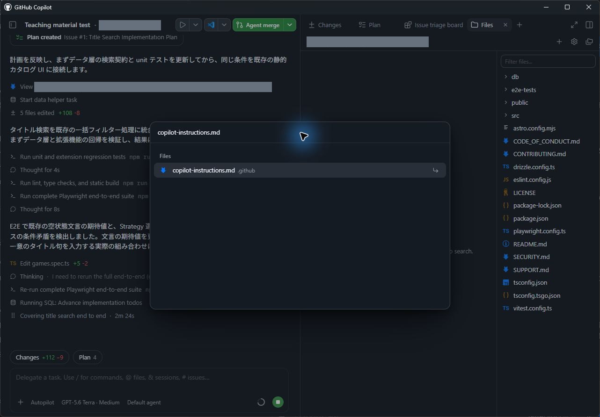
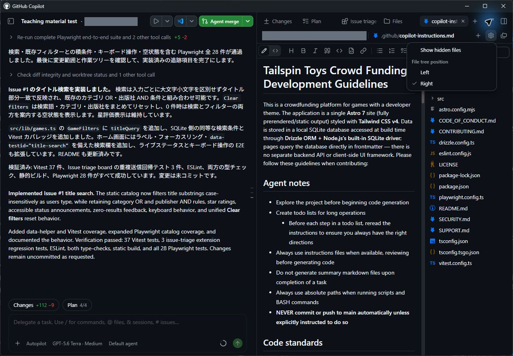

> **この章の進め方：** App で操作します。掲載画像は Windows App 1.1.20 の実機画面です。検索・並べ替え Issue を使った操作位置の例も含まれているため、作業対象の Issue は本文の指示に従って選択してください。ボタンや機能が見つからない場合は [UI が異なるときの確認](../material/ui-check.md)に沿って講師と確認してください。

生成 AI を活用するうえで、コンテキスト（文脈や背景情報）の提供は極めて重要です。特定の設計方針に沿ってタスクを実装させたい場合や、Copilot があらかじめ把握しておくべき前提知識がある場合は、それらをコンテキストとして利用可能な状態にしておく必要があります。

そのための特に強力な手段が[指示ファイル（Instruction files）][instruction-files]です。指示ファイルには、期待するコードの機能要件だけでなく、コードの構成方法や規約も明記できます。本レッスンでは、リポジトリにドキュメント作成の標準規約を追加します。実際の開発現場と同様に、バックログの Issue を起点としてエージェントに変更作業を実行させます。

このレッスンでは、次の内容を学習します。

- リポジトリ全体への指示と、パス固有の指示ファイルがエージェントにどのように渡されるかを理解する
- バックログ内の指示関連 Issue から新しいセッションを開始する
- `.github/copilot-instructions.md` にドキュメント標準を追加するようエージェントに依頼する
- 変更内容をレビューし、pull request としてマージする

## シナリオ

成熟した開発組織と同様に、Tailspin Toys にも開発プラクティスに関するガイドラインと要件が存在します。具体的には次の2点です。

- コードには TSDoc 形式のドキュメントコメント（doc comment）を付与する
- コードフォーマットのルールを文書化し、ESLint 等の静的検証ツールによって機械的に適用する

指示ファイルを活用することで、エージェントへこれらのプラクティスを共有し、提示された方針に厳密に沿ってコードを生成させることができます。

## 指示ファイルの構造と役割

カスタム指示を定義すると、Copilot にプロジェクト固有の前提知識や設定を提供でき、期待するコーディングスタイルや要件を正確に認識させることが可能になります。規約に沿った提案や精度の高いコードスニペットを得るための基盤機能であり、推奨するコーディング規約、採用ライブラリ、コード中に記述すべきコメントの粒度に至るまで指定できます。

指示ファイルには、リポジトリ全体に一律適用するものと、特定ファイル種別のタスクに応じて適用するものの2階層があります。

1. **リポジトリ全体の指示（`.github/copilot-instructions.md`）**  
   リポジトリに対する**すべての**リクエストで Copilot に送信される単一の指示ファイルです。Copilot に投げるチャットや CLI リクエスト全般に関係するプロジェクトレベルの情報（採用技術スタック、アーキテクチャの概要、全体的なベストプラクティスなど）を記載します。
2. **パス固有の指示ファイル（`.github/instructions/*.instructions.md`）**  
   特定のタスクやファイル種類向けに作成する個別指示ファイルです。特定のプログラミング言語（TypeScript や Astro など）のコーディング規約や、UI コンポーネント作成、単体テスト一式の構築といった具体的タスクに応じたガイドラインを定義します。

> [!NOTE]
> Copilot は、AGENTS.md、CLAUDE.md、GEMINI.md といった他ツールの標準指示ファイルを通じたガイダンスの取り込みにも対応しており、環境に応じた適切なコンテキストを提供できます。

### 指示ファイルを管理するためのベストプラクティス

指示ファイルの詳細な設計論はこのワークショップの範囲を超えますが、本サンプルプロジェクトに含まれる構成は代表的なアプローチを示しています。基本方針は次の通りです。

- `copilot-instructions.md` には、開発対象の概要、プロジェクト構造、全体的なコーディング規約など、プロジェクト共通のハイレベルなガイダンスを集約する
- `*.instructions.md` ファイルは、ファイル種別（単体テスト、Astro コンポーネント、データアクセス層など）や個別タスクに特化した具体的な指示を記述する
- 明快な自然言語を用い、望ましいコード例（Good）と避けるべきコード例（Bad）を併記する

指示ファイルに単一の絶対的な正解はありません。プロジェクトの成熟度やチームの文化に合わせて反復的にブラッシュアップしていくことが推奨されます。

> [!TIP]
> GitHub Copilot を導入するすべてのプロジェクトにおいて、体系的な指示ファイル群を整備しておくことを強く推奨します。本プロジェクトでも、多くのコード種別に対応した個別指示ファイルが配置されています。
>
> テンプレートや作成の出発点を探している場合は、指示ファイルやカスタムエージェントの実例が集約されているリポジトリ [awesome-copilot][awesome-copilot] を参考にしてください。

## このプロジェクトのカスタム指示ファイルを確認する

本リポジトリに配置されている指示ファイルを確認しましょう。ルートとなる `copilot-instructions.md` と、個別タスクに対応する複数の `*.instructions.md` ファイルで構成されています。App 内のファイルビューアーを使って確認します。

1. 右側のパネルが表示されていない場合は、画面右上の **Toggle panel** を選択して開きます。

   

2. パネル上部のタブ列にある **+**（Add tab）を選択します。
3. 一覧から **Files** を選択します。
4. <kbd>Ctrl</kbd>+<kbd>P</kbd> を押して **Go to file** を開き、`copilot-instructions.md` を検索します（Windows App 1.1.20 でこの操作導線を確認済みです）。

   

5. 検索結果から `copilot-instructions.md` を選択して開きます。
6. ファイルの内容を確認します。プロジェクト概要に加えて、**Agent notes**、**Code standards**、**Scripts**、**Repository Structure** といったセクションが定義されています。**Code standards** 配下には **GitHub Actions Workflows** の指針もネストされており、これらは Copilot との全対話に共通して適用されます。
7. 右側のファイルツリーを確認します。もしツリー上に `.github` フォルダーが表示されていない場合は、ファイルパネル上部の歯車アイコン **View options** をクリックし、**Show hidden files** を有効にしてください。実機検証では、隠しファイル表示を有効化することで `.github` および各種指示ファイルがツリーに現れることを確認しています。

   なお、ツリーを展開する代わりに、**Go to file** に直接ファイル名を入力して開くことも可能です。

   

8. `.github/instructions` フォルダーを展開し、配置されているファイルを確認します。Astro ファイル、Drizzle データレイヤー、単体テストなどに向けた指示ファイルが並んでいます。
9. `.github/instructions/unit-tests.instructions.md` を開きます。ファイル冒頭の `applyTo` フィールドに注目してください。ここにはリポジトリルートを基準とする glob パターンが記述されており、指示を適用するファイル（例: `**/*.test.ts` に一致する TypeScript テストファイル）が限定されています。
10. このプロジェクトで単体テストを実装する際の個別ルールがどのように定義されているかを確認します。
11. 続けて `.github/instructions/drizzle.instructions.md` を開き、末尾までスクロールします。他の指示ファイル（`unit-tests.instructions.md` 等）やプロジェクト内の既存ファイルへの相対リンクが記載されている点に注目してください。指示セットを小規模かつ再利用可能なファイルへ分割し、コード生成時に参照すべき実例を Copilot に提示する構造になっています（ここに記載された相対パスは、リポジトリルートではなく指示ファイル自身の位置を基準とします）。

> [!NOTE]
> 現在の `copilot-instructions.md` の **Code formatting requirements** セクションにはコーディング標準が記載されていますが、コード内のドキュメントコメントに関する規則はまだ含まれていません。次の手順で、TSDoc ドキュメントコメントおよびファイルヘッダーコメントの規約を追加します。

## 指示に関する Issue から開始する

前章では空の会話入力欄から直接プロンプトを入力してセッションを開始しましたが、実際の開発では Issue に起票された課題を起点として作業を進めることが一般的です。指示ファイルの更新用に登録された Issue を選択し、新しいセッションを作成して作業を依頼しましょう。

> [!NOTE]
> 指示ファイルの内容は、以後 Copilot が生成するすべてのコード品質に直接影響を与えます。そのため、指示が Copilot を正しく導く表現になっているかを厳密に確認する必要があります。本レッスンのように、まず Copilot に初期ドラフトを作成させ、それを人間が慎重にレビューして要件適合性を検証するアプローチが極めて有効です。

1. サイドバーで **My work** を選択します。
2. 一覧から **Update our repository coding standards** というタイトルの Issue を選択して開きます。
3. 画面右上の **New session** を選択し、この Issue に紐づく新しいセッションを開始します。

   

4. 次のプロンプトを入力し、Issue の要件に従って指示ファイルを更新するよう Copilot に指示します。

   ```plaintext
   この Issue に記載された要件に従って、プロジェクトの指示ファイルを更新してください。PR はまだ作らないでください。
   ```

> **2026年9月13日の実機検証（Windows App 1.1.20）：**  
> GitHub 連携プロジェクトにおいて「My work」→「対象 Issue」→「New session」を実行すると、専用の worktree が自動作成され、前章（PR #9）でマージされた星評価のコードが正しく継承されていることを確認しました。  
> 初回セッション開始時には **Accept this repository configuration?** というダイアログが表示されます。**Review configuration** を選択してセットアップ内容や Run の定義を確認したうえで承認を行ってください。実機検証では、利用者が承認した後にプロンプトの送信が可能となりました。エージェントは指示ファイル、README、ESLint 設定、および最小限の書式修正を含む合計7ファイルを更新し、単体テスト30件、E2Eテスト21件、lint、型検査のすべてが正常に通過しました。

Copilot が指示ファイル等の更新作業を実行します。

## 変更をレビューする

Copilot が実施した更新内容を差分ビューで精査し、さらに更新後の指示に基づいてどのようなコードが生成されるかをシミュレーションさせて確認します。

1. 会話入力欄の上部にある **Changes**（Open changes）を選択して差分ビューを開きます。Windows App 1.1.20 の GitHub 連携セッションでは、右パネルに **Changes (7), +43, -4** と表示され、変更されたファイル数と行数が確認できました。

   

2. 更新された指示ファイル（`copilot-instructions.md` など）の差分をレビューします。コードへのドキュメント付与およびコメント記述に関するガイドラインが適切に追加されていることを確認します。

> [!NOTE]
> AI の出力は確率的に変動するため、生成される文言の細部は上記と異なる場合があります。

3. 次のプロンプトを入力し、新しい指示がコード生成にどう反映されるか、コード例の提示をエージェントに求めます。

   ```plaintext
   ファイルを変更せず、コードの例だけを見せてください。新しい指示に従って、すべての Publishers を返すライブラリコンポーネントを作るよう依頼した場合、どのようなコードになりますか？
   ```

4. Copilot が提示したコード例をレビューします。更新した指示の通り、TSDoc ドキュメントコメントおよびファイルヘッダーコメントが正しく付与されていることを確認します。

これで、プロジェクトの指示ファイルが更新され、エージェントへの指示伝達が意図通りに機能していることを確認できました。

## pull request を作成してマージする

指示ファイルはチーム全体で共有されるリポジトリの重要な構成要素（開発資産）です。他のソースコードと同様に、変更内容を含めた pull request を作成してマージします。

1. 画面右上にある **Create PR** を選択します。Windows App 1.1.20 の GitHub 連携セッションでは、この操作からコミット作成、リモートへの push、PR 作成までが一連で実行されることを確認済みです（検証用 PR #10 を作成後に通常マージし、次章で作成される専用 worktree がこの更新済み規約を正常に継承することも確認しています。詳細は [実走記録](../material/verification.md) を参照してください）。
2. ブラウザー認証を求められた場合は、**Sign in with your browser** を選択して画面の指示に従い認証します。
3. Copilot が pull request の作成を開始します。
4. PR 作成後、Copilot はリポジトリの CI ワークフローの実行を監視します。全チェックが通過すると、右上のボタンが **Ready to merge** へ変化します。
5. **Ready to merge** を選択します。
6. 表示されたダイアログウィンドウで **Merge pull request** を選択し、pull request を main ブランチへマージします。

> [!NOTE]
> この標準規約がデフォルトブランチにマージされたことで、チームメンバー全員および今後作成されるすべての新しいセッションにおいて共通規約として適用されます。次のレッスンで最新のデフォルトブランチからフィルター機能のセッションを開始すると、エージェントは明示的に指示しなくても自動的にこの規約に従い、生成される TypeScript コードに TSDoc ドキュメントコメントを含めるようになります。指示ファイルが生成コードの振る舞いを決定づける具体例を体験できます。

<a id="cli-fallback"></a>

> **講師向け：** 参加者の環境でトラブルが生じ、緊急に作業を保全する必要がある場合のみ [対応手順](../material/emergency-cli.md#chapter-3) を参照してください。なお、CLI 側で実装が完了しても、本章における App 操作の完了とは見なしません。

## まとめと次のステップ

App が指示ファイルからコンテキストを取得する仕組みを理解し、Issue を起点とするセッションを通じてリポジトリ全体の標準規約を追加・マージしました。本章で実施した主な内容は次の通りです。

- リポジトリ全体の `copilot-instructions.md` と、特定パス用の `*.instructions.md` ファイルの役割を確認した
- バックログ内の規約更新 Issue から新しいエージェントセッションを開始した
- `.github/copilot-instructions.md` にドキュメント標準を追加するようエージェントへ依頼した
- 変更差分をレビューし、コード生成例によって効果を確認したうえで pull request としてマージした

次は、新しいセッションでゲームの絞り込み（フィルター）機能を実装し、いまマージしたコーディング標準がエージェントによって自律的に遵守される様子を確認します。[レッスン 4「Autopilot による機能の構築」][next-lesson] へ進んでください。

## リソース

- [GitHub Copilot をカスタマイズするための指示ファイル][instruction-files]
- [GitHub Copilot app のカスタマイズ][customize-app]
- [カスタム指示を作成するためのベストプラクティス][instructions-best-practices]
- [Awesome Copilot - 指示ファイルなどのリソース集][awesome-copilot]

[next-lesson]: 4-build-filtering.md
[instruction-files]: https://docs.github.com/copilot/customizing-copilot/about-customizing-github-copilot-chat-responses
[customize-app]: https://docs.github.com/copilot/how-tos/github-copilot-app/customize-github-copilot-app
[instructions-best-practices]: https://docs.github.com/enterprise-cloud@latest/copilot/using-github-copilot/coding-agent/best-practices-for-using-copilot-to-work-on-tasks#adding-custom-instructions-to-your-repository
[awesome-copilot]: https://awesome-copilot.github.com/
[custom-instructions-support]: https://docs.github.com/copilot/reference/custom-instructions-support
[ui-instructions]: https://github.com/iwizsophy/dev-days-tailspin-template/blob/v2026.09.13.1/.github/instructions/ui.instructions.md
[astro-instructions]: https://github.com/iwizsophy/dev-days-tailspin-template/blob/v2026.09.13.1/.github/instructions/astro.instructions.md
[managing-issues-prs]: https://docs.github.com/copilot/how-tos/github-copilot-app/managing-issues-and-pull-requests
