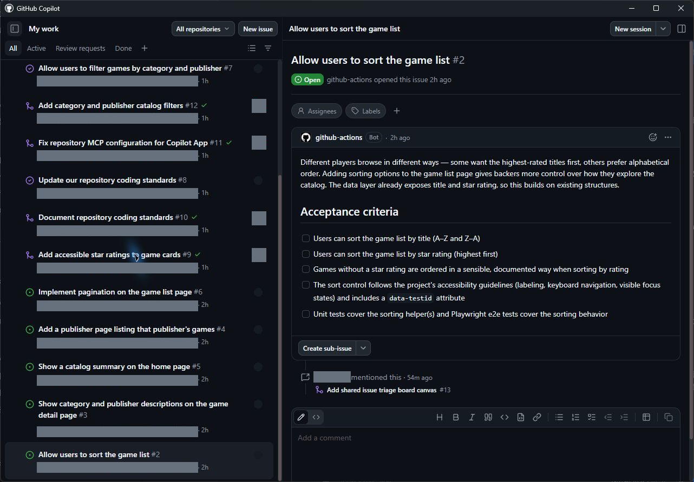
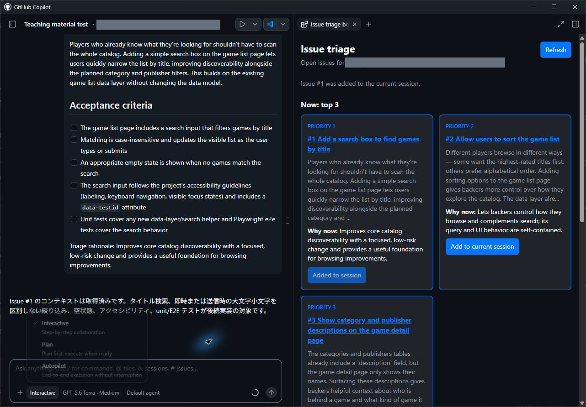
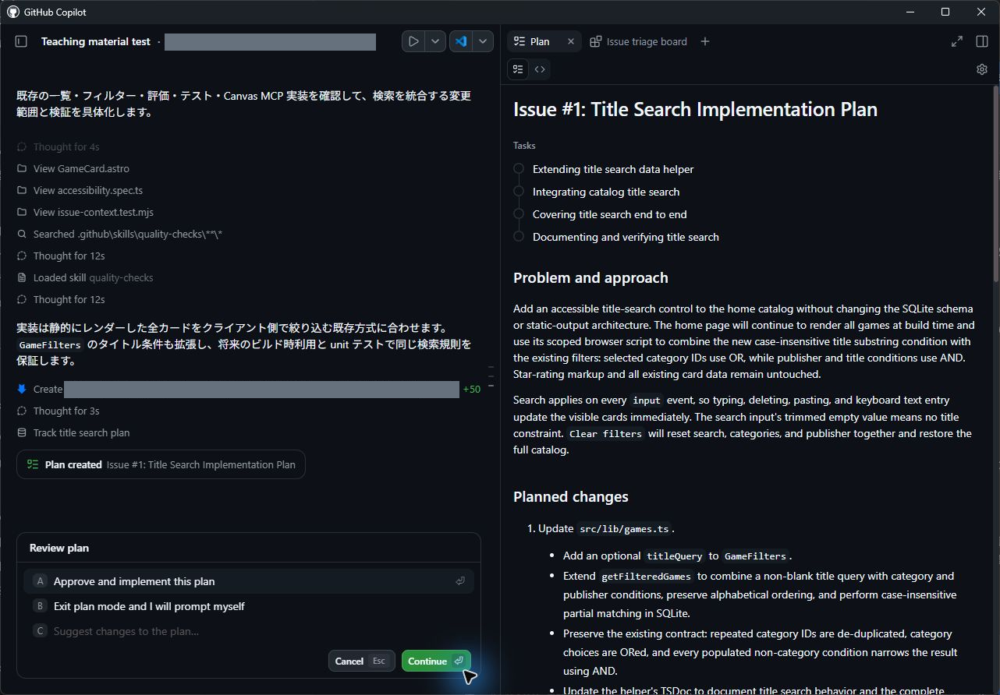
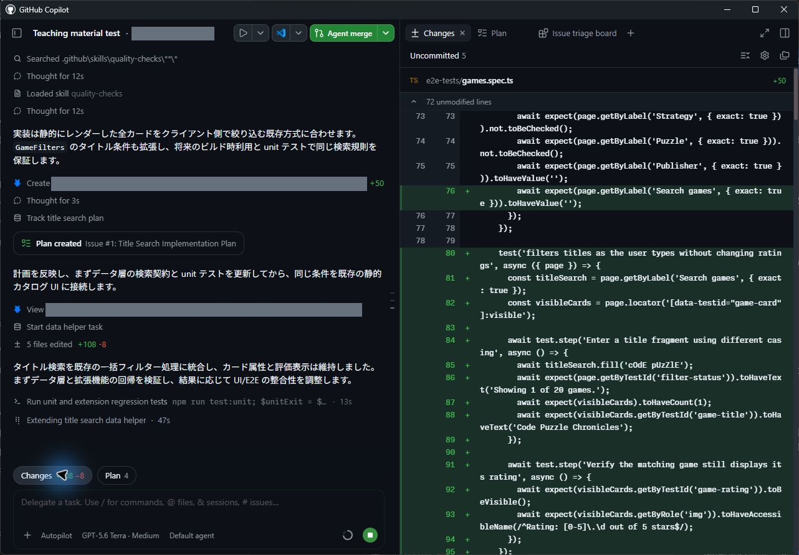
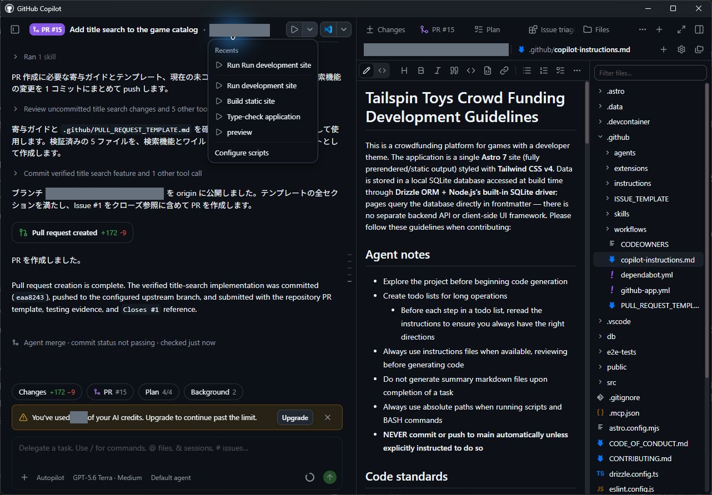
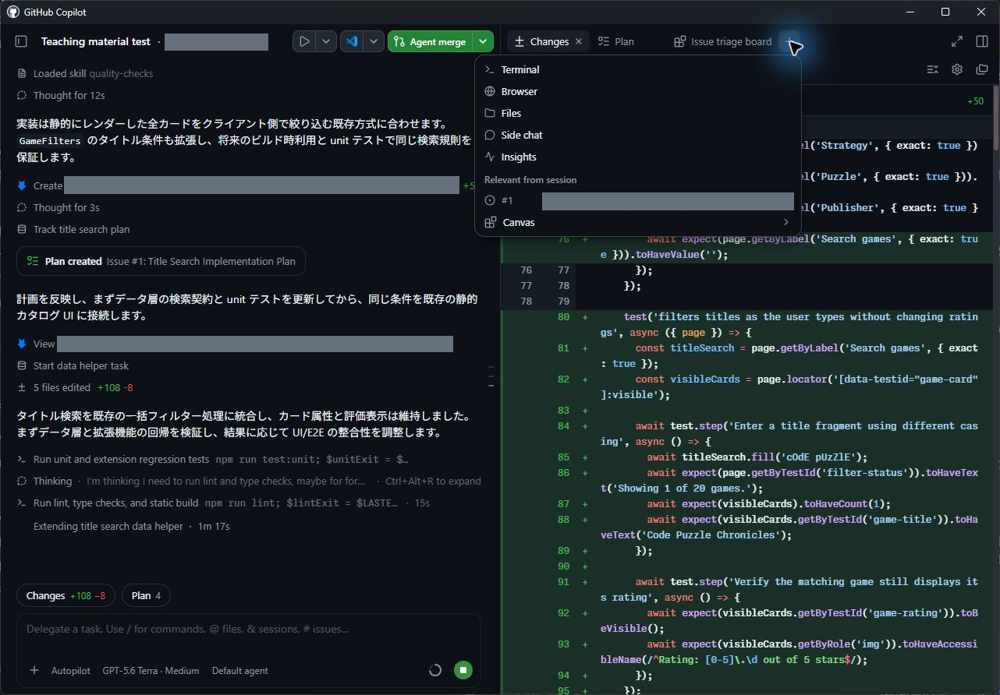

> **この章の進め方：** App で操作します。掲載画像は Windows App 1.1.20 の実機画面です。検索・並べ替え Issue を使った操作位置の例も含まれているため、作業対象の Issue は本文の指示に従って選択してください。ボタンや機能が見つからない場合は [UI が異なるときの確認](../material/ui-check.md)に沿って講師と確認してください。

ここまでのレッスンでは、プロジェクトに比較的小規模な変更を加えてきました。しかし、より本格的な機能開発においては、計画立案から実装・検証に至る一連の統制された開発プロセスが不可欠です。

GitHub Copilot app は開発者の既存ワークフローと協調するように設計されており、「正しい機能」を「適切なアーキテクチャ」で構築できるよう支援します。本レッスンから始まる3つの章では、実践的な開発ライフサイクルを辿ります。まず Issue を起点として新機能の計画・実装を行い、続いて**エージェントスキル（Agent Skills）**を活用してテストスイートや linter による自動検証を実施します。

このレッスンでは、次の内容を学習します。

- フィルター機能に関する Issue から新しいセッションを開始する
- **Plan** モードで実装計画を策定・レビューし、**Autopilot** モードで自律的にコードを構築する
- 生成されたコードが、前章でマージしたドキュメント標準規約（TSDoc 等）を自律的に継承していることを確認する
- プロジェクトに定義された `quality-checks` スキルを活用して実装の品質を検証する

## シナリオ

現在のホームページには登録されている全ゲームが一覧表示されていますが、訪問者が条件を指定して絞り込む機能がありません。バックログのフィルター機能に関する Issue では、**カテゴリー**および**パブリッシャー（発売元）**の条件でゲーム一覧を絞り込めるようにすることが求められています。Copilot を活用して、このクライアント側フィルター機能を構築します。

## 開発プロセスの背景

AI コーディングエージェントを現場のワークフローに導入しても、ソフトウェア開発の基本原則が変わるわけではありません。むしろ、AI が高速にコードを生成するからこそ、各プロセスの規律がより重要になります。一般的に推奨される開発フローは次の通りです。

1. 要件が明確に記述された Issue を確認する
2. 実装方針と手順を定めた計画（Plan）を策定する
3. コードを実装し、差分（diff）を精査・レビューする
4. 自動テストを実行してコードの正確性を検証する
5. 開発サーバー上で新機能の挙動を手動検証する
6. pull request（PR）を作成する
7. コードレビューと CI（継続的インテグレーション）がすべて通過したことを確認してマージする

> [!NOTE]
> 具体的なステップはチームや組織の規約によって多少異なりますが、基本骨格は共通しています。

この標準的なアプローチを踏襲することで、AI が生成したコードであっても人間の書いたコードと同等以上の厳密な品質基準を満たし、安全に本番環境へ反映できるようになります。

## セッションモードの種類

**セッションモード**は、エージェントに与える自律性の度合いを制御する仕組みです。プロンプト入力欄の下部にあるドロップダウンから選択でき、セッションの進行中いつでも切り替えられます。

- **Interactive**：対話型モード。ユーザーとエージェントが協調して作業を進めます。エージェントは変更案を提示し、次のアクションへ進む前に必ず人間の承認や入力を待ちます。
- **Plan**：計画策定モード。エージェントはコードを直接編集せず、まず調査と実装計画の作成に専念します。作成された計画を人間がレビュー・承認した後に実装フェーズへ進みます。
- **Autopilot**：自律実行モード。エージェントが完全に自律して作業を進めます。追加の確認を待つことなく、ファイルの編集、新規作成、テスト実行、エラー発生時の自己修正などを反復して実行します。

## フィルター機能を計画する

ソフトウェア開発において潜在的な問題や設計ミスを未然に防ぐ最適なタイミングは、コードを書き始める前です。そのため、あらかじめエージェントと計画をすり合わせておくことが極めて効果的です。

Plan モードを使用すると、エージェントはコードベースを分析したうえで、実装手順と採用アーキテクチャの概要を提案します。人間がその計画をレビューし、必要に応じて修正や改善のフィードバックを与えることで、手戻りのない確実な実装へ繋げることができます。

1. サイドバーで **My work** を選択します。
2. 一覧から **Allow users to filter games by category and publisher** というタイトルの Issue を選択します。
3. 画面右上の **New session** を選択します。

   

4. プロンプト入力欄の下部にあるモードメニュー（初期表示: **Mode: Interactive**）を開き、**Plan — Plan first, execute when ready** を選択します（Windows App 1.1.20 でこの操作導線を確認済みです。メニューには Interactive、Plan、Autopilot が表示されます）。

   

5. 次のプロンプトを入力して送信します。Issue を起点として開始したセッションであるため、フィルター機能の要件はすでにセッションのコンテキストに含まれています。

   ```plaintext
   Issue に記載された要件に基づいて作業を計画してください。計画中に不明点があれば質問してください。
   ```

6. 計画の策定過程で、エージェントから設計上の選択肢や不明点に関する質問が提示される場合があります。自身の開発方針に沿って回答してください。

> [!NOTE]
> Copilot の出力は確率的に動作するため、提示される質問内容や有無はセッションごとに異なります。質問が一切行われずに直接計画が提示された場合でも問題ありません。

7. 処理が完了すると、Copilot は計画の概要を提示します。計画内容をレビューしてください。通常、クエリ処理の構築、フィルター用 UI コントロールの追加、および対応するテストの作成が提案されます。必要であれば改善を指示し、エージェントに計画を再構成させます。

## Autopilot で構築する

策定した計画に問題がなければ、Copilot に自律的なコード実装を実行させます。

1. 提示された計画を読んだうえで、**Review plan** の選択肢から **A. Approve and implement this plan** を選択し、**Continue** をクリックします。Windows App 1.1.20 では、この操作によってセッションが **Mode: Autopilot** へ自動的に切り替わり、実装が開始されることを確認しています。

   

Copilot が自律実装を開始します。

> [!NOTE]
> もし Copilot がコードの作成を自動的に開始しない場合は、「確認した計画に沿って実装を開始してください」とチャットで指示してください。
>
> 実装の完了までには通常数分を要します。エージェントはファイルの編集や新規作成、テストコードの追加と実行、エラー時のリトライを自律的に繰り返します。処理の進行中は画面を眺めるか、小休止を取って待ちましょう。

## 変更をレビューする

AI が生成したコードは、必ず人間が差分を精査し、ローカル開発サーバーで動作確認を行う必要があります。

1. 入力欄の上にある **Changes**（Open changes）を選択し、右パネルに差分ビューを開きます。

   

2. 変更内容をレビューします。TypeScript ファイル、Astro コンポーネント、テストファイルが新設・修正されていることを確認します。  
   特に、新設されたデータアクセス等のヘルパー関数において、前章でリポジトリにマージしたドキュメント標準規約が遵守され、指示通りの **TSDoc ドキュメントコメント** が付与されているか確認してください（ファイル先頭のヘッダーコメントは、モジュールの役割や制約を明示する必要がある箇所で確認し、全ファイルへの一律付与までは成功条件としません。2026年9月13日の実機検証では、データアクセス関数の TSDoc 付与を確認しています）。
3. 画面上部の **Run options** から **Run development site** を選択します。

   

> **実機で確認した Run 経路（Windows App 1.1.20）：**  
> 上部の Run development site で起動後、Browser パネルに通常の21件のゲームが表示されることを確認しました。さらに、外部ブラウザーからも複数カテゴリーの選択、出版社との絞り込みの組み合わせ、フィルター解除の動作を確認したうえで、Stop Run development site で停止しました。単体テスト35件、E2Eテスト25件、lint、型検査、build の全検証に成功しています。なお、検索結果が0件になるパターンの E2E 検証には、専用の分離テストデータを使用しています。詳細は [実走記録](../material/verification.md) を参照してください。

4. ボタンが **Run Run development site** と表示されている場合はクリックして起動します。すでに **Stop Run development site** と表示されている場合は稼働中ですので、そのまま次へ進みます。
5. **Browser** パネルに表示された URL（実機では `http://localhost:4321/`）を確認します。
6. トップページ上で、複数カテゴリーの選択、特定パブリッシャーとの組み合わせ、絞り込み解除が意図通りに動作することを確認します。
7. 挙動に不備がある場合は、チャット欄からエージェントに修正を依頼し、再確認します。
8. 確認が完了したら、セッション上部の **Stop Run development site** を選択して開発サーバーを停止します。

## quality-checks スキルで作業を検証する

差分の目視確認とブラウザーでの手動操作に加えて、プロジェクトに定義された厳密な自動テスト群を実行して品質を検証します。

**エージェントスキル（Agent Skills）**は、テスト実行、ビルド生成、pull request 作成といった反復的なタスクの手順をエージェントに教え込むための仕組みです。スキルは、エージェントが必要に応じてオンデマンドで読み込む指示、スクリプト、参照リソースをまとめたフォルダーとして構成されます。[Agent Skills はオープン標準][agent-skills-repo]として策定されており、Copilot Chat（エージェントモード）、Copilot cloud agent、Copilot CLI、そして GitHub Copilot app の各環境で共通して動作します。

スキルはリポジトリ内の `.github/skills` フォルダー（または端末のグローバル環境 `~/.copilot/skills`）に配置されます。各スキルフォルダー内には、YAML frontmatter（`name` と `description`）および Markdown 形式の指示文を含む `SKILL.md` ファイルが格納されています。

```yaml
---
name: quality-checks
description: Run the project's test suites and linter to verify code changes are ready to commit, push, or merge.
---
```

必要に応じて、補助スクリプトや静的アセットをサブフォルダーに含めることも可能です（完全な構成仕様は [エージェントスキルの仕様書][agent-skills-spec] を参照してください）。

> [!TIP]
> スキルは実行時に動的に読み込まれます。エージェントは各スキルの `description` フィールドの記述を読み取り、現在のタスクに適したスキルを自律的に選択します。そのため、スキルの目的と適用条件を明確に記述しておくことが、スキルが正しく呼び出されるための鍵となります。

## quality-checks スキルを確認する

本リポジトリに用意されている `quality-checks` スキルの中身を確認してみましょう。

1. 右側のパネルが表示されていない場合は、画面右上の **Toggle panel** を選択して開きます。

   

2. パネル上部のタブ列にある **+**（Add tab）を選択します。
3. **Files** を選択します。
4. <kbd>Ctrl</kbd>+<kbd>P</kbd> を押して **Go to file** を開き、`SKILL.md` を検索します。
5. 検索結果から `SKILL.md .github/skills/quality-checks` を選択して開きます。
6. `name` と `description` の定義を確認します。コミット、push、マージの前にテストや linter による検証が必要な場合に本スキルを使用する旨が宣言されています。
7. ファイル全体をスクロールして確認します。単体テスト、Playwright による E2E テスト、ESLint の各スイートを実行するコマンド体系、実行順序、および典型的な失敗時のトラブルシューティング手順が体系化されています。エージェントは推測に頼ることなく、チームが定めた正規の手順に沿って検証を遂行できます。

## チェックを実行する

フィルター機能を実装した同一セッション内で、エージェントに品質検証の実行を依頼します。

1. Copilot app の会話画面に戻ります。
2. スラッシュコマンド `/quality-checks` を入力して送信します（スキル名を直接指定して呼び出します）。
3. エージェントはスキルの手順に従って単体テスト、linter、E2E テストを順次実行し、検証結果を報告します。もし失敗した項目があれば、エラーを解消して全テストが通過するまで修正を行わせます。
4. **【重要】このセッションは閉じずに開いたままにしておいてください。** 次のレッスンでは、Playwright MCP server を設定し、実際のブラウザーを自律操作してフィルター機能が正しく動作することを検証します。

<a id="cli-fallback"></a>

> **講師向け：** 参加者の環境でトラブルが生じ、緊急に作業を保全する必要がある場合のみ [対応手順](../material/emergency-cli.md#chapter-4) を参照してください。なお、CLI 側で実装が完了しても、本章における App 操作の完了とは見なしません。

## まとめと次のステップ

フィルター機能をエンドツーエンドで実装し、リポジトリの品質基準に基づいて自動検証を完走させました。本章で実施した主な内容は次の通りです。

- 最新のコードベースから、フィルター機能の Issue に紐づく新しいセッションを開始した
- Plan モードで実装計画を策定・レビューし、Autopilot モードで自律実装を実行した
- 生成されたコードにおいて、前章で定義したドキュメント標準規約（TSDoc 等）が自律的に適用されていることを確認した
- `quality-checks` スキルを活用して単体テスト、E2E テスト、lint による検証を完了した

次は、Playwright MCP server をプロジェクトに導入し、エージェントが実際のブラウザーを自律的に操作して検証を行う高度な自動化を体験します。[レッスン 5「Playwright MCP server によるテスト」][next-lesson] へ進んでください。

## リソース

- [GitHub Copilot app でのエージェントセッションの操作][agent-sessions]
- [Agent Skills について][about-agent-skills]
- [GitHub Copilot app のカスタマイズ][customize-app]
- [GitHub Copilot のクラウドサンドボックスとローカルサンドボックスについて][sandboxes]

[ex0]: 0-prerequisites.md
[ex2]: 2-add-star-rating.md
[ex3]: 3-custom-instructions.md
[next-lesson]: 5-mcp-playwright.md
[agent-sessions]: https://docs.github.com/copilot/how-tos/github-copilot-app/agent-sessions
[about-agent-skills]: https://docs.github.com/copilot/concepts/agents/about-agent-skills
[customize-app]: https://docs.github.com/copilot/how-tos/github-copilot-app/customize-github-copilot-app
[sandboxes]: https://docs.github.com/copilot/concepts/about-cloud-and-local-sandboxes
[agent-skills-repo]: https://github.com/agentskills/agentskills
[agent-skills-spec]: https://agentskills.io/specification
