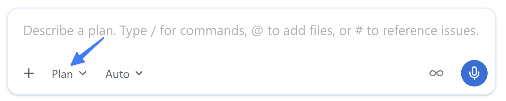
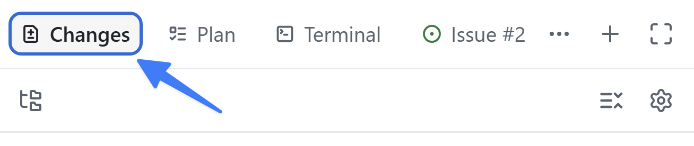
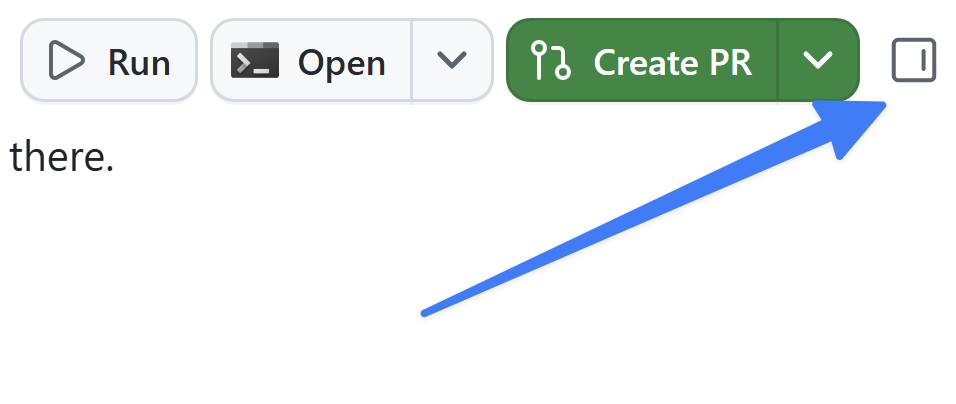

> **この章の進め方：** App で操作します。画像は参照元の画面例で、現行 UI との一致は未確認です。ボタンや機能が見つからない場合は [UI が異なるときの確認](../material/ui-check.md)に沿って講師と確認してください。


ここまで、プロジェクトに小さな更新をいくつか加えました。しかし、より本格的な変更には、よりしっかりしたプロセスが必要です。GitHub Copilot app は既存のフローと連携できるように設計されており、適切なものを適切な方法で構築できます。このレッスンから3回にわたり、一般的な開発プロセスに従います。まず Issue を使って新機能を生成し、エージェントスキルで検証テストと linter を実行します。

このレッスンでは、次の内容を学習します。

- フィルター機能に関する Issue から新しいセッションを開始する。
- **Plan** モードで機能を計画し、**Autopilot** で構築する。
- 生成されたコードが、以前マージしたドキュメント標準に従っていることを確認する。
- プロジェクトの `quality-checks` スキルで作業を検証する。

## シナリオ

ホームページにはすべてのゲームが一覧表示されますが、訪問者は一覧を絞り込めません。フィルター機能に関する Issue では、**カテゴリー**と**パブリッシャー**でゲームを絞り込めるようにすることが求められています。Copilot を使ってこの機能を実装します。

## 背景

AI コーディングエージェントを開発フローに導入しても、基本は変わりません。むしろ、基本はさらに重要になります。多くの開発者は、次のようなフローに従います。

1. 必要な作業の詳細が記載された Issue を開く。
2. 構築する内容の計画を作成する。
3. コードを構築してレビューする。
4. テストを実行してコードを検証する。
5. 新機能を手動で検証する。
6. pull request (PR) を作成する。
7. コードのレビューと継続的インテグレーションプロセスが成功したら、コードをマージする。

> [!NOTE]
> 正確な手順はチームや Organization によって異なりますが、多くの場合は上記の流れを変形したものです。

この標準的なアプローチを守ることで、AI が生成したコードが定められた要件を満たし、人間が作成したコードと同じ審査プロセスを通るようにできます。

## セッションモード

**セッションモード**は、エージェントの自律性を制御します。プロンプトフィールド下のドロップダウンから設定し、いつでも変更できます。

- **Interactive**: ユーザーとエージェントが共同で作業します。エージェントは変更を提案し、続行前に入力を待ちます。
- **Plan**: エージェントが最初に計画を作成します。計画実行前に内容をレビューして承認します。
- **Autopilot**: エージェントが完全に自律して作業し、入力を待たずにコードの作成、テストの実行、反復を行います。

## フィルター機能を計画する

潜在的な問題を見つける最適なタイミングは、コードを作成する前です。そのためには、事前に少し計画を立てるのが効果的です。Copilot と計画を立てると、一連の手順と採用するアプローチが生成されます。その計画をレビューし、改善案があれば提案してから、計画に基づいて Copilot にコードを生成させることができます。

Issue を開いて新しいセッションを開始し、Plan モードに切り替えて計画を作成します。

1. ナビゲーションタブから **My work** を選択します。
2. **Allow users to filter games by category and publisher** というタイトルの Issue を選択します。
3. 右上の **New session** を選択します。

   

4. 入力欄下部のモードメニュー（**Mode: Interactive**）を開き、**Plan — Plan first, execute when ready** を選択します。Windows App 1.1.20 でこの経路を確認しました。メニューには **Interactive**・**Plan**・**Autopilot** が表示されます。

   

5. 次のプロンプトを送信します。Issue から開始したため、フィルター機能の Issue はすでにこのセッションのコンテキストに含まれています。

   ```plaintext
   Issue に記載された要件に基づいて作業を計画してください。計画中に不明点があれば質問してください。
   ```

6. 計画の作成中に、エージェントから追加の質問が提示される場合があります。自分で機能を構築するときの方針に基づいて回答します。

> [!NOTE]
> Copilot は確率的に動作するため、追加で尋ねられる質問は異なります。質問がまったくない場合もありますが、問題ありません。

7. 完了すると、Copilot が計画の概要を提示します。計画をレビューしてください。クエリの構築、フィルターコントロールの追加、テストの作成が提案されているはずです。必要に応じてフィードバックを返して改善できます。エージェントは提案を新しいバージョンに反映します。

## Autopilot で構築する

計画が完成したので、Copilot に実装を構築させます。

1. 計画を読んだうえで、**Review plan** の **A. Approve and implement this plan** を選択し、**Continue** を押します。Windows App 1.1.20 では、これにより **Mode: Autopilot** に切り替わって実装が始まりました。

Copilot が実装作業を開始します。

> [!NOTE]
> Copilot が必要なコードの作成を自動的に開始しない場合は、「確認した計画に沿って実装を開始してください」のようなプロンプトを使って開始を依頼できます。
>
> 必要な更新の作成には数分かかります。エージェントはファイルを編集および作成し、テストを作成して実行し、反復します。この時間に、ここまで学習した内容を振り返ったり、飲み物を用意したりできます。

## 変更をレビューする

AI が生成したすべてのコードは、マージ前にレビューする必要があります。コードをレビューし、サイトを実行して問題がないことを確認します。

1. セッションの入力欄の上にある **Changes**（Open changes）を選択し、右パネルに差分を開きます。

   

2. 変更をレビューします。新しい TypeScript ファイル、Astro ファイル、テストファイルが表示されます。新しいヘルパー関数には、レッスン3でマージしたドキュメント標準に従い、更新した指示に沿った TSDoc doc comment が含まれているか確認します。ファイルヘッダーは役割や制約を伝える必要がある場合に確認し、すべてのファイルへの自動追加を成功条件にしません。今回の実走ではデータアクセス関数の TSDoc を確認しました。
3. セッション上部の **Run options** で **Run development site** を選択します。

> **確認済みの Run 経路（Windows App 1.1.20）：** 上部の Run development site で起動し、Browser パネルに通常の21件を表示しました。複数カテゴリ・出版社との組合せ・解除を別ブラウザーでも確認後、Stop Run development site で停止しました。単体35件・E2E25件・lint・型検査・build は成功。0件のE2E検証には専用データを使用しています。詳細は [実走記録](../material/verification.md)を参照してください。

4. Run ボタンでサイトを起動します。すでにこの項目が選択されていれば **Run Run development site** を選択します。
5. **Browser** パネルに表示されたローカル URL を確認します。実走では `http://localhost:4321/` が自動表示されました。
6. ランディングページで複数カテゴリ、出版社との組み合わせ、解除を確認します。
7. 問題がある場合は Copilot に更新を依頼し、再確認します。
8. **Stop Run development site** を選択して開発サーバーを停止します。

## quality-checks スキルで作業を検証する

差分を目視で確認するだけで完了とすることもできますが、このチームには明確な品質基準と、それを繰り返し確認する方法があります。

**エージェントスキル**を使うと、テストの実行、ビルドの生成、pull request の作成など、繰り返し発生するタスクの実行方法を Copilot に指示できます。スキルは、エージェントが必要に応じて読み込める指示、スクリプト、リソースのフォルダーです。[Agent Skills はオープン標準][agent-skills-repo]であり、さまざまなエージェントで使用されています。そのため、同じスキルをエージェントモードの Copilot Chat、Copilot cloud agent、Copilot CLI、GitHub Copilot app で使用できます。

スキルはプロジェクトの `.github/skills` フォルダー、またはグローバルの `~/.copilot/skills` に配置します。各スキルは、YAML frontmatter (`name` と `description`) と、それに続く Markdown の指示が記載された `SKILL.md` ファイルを含むフォルダーです。

```yaml
---
name: quality-checks
description: Run the project's test suites and linter to verify code changes are ready to commit, push, or merge.
---
```

スキルには、スクリプト、アセット、参考資料を含むサブフォルダーも追加できます。完全な構造については、[エージェントスキルの仕様][agent-skills-spec]を参照してください。

> [!TIP]
> スキルは動的に読み込まれます。エージェントは `description` フィールドに基づいて適用するスキルを判断します。明確でシナリオに合った説明を記述することが、スキルが使用されるか無視されるかを左右します。

## quality-checks スキルを確認する

スキルの内容を確認します。

1. 右パネルが表示されていない場合は、右上の **Toggle panel** を選択して開きます。

   

2. パネルのタブ列にある **+**（Add tab）を選択します。
3. **Files** を選択します。
4. <kbd>Ctrl</kbd>+<kbd>P</kbd> で **Go to file** を開き、`SKILL.md` を検索します。
5. ファイル一覧から `SKILL.md .github/skills/quality-checks` を選択して開きます。
6. `name` と `description` を確認します。説明は、コード変更を commit、push、merge する前にテスト、lint、検証する必要がある場合に、このスキルを使用することをエージェントに伝えます。
7. スキル全体を読みます。単体テスト、Playwright のエンドツーエンドテスト、ESLint の各スイートを実行するスクリプト、実行順序、一般的な失敗のデバッグ方法が記載されています。そのため、エージェントは推測するのではなく、チームの方法でチェックを実行できます。

## チェックを実行する

同じフィルター機能のセッションで、エージェントに作業の検証を依頼します。スキル名を説明する必要はありません。エージェントがリクエストに一致するスキルを見つけます。

1. Copilot app に戻ります。
2. スラッシュコマンド `/quality-checks` を使ってスキルを直接呼び出し、<kbd>Enter</kbd> を選択します。
3. エージェントはスキルに従って単体テスト、linter、エンドツーエンドテストを実行し、結果を報告します。失敗したものがあれば、問題を修正して、すべて成功するまでチェックを再実行するよう依頼します。
4. **このセッションを開いたままにします。** 次のレッスンでは Playwright MCP server を追加し、実際のブラウザーでフィルター機能が動作することを確認します。

<a id="cli-fallback"></a>

> **講師向け：** 緊急の作業保全が必要な場合だけ [対応手順](../material/emergency-cli.md#chapter-4) を参照してください。CLI の実装成功は、この章の App 操作の完了には数えません。

## まとめと次のステップ

実際の機能をエンドツーエンドで構築し、チームの基準に照らして検証しました。具体的には、次の作業を行いました。

- 最新のプロジェクトで、フィルター機能に関する Issue から新しいセッションを開始した。
- Plan モードで機能を計画し、Autopilot で構築した。
- 生成されたヘルパーが、レッスン3でマージしたドキュメント標準に従っていることを確認した。
- `quality-checks` スキルで作業を検証した。

次は Playwright MCP server を接続し、実際のブラウザーでフィルター機能を確認するようエージェントに依頼します。[レッスン 5「Playwright MCP server によるテスト」][next-lesson]に進んでください。

## リソース

- [GitHub Copilot app でのエージェントセッションの操作][agent-sessions]
- [Agent Skills について][about-agent-skills]
- [GitHub Copilot app のカスタマイズ][customize-app]
- [GitHub Copilot のクラウドサンドボックスとローカルサンドボックスについて][sandboxes]

[ex0]: 0-prerequisites.md
[ex2]: 2-add-star-rating.md
[ex3]: 3-custom-instructions.md
[next-lesson]: 5-mcp-playwright.md
[agent-sessions]: https://docs.github.com/copilot/how-tos/github-copilot-app/agent-sessions
[about-agent-skills]: https://docs.github.com/copilot/concepts/agents/about-agent-skills
[customize-app]: https://docs.github.com/copilot/how-tos/github-copilot-app/customize-github-copilot-app
[sandboxes]: https://docs.github.com/copilot/concepts/about-cloud-and-local-sandboxes
[agent-skills-repo]: https://github.com/agentskills/agentskills
[agent-skills-spec]: https://agentskills.io/specification
