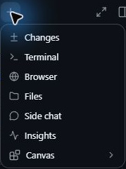
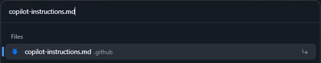
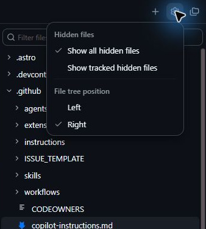
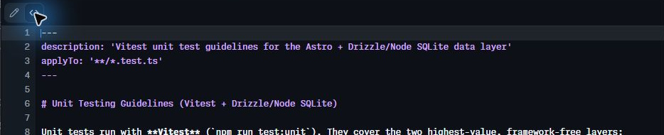
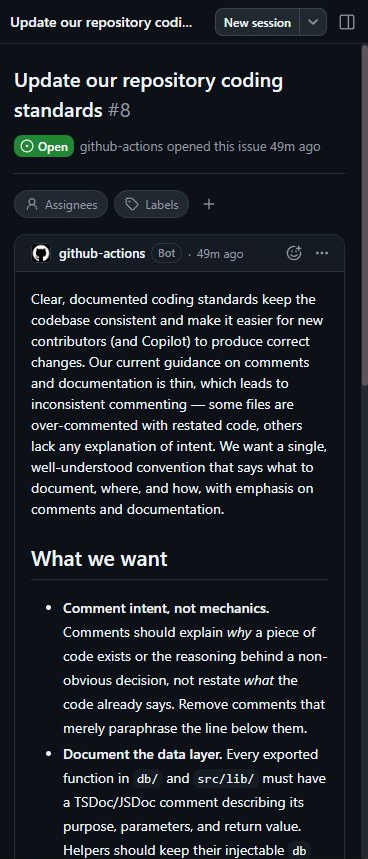
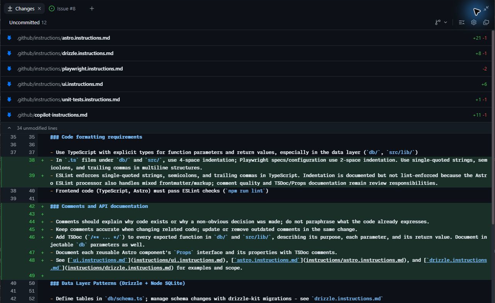
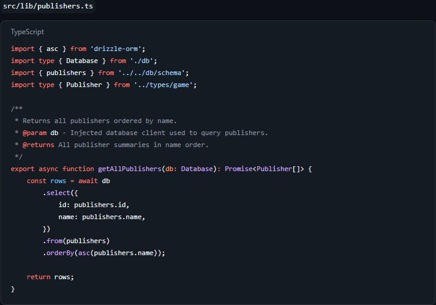
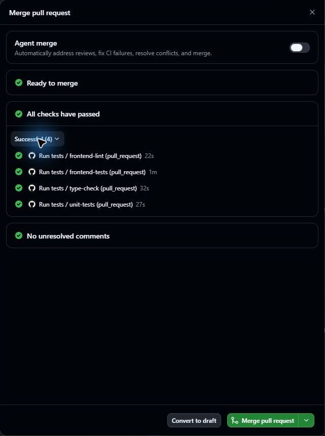

## 4.1 章の概要

本章の主題は、Copilotにプロジェクトの規約を継続的に共有する方法です。カスタム指示の適用範囲を読み、指示と既存の実装・検査設定が食い違っていないかを確認します。

人が読む説明と、ツールが検査する規則を分けて考えると、コードを読んで判断すべき内容と、機械検査で確かめる内容を整理できます。指示ファイルを更新した後も、受講者がコード例と差分を読み、規約が生成結果へどう反映されたかを確認することが本章の狙いです。

### 4.1.1 この章で学ぶこと

この章を終えると、プロジェクトの規約をCopilotに共有し、指示の適用範囲と生成コードを根拠に、規約への適合をレビューできます。

| 項番 | この章で行うこと | 期待される効果 |
| :---: | :--- | :--- |
| 1 | 共通指示とパス固有指示を読み、対象ファイルを比べる | それぞれの指示が適用されるファイルを、具体例で説明できる |
| 2 | Issueの要件を既存の指示・実装・検査設定と照合し、指示ファイルを更新する | 規則の対象と追加の理由を説明し、既存の実装や検査設定との矛盾を判断できる |
| 3 | Copilotの生成例とlintの結果を読み、規約の反映を確かめる | コメントを読んで判断する項目と、lintで検査できる項目を区別できる |
| 4 | 指示ファイルの変更をPRでレビューし、CIの結果を確認して共有する | 差分とCIの結果を根拠に、指示ファイルの変更をマージしてよいか判断できる |

## 4.2 取り組む前に

第3章で実装したゲームの星評価が、自分の演習用Tailspin Toysリポジトリのmainへマージされ、Copilot Appでそのプロジェクトを開ける状態から始めます。対象のIssueは「Update our repository coding standards」です。

本章では、`.github/copilot-instructions.md`と`.github/instructions/`の既存ファイルを読みます。Markdownの内容と、変更前後の差分を確認できれば取り組めます。TSDocの詳しい書式を暗記する必要はありません。コード例を読むときに、関数の目的、引数、戻り値が説明されているかを確かめましょう。

Tailspin Toysの指示ファイルを更新する前に、規約を追加しただけでCopilotのコード生成がどう変わるかを予想してください。更新後はCopilotに提示させたコード例を読み、その予想と比べます。

## 4.3 ケース

<a id="シナリオ"></a>

このケースでは、自分の演習用Tailspin Toysリポジトリのコーディング規約を更新します。対象は「Update our repository coding standards」のIssueです。

| 項番 | 観点 | このケースで扱う内容 |
| :---: | :--- | :--- |
| 1 | 状況 | 演習用リポジトリには既存の指示ファイルがあり、Issueで規約の更新が求められています。 |
| 2 | 課題と理由 | 規約更新のIssueでは、処理の意図を説明するコメント、データ層のTSDoc/JSDoc、AstroコンポーネントのPropsの説明、コードの書式の文書化が求められています。人が読む説明と、ツールが検査する規則をCopilotへ共有する必要があります。 |
| 3 | 解決策 | Issueに沿って既存の指示ファイルを更新し、Copilotへ規約を共有します。受講者は、コメントを生成例のレビューで確かめ、コードの書式をESLintなどの静的検査でも確認します。 |

受講者は、Copilotに指示ファイルの更新を依頼し、生成例を読んで規約の反映を確かめます。差分と生成例の確認を終えたら、レビュー済みの変更を演習用リポジトリのmainへ取り込んで共有してください。

<a id="このプロジェクトのカスタム指示ファイルを確認する"></a>

### 4.3.1 指示ファイルを読み、適用範囲を確かめる

自分の演習用Tailspin Toysリポジトリに配置されている指示ファイルを確認しましょう。共通指示の `copilot-instructions.md` と、個別タスクに対応する複数の `*.instructions.md` ファイルで構成されています。Copilot App内のファイルビューアーを使って確認します。

1. 右側のパネルが表示されていない場合は、画面右上の**Toggle panel**を選択して開きます。

   

2. パネル上部のタブ列にある **+**（**Add tab**）を選択します。
3. 一覧から**Files**を選択します。
4. <kbd>Ctrl</kbd>+<kbd>P</kbd> を押して**Go to file**を開き、`copilot-instructions.md` を検索します。

   

5. 検索結果から `copilot-instructions.md` を選択して開きます。
6. ファイルの内容を確認します。プロジェクト概要に加えて、Agent notes、Code standards、Scripts、Repository Structureといったセクションが定義されています。Code standards配下にはGitHub Actions Workflowsの指針もネストされており、これらはCopilotとの全対話に共通して適用されます。
7. 右側のファイルツリーを確認します。ツリー上に `.github` フォルダーが表示されていない場合は、ファイルパネル上部の歯車アイコン**View options**をクリックし、**Show tracked hidden files**または**Show all hidden files**を選択してください。前者はGitで管理している隠しファイル、後者はすべての隠しファイルを表示する選択肢です。

   なお、ツリーを展開する代わりに、**Go to file**に直接ファイル名を入力して開くことも可能です。

   

8. `.github/instructions` フォルダーを展開し、配置されているファイルを確認します。Astroファイル、Drizzleデータレイヤー、単体テストなどに向けた指示ファイルが並んでいます。
9. `.github/instructions/unit-tests.instructions.md`を開き、ファイルの表示を**Raw**へ切り替えます。Rich textでは冒頭のメタデータが表示されないことがあります。`applyTo`フィールドに注目してください。ここにはリポジトリルートを基準とするglobパターンが記述されており、指示を適用するファイル（例: `**/*.test.ts` に一致するTypeScriptテストファイル）が限定されています。

   `applyTo`は指示の対象を表す指定です。たとえば`src/lib/games.test.ts`は上記のパターンに一致し、`src/components/GameCard.astro`は一致しません。対象が狭すぎると必要なファイルが漏れ、広すぎると関係のない規則まで読ませることになります。書式は[公式のパス固有指示の説明][path-instructions]を参照し、対象ファイルを具体的に挙げて適用範囲を確認しましょう。ファイル名だけで判断せず、本文の指示内容も読んでください。

   

10. unit-tests.instructions.mdを読み、Tailspin Toysの単体テストに対する個別ルールがどのように定義されているかを確認します。
11. 続けて `.github/instructions/drizzle.instructions.md` を開き、末尾までスクロールします。他の指示ファイル（`unit-tests.instructions.md` 等）やプロジェクト内の既存ファイルへの相対リンクが記載されている点に注目してください。指示セットを小規模かつ再利用可能なファイルへ分割し、コード生成時に参照すべき実例をCopilotに提示する構造になっています（ここに記載された相対パスは、指示ファイル自身の位置が基準です）。

> [!NOTE]
> 現在の`copilot-instructions.md`にはコーディング標準が記載されています。次の手順では規約更新のIssueの要件に従い、処理の意図を説明するコメント、データ層のTSDoc/JSDoc、AstroコンポーネントのPropsの説明、ESLintとREADMEへの反映を確認します。全ファイルへのヘッダーコメント追加はIssueの要件に含まれていません。

<a id="指示に関する-issue-から開始する"></a>

### 4.3.2 規約更新のIssueから作業を始める

第3章の星評価の実装では、空の会話入力欄から直接プロンプトを入力してセッションを開始しました。実際の開発では、Issueに起票された課題を起点として作業を進めることが一般的です。Copilot Appで自分の演習用リポジトリの規約更新Issueを選択し、新しいセッションを作成して指示ファイルの更新を依頼しましょう。

> [!NOTE]
> 指示ファイルは、その後のコード生成でも参照されます。規則の対象と理由が伝わる表現かを確認してください。Copilotに初稿を作らせ、人が差分を読んで要件との一致を確かめる方法が有効です。

1. Copilot Appのサイドバーの**Issues**を開き、一覧のリポジトリ選択で自分の演習用Tailspin Toysリポジトリを選び、**Open**の課題を表示します。**Projects**で選んだプロジェクトと、Issues一覧の表示条件をそれぞれ確認してください。課題が見つからない場合は、[第2章のバックログ確認](2-install-copilot-app.md#バックログ-issue-の確認)に従って表示条件を見直します。

2. 一覧からUpdate our repository coding standardsというタイトルのIssueを選択して開きます。番号だけで選ばず、タイトルと本文を確認してください。
3. 画面右上の **New session**を選択し、このIssueに紐づく新しいセッションを開始します。

> [!NOTE]
> 規約更新セッションのworktreeに、第3章でmainへマージした星評価の変更が含まれていることを確認してください。リポジトリ設定の承認を求められた場合は、**Review repository content** → **Repository trust**でセットアップ内容やRunの定義を読み、**Accept for new sessions**を選択します。

   

4. 規約更新セッションの会話入力欄に`/issue-fix`などが入っている場合は、<kbd>Ctrl</kbd>+<kbd>A</kbd>で全選択し、次のプロンプトへ置き換えます。内容を確認して送信し、Issueの要件に従って更新するよう依頼します。

   ```plaintext
   この Issue に記載された要件に従って、プロジェクトの指示ファイルを更新してください。既存の指示、実装、ESLint設定に矛盾がないか確認し、必要なREADMEの説明も更新してください。変更した規則と、その規則を機械検査できる範囲を説明してください。PR はまだ作らないでください。
   ```

Copilotが規約更新セッションで、指示ファイル等の更新作業を実行します。

規約更新の変更対象には、指示ファイルだけでなくREADMEやESLint設定が含まれる場合があります。ファイル数を正解とせず、それぞれが「Update our repository coding standards」の要件に必要な変更かを確認してください。

<a id="変更をレビューする"></a>

### 4.3.3 差分とコード例をレビューする

Copilotが更新したTailspin Toysの指示ファイル等を、規約更新セッションの差分ビューで確認します。続いてCopilotにコード例だけを提示させ、更新した指示がコードにどのように反映されるかを観察してください。

指示ファイルを活用すると、エージェントへTailspin Toysのコーディング規約を共有し、方針に沿ったコード生成を促せます。ただし、毎回同じように指示を守ることは保証されません。GitHubの[カスタム指示の説明][instruction-files]でも、AIの応答は非決定的であると説明されています。そのため、本章では指示を書いた後に生成例を読み、機械検査で確認できる規則はESLintなどでも検査します。

指示と機械検査は、異なる役割を持ちます。「なぜこの処理が必要かをコメントで説明する」という指示は、書く内容の判断を助けます。一方、ESLintは設定した規則への違反を検出します。lintが成功しても、コメントが実装と一致し、その理由を十分に伝えているかは人間が読む必要があります。

1. Copilot Appの規約更新セッションで、会話入力欄の上部にある **Changes**（Open changes）を選択して差分ビューを開きます。変更されたファイルの一覧と、追加・削除された行を確認します。

   

2. 更新された指示ファイル（`copilot-instructions.md`など）の差分をレビューします。コードへのドキュメント付与およびコメント記述に関するガイドラインが適切に追加されていることを確認します。

   規則の対象と理由を説明できるか、既存の説明と矛盾しないかを読みます。たとえば、ディレクトリ構成の説明は実際のファイルと、SQLiteのコード例は実装の使い方と照合します。食い違いがあれば修正を依頼してください。Node.jsの条件は`package.json`などの設定と、スクリプトの説明は実在するファイルと比べます。コード例のリンクや属性も、既存コンポーネントの使い方に一致しているかを読みます。指示を増やすときは、新しい段落と同じ内容を説明する既存の段落も確認しましょう。

> [!NOTE]
> AIの出力は確率的に変動するため、生成される文言の細部は上記と異なる場合があります。

3. 次のプロンプトを入力し、新しい指示がコード生成にどう反映されるか、コード例の提示をエージェントに求めます。

   ```plaintext
   ファイルを変更せず、コードの例だけを見せてください。新しい指示に従って、すべての Publishers を返すライブラリコンポーネントを作るよう依頼した場合、どのようなコードになりますか？
   ```

4. Copilotが提示した出版社取得のコード例をレビューします。出版社データを取得する関数の役割、引数、戻り値がTSDoc/JSDocで説明され、コメントがコードと一致しているかを確認します。引数や戻り値がある関数では、`@param`・`@returns`の説明も読みます。Issueにない全ファイルへの一律のヘッダー付与は、成功条件に含めません。

提示された出版社取得のコード例に、たとえばテストから渡せる`db`引数があれば、コメントにもその使い方が読み取れるかを確認します。「出版社を返す」とだけ書かれていて、実際の戻り値や引数の意味が不明な場合は、具体的な修正を依頼できます。コード例は指示の伝わり方を観察する小さな試行です。この一例の成功だけで、今後の生成結果がすべて規約に適合すると判断せず、次章の実装でも確認を続けます。

   

Copilotがコード例を提示した後も、規約更新セッションの**Changes**を確認し、例を見せる依頼で演習用リポジトリの実ファイルが変更されていないことを確かめてください。

<a id="pull-request-を作成してマージする"></a>

### 4.3.4 PRを作成し、CI成功後にマージする

Tailspin Toysの指示ファイルは、チームで共有する開発資産です。ソースコードと同じようにPRで差分をレビューし、確認を終えた規約更新の変更を演習用リポジトリのmainへ取り込みます。本章では手動でマージするため、規約更新セッションの**Agent merge**が**Off**であることを操作前に確認してください。

1. Copilot Appの規約更新セッションの画面右上にある **Create PR**を選択します。

   この操作でコミット作成、リモートへのpush、PR作成へ進みます。対象の差分をレビューしてから実行してください。

2. ブラウザー認証を求められた場合は、**Sign in with your browser**を選択して画面の指示に従い認証します。
3. CopilotがPRの作成を開始します。
4. 規約更新のPRを作成すると、CopilotはそのPRのCIワークフローを監視します。Copilot Appのチェック一覧を開き、必要なすべてのジョブが成功したか確認します。
5. **Ready to merge**を選択し、ダイアログ内のチェック状態も確認します。**Checks are running**が残る間は待ちます。ボタンの表示だけでCIの成功を判断せず、GitHubの規約更新PRでCIの実行結果とも照合してください。表示が更新されない場合はダイアログを閉じて開き直します。

   

6. 規約更新PRのCIがすべて成功したことを確認してから、ダイアログの**Merge pull request**を選択し、演習用リポジトリのmainへ通常マージします。Copilot AppとGitHubの両方で、そのPRが**Merged**になったことを確認します。

> [!NOTE]
> デフォルトブランチへマージした指示は、次章で最新のmainから始めるセッションでも参照できます。新しいworktreeに更新した指示が含まれているかを確認し、生成されたTypeScriptコードのTSDocもレビューします。指示を共有することと、生成結果が指示に従ったことの確認を、それぞれ行ってください。

<a id="まとめと次のステップ"></a>

## 4.4 結果の整理と振り返り

Tailspin Toysの指示ファイルの適用範囲、更新した規則、Copilotが提示したコード例、規約更新PRのCIの結果を整理します。次の項目を、自分が規約更新セッションで確認した変更と照らし合わせてください。

- リポジトリ全体の `copilot-instructions.md` と、特定パス用の `*.instructions.md` ファイルの役割を確認した
- バックログ内の規約更新Issueから新しいエージェントセッションを開始した
- `.github/copilot-instructions.md` にドキュメント標準を追加するようエージェントへ依頼した
- 変更差分をレビューし、コード生成例によって効果を確認したうえでPRとしてマージした

この章を振り返り、追加した規則のうち「機械検査で確認したもの」と「コードを読んで判断したもの」を一つずつ挙げてみてください。次は新しいセッションでゲームの絞り込み機能を実装し、いま共有した規約が実際のコードにどう反映されるかを確認します。[第5章「Autopilotによる機能の構築」][next-lesson]へ進んでください。

<a id="補足"></a>

## 4.5 補足

<a id="コンテキストと指示ファイル"></a>

### 4.5.1 コンテキストと指示ファイル

設計方針やプロジェクトの前提をCopilotに伝えることは、コード生成で重要です。採用技術、規約、既存の実装例を参照できる形にしておくと、依頼の背景も共有できます。

[指示ファイル][instruction-files]は、こうした背景を継続的に共有する手段です。期待する機能に加えて、コードの構成や規約も記載できます。本章ではTailspin Toysの規約更新Issueの要件に従って指示ファイルを更新し、共有した規約が出版社取得のコード例へどう反映されたかを確認しました。

<a id="指示ファイルの構造と役割"></a>

### 4.5.2 指示ファイルの構造と役割

カスタム指示を定義すると、Copilotにプロジェクト固有の前提知識や設定を提供できます。毎回のプロンプトに同じ背景を繰り返し書く手間を減らし、規約に沿った提案を得やすくする仕組みです。推奨するコーディング規約、採用ライブラリ、コード中に記述すべきコメントの粒度まで指定できます。[GitHub公式の概要][instruction-files]も、継続的に使う背景情報を指示として共有する方法を説明しています。

指示を置く場所は、その指示が必要な範囲に合わせて選びます。リポジトリ全体に関わる前提と、特定のファイルに関わる規則を使い分けてください。

1. **リポジトリ全体の指示**（`.github/copilot-instructions.md`）<br>
   リポジトリに対するすべてのリクエストでCopilotに送信される単一の指示ファイルです。Copilotに投げるチャットやCLIリクエスト全般に関係するプロジェクトレベルの情報（採用技術スタック、アーキテクチャの概要、全体的なベストプラクティスなど）を記載します。
2. **パス固有の指示ファイル**（`.github/instructions/*.instructions.md`）<br>
   特定のファイル向けに作成する個別指示ファイルです。Copilotは`applyTo`のglobパターンに一致するファイルを扱うときに、この指示を参照します。TypeScriptやAstroなどのコーディング規約、UIコンポーネントや単体テストの作成に関するガイドラインを記述します。適用条件は、[GitHub公式のパス固有指示の説明](https://docs.github.com/en/copilot/how-tos/copilot-on-github/customize-copilot/add-custom-instructions/add-repository-instructions#creating-path-specific-custom-instructions)を参照してください。

> [!NOTE]
> `AGENTS.md`、`CLAUDE.md`、`GEMINI.md`などの指示ファイルもありますが、対応する種類はCopilotの利用環境によって異なります。業務で使う環境がどの種類に対応するかを[対応表][custom-instructions-support]で確認してください。本演習ではテンプレートにある`.github/copilot-instructions.md`と`.github/instructions/`を確認します。

Appの設定画面にも、全プロジェクト共通のApp instructionsと、プロジェクトごとのInstructionsがあります。これらの設定場所は[Appのカスタマイズ手順][customize-app]で説明されています。チームが同じ指示を読み、ソースコードと同じように差分レビューできる形で共有するには、リポジトリ内のファイルで管理します。本章でも、この共有方法を使って規約を更新しました。

<a id="指示ファイルを管理するためのベストプラクティス"></a>

#### 4.5.2.1 指示ファイルを管理するためのベストプラクティス

指示ファイルは、プロジェクト共通の前提と、ファイル種別やタスクごとの規則を読み分けられる形で管理します。構成を決めるときの基本方針は次のとおりです。

- `copilot-instructions.md` には、開発対象の概要、プロジェクト構造、全体的なコーディング規約など、プロジェクト共通のハイレベルなガイダンスを集約する
- `*.instructions.md` ファイルは、ファイル種別（単体テスト、Astroコンポーネント、データアクセス層など）や個別タスクに特化した具体的な指示を記述する
- 明快な自然言語を用い、望ましいコード例（Good）と避けるべきコード例（Bad）を併記する

指示ファイルの構成は、プロジェクトやチームに合わせて繰り返し見直してください。実装や検査設定との矛盾をなくし、生成結果を読んだ際の気づきも反映します。

指示の粒度を決めるときは、その規則を必要とするファイルを先に考えます。たとえば、全体の技術構成は共通指示、テスト用DBの作り方は単体テスト向けの指示へ置けます。この配置なら用途を読み分けやすくなります。似た規則を複数ファイルへコピーすると、後の変更で食い違うことがあります。同じ対象に適用される指示は一緒に読み、既存コードや検査設定とも照合してください。

> [!TIP]
> GitHub Copilotを導入するすべてのプロジェクトにおいて、体系的な指示ファイル群を整備しておくことを強く推奨します。Tailspin Toysのリポジトリにも、多くのコード種別に対応した個別指示ファイルが配置されています。
>
> テンプレートや作成の出発点を探している場合は、指示ファイルやカスタムエージェントの実例が集約されているリポジトリ [awesome-copilot][awesome-copilot] を参考にしてください。

[指示ファイルの確認手順へ戻る](#このプロジェクトのカスタム指示ファイルを確認する)

<a id="リソース"></a>

### 4.5.3 公式資料と参考例

- [GitHub Copilotをカスタマイズするための指示ファイル][instruction-files]
- [GitHub Copilot appのカスタマイズ][customize-app]
- [カスタム指示を作成するためのベストプラクティス][instructions-best-practices]
- [Awesome Copilot - 指示ファイルなどのリソース集][awesome-copilot]

[next-lesson]: 5-build-filtering.md
[instruction-files]: https://docs.github.com/en/copilot/concepts/prompting/response-customization
[path-instructions]: https://docs.github.com/en/copilot/how-tos/copilot-on-github/customize-copilot/add-custom-instructions/add-repository-instructions#creating-path-specific-custom-instructions
[customize-app]: https://docs.github.com/copilot/how-tos/github-copilot-app/customize-github-copilot-app
[instructions-best-practices]: https://docs.github.com/enterprise-cloud@latest/copilot/using-github-copilot/coding-agent/best-practices-for-using-copilot-to-work-on-tasks#adding-custom-instructions-to-your-repository
[awesome-copilot]: https://awesome-copilot.github.com/
[custom-instructions-support]: https://docs.github.com/copilot/reference/custom-instructions-support
[ui-instructions]: https://github.com/iwizsophy/dev-days-tailspin-template/blob/v2026.10.05/.github/instructions/ui.instructions.md
[astro-instructions]: https://github.com/iwizsophy/dev-days-tailspin-template/blob/v2026.10.05/.github/instructions/astro.instructions.md
[managing-issues-prs]: https://docs.github.com/copilot/how-tos/github-copilot-app/managing-issues-and-pull-requests
