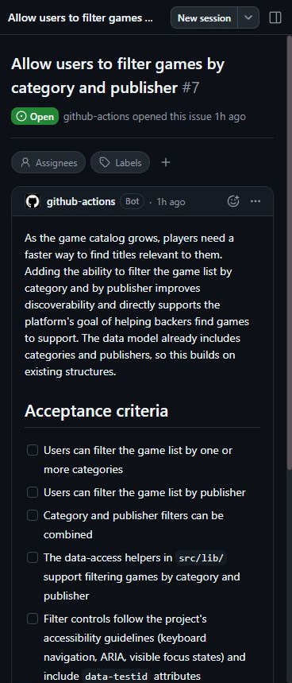
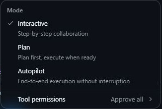
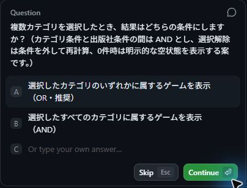
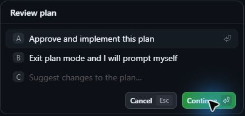
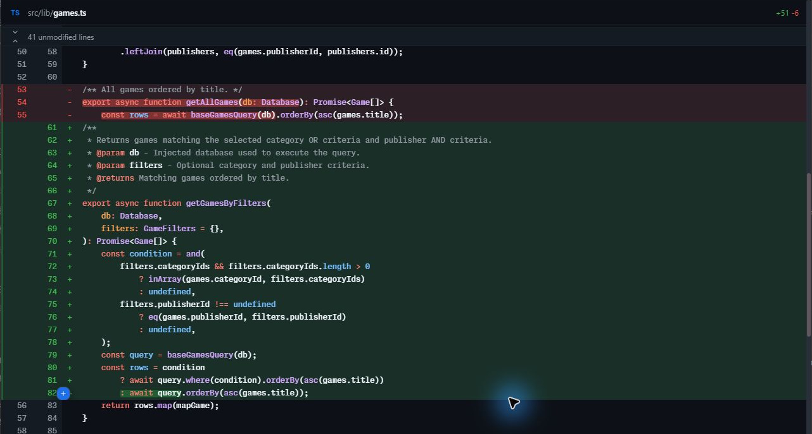
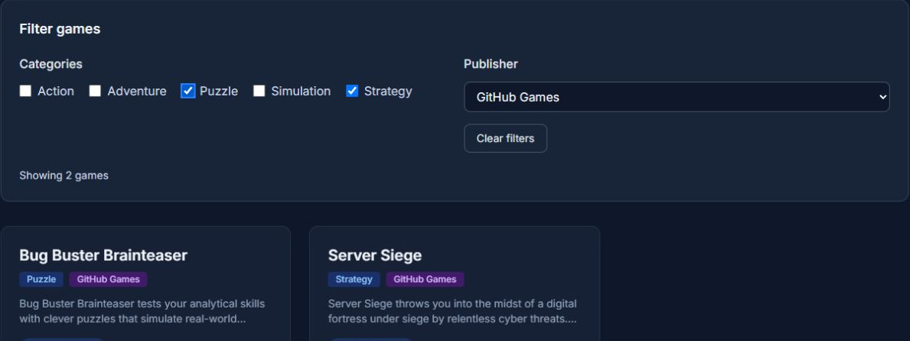
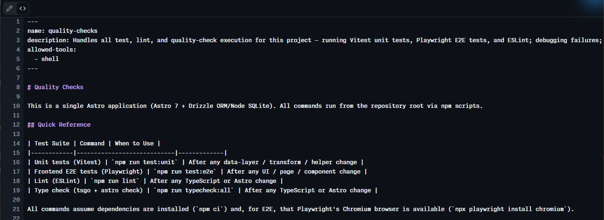
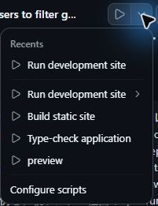
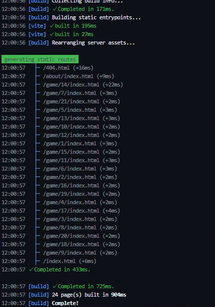
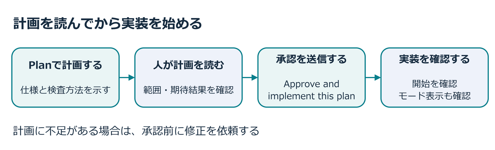

<a id="シナリオ"></a>

## 5.1 章の概要

Tailspin Toysのホームページには全ゲームが並び、訪問者が条件で絞り込む機能がありません。フィルター機能のIssueでは、カテゴリと出版社を選んでゲームを探せるようにすることが求められています。本章ではCopilot Appでこのゲーム一覧の絞り込み仕様をCopilotと確認し、クライアント側のフィルターを実装します。

本章の範囲は、Tailspin Toysのフィルター機能の計画、実装、自動テストまでです。第6章でPlaywright MCPによるブラウザー検証、第7章でフィルター機能のPR作成とマージへ進みます。工程を分けるのは、実装ができた時点で操作性やCIまで確認済みだと思い込まないためです。各工程の結果を読んでから次に進む判断は、受講者が行います。

Copilot Appで選べるInteractive、Plan、Autopilotの役割は[GitHub公式のセッション説明][agent-sessions]に記載されています。本演習は、Planで仕様を判断し、承認した範囲をAutopilotへ渡す進め方です。Autopilotへ切り替えても、受け入れ条件や作業範囲を決める必要はなくなりません。どこで作業を止め、何を報告してほしいかもプロンプトに含めます。

## 5.2 この章で学ぶこと

この章を終えると、ゲームのフィルター機能の受け入れ条件を実装前に整理し、Copilotが実装した差分と検査結果を根拠に追加修正を依頼できます。

| 学ぶこと | 到達した状態 |
| :--- | :--- |
| Planによる仕様の確認 | カテゴリのOR条件と、出版社とのAND条件を説明できる |
| Autopilotによる実装 | 承認した計画と変更範囲を照合できる |
| カスタム指示の継承 | 第4章で更新した規約が生成コードに反映されたかを読んで確認できる |
| quality-checksによる検査 | 単体テスト、E2E、lint・型検査、buildの役割を区別し、結果を確認できる |

## 5.3 取り組む前に

第4章の規約更新をmainへマージ済みの演習用Tailspin Toysリポジトリを使います。Copilot Appで始めるフィルター実装セッションは、そのmainから始めます。対象のIssueは「Allow users to filter games by category and publisher」です。

Tailspin Toysは静的サイトです。ページの生成時にゲームデータを読み込み、ブラウザー上で表示するゲームを絞ります。通常の教材データは21件あり、フィルターを追加した後も星評価とゲーム詳細へのリンクを維持します。0件表示の検査には、専用CSV、隔離DB、別ポートのサーバーが必要です。

フィルター機能を実装する前に、Tailspin Toysのゲーム一覧でカテゴリを二つ選んだときと、出版社も加えたときに件数がどう変わるかを予想してください。実装後は、表示されたゲームの件数とタイトルの両方でその予想を確かめます。

## 5.4 体験すること

Copilotにゲームのフィルター機能の計画を作成させ、仕様を確認してから実装を承認します。実装後の差分、Tailspin Toysの画面操作、自動検査の確認を終えたら、第6章のブラウザー検証へ進んでください。

<a id="フィルター機能を計画する"></a>

### 5.4.1 フィルター機能を計画する

1. Copilot Appのサイドバーの**Issues**を開き、一覧のリポジトリ選択で自分の演習用Tailspin Toysリポジトリを選び、Openの課題を表示します。Projectsの選択と、Issues一覧の表示条件をそれぞれ確認してください。課題が見つからない場合は、[第2章のバックログ確認](2-install-copilot-app.md#バックログ-issue-の確認)に従って表示条件を見直します。

2. 一覧からAllow users to filter games by category and publisherというタイトルのIssueを選択します。第4章の指示更新が演習用リポジトリのmainへマージ済みであることも確認してください。
3. 画面右上の **New session**を選択します。

   

4. プロンプト入力欄の下部にあるモードメニュー（初期表示: Mode: Interactive）を開き、Plan — Plan first, execute when readyを選択します。

   

5. 入力欄に`/issue-fix`などが入っている場合は、<kbd>Ctrl</kbd>+<kbd>A</kbd>で全選択し、次のプロンプトへ置き換えて送信します。Issueを起点として開始したセッションであるため、フィルター機能の要件はすでにセッションのコンテキストに含まれています。

   ```plaintext
   Issue に記載された要件に基づいて作業を計画してください。計画中に不明点があれば質問してください。カテゴリ同士の条件、出版社との組み合わせ、選択解除、0件表示をどう実装・検証するかを計画に含めてください。
   実装後は差分と検証結果を報告して停止してください。Playwright MCPでのブラウザー検証を次章で行ってからPRを作るため、この段階ではコミット・push・PR作成・マージへ進まないでください。
   ```

6. 計画の作成過程で、エージェントから設計上の選択肢や不明点に関する質問が提示される場合があります。本演習の条件に従って回答し、Continueで送信します。複数カテゴリの条件を聞かれた場合はOR、出版社の選択方法を聞かれた場合は単一選択を選んでください。

   

> [!NOTE]
> Copilotの出力は確率的に動作するため、提示される質問内容や有無はセッションごとに異なります。質問が一切行われずに直接計画が提示された場合でも問題ありません。

7. Copilotがフィルター機能の計画を作成すると、その概要を提示します。計画内容をレビューしてください。通常、クエリ処理の構築、フィルター用UIコントロールの追加、および対応するテストの作成が提案されます。不足があれば**Suggest changes to plan**から修正を依頼し、再提示された計画を読みます。

フィルター機能の計画を読むときは、Tailspin Toysのゲーム一覧に残す条件を自分の言葉で説明してみましょう。本演習では、複数カテゴリはOR条件、カテゴリと出版社はAND条件で組み合わせます。StrategyとPuzzleを選んだときは「どちらかのカテゴリに該当するゲーム」を表示し、そこに出版社を選ぶと「その出版社にも該当するゲーム」まで絞ります。カテゴリを増やす操作と、出版社を加える操作では件数の変化が逆になる点を確認してください。

出版社を単一選択にするか複数選択にするかは、操作方法とテストの両方に影響します。この教材では出版社を単一選択にします。エージェントから質問が出たら、その条件を伝えてください。質問が出なければ、提示された計画に単一選択と明記されているかを読み、必要なら補足します。Issueの目的に照らして選択肢を決めることが、Planを使う際の受講者の役割です。

フィルター機能の計画には、カテゴリと出版社の選択をすべて外すと全ゲームの一覧へ戻ること、該当ゲームがなければ0件の説明を表示すること、ラベルとキーボードで操作できることも含めます。既存の星評価とゲーム詳細へのリンクも維持します。Tailspin Toysは静的サイトなので、ブラウザー上でゲーム一覧を絞る処理と、ビルド時のゲームデータ取得を区別し、フィルターのために不要なAPIやDB変更を加えていないかも確認しましょう。

フィルター機能の計画に「テストを追加する」とあるだけでは、何を確認するかはまだ分かりません。たとえば、複数カテゴリのテストが「0件より多い」だけなら、片方のカテゴリを無視した実装でも通る可能性があります。両方のカテゴリが表示され、指定外のゲームが含まれないことまで期待結果に書いておくと、実装後のレビュー基準が明確になります。

Tailspin Toysの通常データ21件では、Strategyが4件、Puzzleが4件、両方のOR条件で8件、その状態にGitHub Gamesを加えると2件、全解除で21件です。0件の検査では、通常CSVとDBに触れず、専用データ3件の環境を用意します。準備スクリプトがテスト用DBを明示的に要求することと、検査後に今回作った一時DBとサーバーを片付けることも計画に含めてください。

<a id="autopilot-で構築する"></a>

### 5.4.2 計画を承認し、Autopilotで実装する

フィルター実装セッションで作成した計画に問題がなければ、Copilotにその計画に沿って自律的にコードを実装させます。

1. 提示された計画を読んだうえで、**Review plan**のApprove and implement this planを選択します。この選択で承認が送信されます。実装へ進んだこととモード表示を確認してください。

   

Copilotがゲームのフィルター機能の自律実装を開始します。

> [!NOTE]
> もしCopilotがコードの作成を自動的に開始しない場合は、「確認した計画に沿って実装を開始してください」とチャットで指示してください。
>
> 実装の完了までには通常数分を要します。エージェントはファイルの編集や新規作成、テストコードの追加と実行、エラー時のリトライを自律的に繰り返します。進行中は、計画に沿ったファイルを変更しているか、どの検査を実行したかを観察します。

フィルター実装セッションでCopilotが指示した範囲を超えてPR作成やpushへ進み始めた場合は、Stopで停止してください。現在の差分と演習用リポジトリのリモートの状態を確認してから、第6章のブラウザー検証まで待つよう伝えます。

<a id="変更をレビューする"></a>

### 5.4.3 差分と画面の動きをレビューする

Copilotが生成したフィルター機能のコードは、必ず人間が差分を確認し、そのセッションのworktreeで起動したTailspin Toysの開発サーバーで動作確認を行う必要があります。

1. Copilot Appのフィルター実装セッションで、入力欄の上にある **Changes**（Open changes）を選択し、右パネルに差分ビューを開きます。

   

2. 変更内容をレビューします。TypeScriptファイル、Astroコンポーネント、テストファイルが新設・修正されていることを確認します。
   特に、新設されたデータアクセス等のヘルパー関数において、第4章で演習用リポジトリにマージしたドキュメント標準規約が遵守され、指示通りのTSDocドキュメントコメントが付与されているか確認してください。ファイル先頭のヘッダーコメントは、モジュールの役割や制約を明示する必要がある箇所で確認し、全ファイルへの一律付与までは成功条件としません。
3. 画面上部の **Run options**から **Run development site**を選択します。

4. ボタンがRun Run development siteと表示されている場合はクリックして起動します。すでに **Stop Run development site**と表示されている場合は稼働中ですので、そのまま次へ進みます。
5. Copilot AppのBrowserパネルで、フィルター実装セッションから起動したTailspin Toysのサイトを開きます。パネルが自動表示されない場合は、Runターミナルに表示されたURLを外部ブラウザーで開いてください。ポート番号を決め打ちせず、今回起動したサーバーの表示を使います。別のセッションのサイトを見ていないか、起動元のworktreeも確認してください。
6. Tailspin Toysのトップページ上で、複数カテゴリーの選択、特定パブリッシャーとの組み合わせ、絞り込み解除が意図通りに動作することを確認します。
7. 挙動に不備がある場合は、チャット欄からエージェントに修正を依頼し、再確認します。
8. 確認が完了したら、セッション上部の **Stop Run development site**を選択して開発サーバーを停止します。

Tailspin Toysのフィルターを手動確認するときの対象は、カテゴリ・出版社の選択状態と、一覧に残ったゲームの対応です。件数だけが合っていても、違うゲームが表示されていれば正しい実装とはいえません。フィルター機能のTSDocも、第4章で共有した規約と照合してください。OR/AND条件や引数の説明が実装と食い違っていないかを確認しましょう。Publisherから<kbd>Tab</kbd>で**Clear filters**へ移動し、<kbd>Enter</kbd>で解除できるかも試します。テストがボタンへ直接フォーカスを移すだけでは、実際のTab移動の順序は分かりません。



<a id="quality-checks-スキルで作業を検証する"></a>

### 5.4.4 quality-checksスキルで検査する

フィルター機能の差分の目視確認と、ブラウザーでのTailspin Toysの手動操作に加えて、演習用リポジトリに定義された自動テスト群を実行して品質を検証します。

<a id="quality-checks-スキルを確認する"></a>

#### 5.4.4.1 quality-checksスキルを確認する

Copilot Appのフィルター実装セッションのFilesで、自分の演習用Tailspin Toysリポジトリにある`quality-checks`スキルの中身を確認してみましょう。

1. 右側のパネルが表示されていない場合は、画面右上のToggle panelを選択して開きます。

2. パネル上部のタブ列にある `+`（Add tab）を選択します。
3. Filesを選択します。
4. <kbd>Ctrl</kbd>+<kbd>P</kbd> を押してGo to fileを開き、`SKILL.md` を検索します。
5. 検索結果から `SKILL.md .github/skills/quality-checks` を選択して開きます。
6. ファイルの表示を**Raw**へ切り替え、`name`と`description`の定義を確認します。Rich textでは冒頭のメタデータが表示されないことがあります。Tailspin Toysのテスト、lint、品質検査を実行するスキルであることが説明されています。

   

7. ファイル全体を確認します。単体テスト、PlaywrightによるE2Eテスト、ESLintの各スイートを実行するコマンド体系、実行順序、および失敗時のトラブルシューティング手順が体系化されています。エージェントは推測に頼らず、チーム規定の手順に沿って検証を実行できます。

Tailspin Toysの各検査で分かることは異なります。フィルター機能の検査結果を読むときは、次の役割を区別してください。

| 検査 | この機能で確認すること |
| :--- | :--- |
| 単体テスト | フィルター条件の判定やデータ処理を、小さな入力と期待結果で確認する |
| E2Eテスト | ブラウザーで選択・表示・解除がつながることを、繰り返せる操作として確認する |
| lint・型検査 | 設定されたコード規約、型やコンポーネントの整合性を確認する |
| build | 静的ページを生成できることを確認する。画面操作の正しさは別途確認する |

スキルを呼び出したという表示だけでは、全検査の成功を判断できません。実行したコマンド、成功・失敗した結果、追加したテストの内容を報告から確認します。`quality-checks`の定義に含まれる型検査も確認し、静的サイトの生成はAppのRun → Build static siteでも確かめてください。

<a id="通常データでは確認できない0件表示"></a>

#### 5.4.4.2 通常データでは確認できない0件表示

Tailspin Toysの通常データ21件には、すべてのカテゴリと出版社の組み合わせに該当するゲームがあります。そのため、通常画面で条件を変えるだけでは0件表示に到達できません。0件の状態を試すには、組み合わせが欠けたテストデータを別に用意します。通常の`db/games.csv`を書き換えると、他のテストの期待結果まで変わってしまいます。CSVだけを分けても、準備処理の接続先が通常DBなら通常環境の一覧も変わってしまいます。準備と検査の両方が、同じ隔離DBを使っていることを確認してください。

0件表示の検査では、専用CSVのゲーム3件を隔離したSQLiteへ読み込み、Tailspin Toysの通常環境とは別ポートのサーバーで検証します。PuzzleとNova Interactiveを選ぶと0件となり、解除するとテスト用の3件へ戻る条件を用意してください。計画に0件のテストが含まれていても、実装・実行されたことまでは分かりません。計画・テストコード・実行結果の3つを照合します。`DATABASE_URL`が未指定、または通常DBを指している場合に、準備処理がDBへ書き込む前に停止するかもレビューしてください。

<a id="チェックを実行する"></a>

#### 5.4.4.3 チェックを実行する

Copilot Appのフィルター実装セッション内で、エージェントにそのフィルター機能の品質検証を依頼します。

1. Copilot appの会話画面に戻ります。
2. スラッシュコマンド `/quality-checks` を入力して送信します（スキル名を直接指定して呼び出します）。
3. エージェントはスキルの手順に従って単体テスト、linter、E2Eテストを順次実行し、結果を報告します。失敗した項目があれば、修正を行わせて全テストを通過させます。

   複数カテゴリや0件表示の検査が不足している場合は、次のように具体的に補足します。

   ```plaintext
   フィルターのテストを確認してください。通常データではStrategyとPuzzleが各4件、両方を選択すると8件表示され、両カテゴリのゲームが含まれることを検査してください。
   0件表示は通常のdb/games.csvと通常DBを変更せず、分離したテスト用CSV・DB・サーバーで確認してください。準備と検査で同じテスト用DBを明示し、DB未指定や通常DBへの指定は書き込み前に拒否してください。PuzzleとNova Interactiveの組み合わせで0件になり、解除するとテスト用の全3件に戻る条件を用意してください。
   PublisherからTabでClear filtersへ移動し、Enterで解除できることを、直接フォーカスを移す方法に置き換えず検査してください。検査後は今回起動したサーバーを停止し、今回作成した一時DBを片付けてください。テスト用CSVとテストコードは残してください。
   quality-checksスキルで検証し、実行結果と未確認の項目を報告してください。コミット・push・PR作成・マージはまだ行わないでください。
   ```

4. フィルター実装セッションは閉じずに開いたままにします。第6章では、このセッションからPlaywright MCP serverを利用し、エージェントに実際のブラウザーを自律操作させてフィルター機能が正しく動作することを検証します。

Tailspin Toysのquality-checksスキルに書かれた検査のコマンド例も読んでください。テストを呼び出す親スクリプトがテスト用の環境を用意している場合は、その経路を使います。検査対象を絞る追加引数がテストへ届き、指定した検査だけを実行したかも実行結果で確認しましょう。





テスト数を増やすこと自体を目標にせず、実装した受け入れ条件が検査されていることを確認します。単体テスト、E2Eテスト、lint・型検査の結果と、**Build static site**によるページ生成を確認してから次章へ進んでください。

<a id="まとめと次のステップ"></a>

## 5.5 結果の整理と振り返り

フィルター機能に実装したカテゴリ・出版社の条件と、実際のゲームの表示や検査結果を整理します。次の項目を、自分がフィルター実装セッションで確認した差分・画面・検査結果と照らし合わせてください。

- 最新のコードベースから、フィルター機能のIssueに紐づく新しいセッションを開始した
- Planモードで実装計画を作成・レビューし、Autopilotモードで自律実装を実行した
- 生成されたコードにおいて、第4章で定義したドキュメント標準規約（TSDoc等）が反映されていることを確認した
- `quality-checks` スキルを活用して単体テスト、E2Eテスト、lintによる検証を完了した

フィルター機能の計画で自分が判断したことと、そのテスト結果を見て修正したことを振り返ってください。次はPlaywright MCP serverの接続を確認し、実際のブラウザー操作をエージェントへ依頼します。自動テストの結果と操作時の観察を比べるため、フィルター実装セッションを開いたまま、[第6章「Playwright MCP serverによるテスト」][next-lesson]へ進んでください。

<a id="補足"></a>

## 5.6 補足

<a id="開発プロセスの背景"></a>

### 5.6.1 開発プロセスの背景

第3章の星評価の追加と第4章の規約更新では、比較的小規模な変更を扱いました。機能開発では、要件の確認、計画、実装、検査をつなげて進める必要があります。

第5〜7章では、Tailspin Toysのフィルター機能のIssueに沿って計画・実装し、その検査結果を読んでからPRを共有します。quality-checksスキルによる自動検査と、MCPによるブラウザー操作をそれぞれ確認する進め方です。

AIコーディングエージェントを現場のワークフローに導入しても、ソフトウェア開発の基本原則が変わるわけではありません。むしろ、AIが高速にコードを生成するからこそ、各プロセスの規律がより重要になります。一般的に推奨される開発フローは次のとおりです。

1. 要件が明確に記述されたIssueを確認する
2. 実装方針と手順を定めた計画（Plan）を作成する
3. コードを実装し、差分（diff）を確認・レビューする
4. 自動テストを実行してコードの正確性を検証する
5. 開発サーバー上で新機能の挙動を手動検証する
6. Pull Request（PR）を作成する
7. コードレビューとCI（継続的インテグレーション）がすべて通過したことを確認してマージする

> [!NOTE]
> 具体的なステップはチームや組織の規約によって多少異なりますが、基本骨格は共通しています。

この標準的なアプローチを踏襲することで、AIが生成したコードにも、人間が書いたコードと同じ品質基準を適用できます。計画、差分、自動テスト、実際の操作をそれぞれ確認し、本番環境へ反映できるかを判断します。

<a id="セッションモードの種類"></a>

### 5.6.2 セッションモードの種類

Copilot Appのセッションモードは、エージェントに与える自律性の度合いを制御する仕組みです。プロンプト入力欄の下部にあるドロップダウンから選択でき、セッションの進行中いつでも切り替えられます。

- Interactive：対話型モード。ユーザーとエージェントが協調して作業を進めます。エージェントは変更案を提示し、ユーザーの入力を受けながら進めます。
- **Plan**：計画作成モード。エージェントはコードを直接編集せず、まず調査と実装計画の作成に専念します。作成された計画を人間がレビュー・承認した後に実装フェーズへ進みます。
- **Autopilot**：自律実行モード。エージェントが完全に自律して作業を進めます。追加の確認を待つことなく、ファイルの編集、新規作成、テスト実行、エラー発生時の自己修正などを反復して実行します。

<a id="計画を先に確認する理由"></a>

### 5.6.3 計画を先に確認する理由



コードを書き始める前に、仕様や設計の疑問を計画で解決しておくと、実装後の修正を減らせます。条件の組み合わせ、既存機能の維持、期待するテスト結果を、承認前に確認してください。

Planモードでは、エージェントが既存コードを調べ、実装手順と構成を提案します。計画を読んだ人が不足や矛盾を指摘し、修正後の計画を承認することで、実装する内容を共有できます。

<a id="エージェントスキルagent-skillsとは"></a>

### 5.6.4 エージェントスキル（Agent Skills）とは
エージェントスキルは、テスト実行、ビルド生成、Pull Request作成といった反復タスクの手順を、エージェントに教え込むための仕組みです。

- 指示文、スクリプト、参照リソースをまとめたフォルダーとして構成される
- [オープン標準規格][agent-skills-repo]に基づき、Copilot cloud agent、Copilot CLI、Copilot appや、対応IDEのエージェントモードなどで利用できる
- リポジトリ内の `.github/skills`（または端末の `~/.copilot/skills`）に配置される

対応環境と配置場所は[GitHub公式のAgent Skillsの説明][about-agent-skills]で確認できます。また、[Appのカスタマイズ手順][customize-app]では、リポジトリやCopilot CLIに設定したスキルをAppでも利用できると説明されています。第4章の指示ファイルで共有するのは、継続的に使う規約です。スキルには、特定の作業の手順や資料をまとめます。`quality-checks`では、どのコマンドを実行し、失敗時に何を調べるかを共有しています。

各スキルフォルダー内の `SKILL.md` には、次のようなYAML frontmatterと指示文が含まれます。

```yaml
---
name: quality-checks
description: Run the project's test suites and linter to verify code changes are ready to commit, push, or merge.
---
```

> [!TIP]
> スキルは実行時に動的に読み込まれます。エージェントは各スキルの `description` を読み取り、現在のタスクに適したスキルを自律的に選択します。そのため、スキルの目的と適用条件を明確に記述しておくことが重要です。

[フィルター機能の計画手順へ戻る](#フィルター機能を計画する)

<a id="リソース"></a>

### 5.6.5 公式資料と参考例

- [GitHub Copilot appでのエージェントセッションの操作][agent-sessions]
- [Agent Skillsについて][about-agent-skills]
- [GitHub Copilot appのカスタマイズ][customize-app]
- [GitHub Copilotのクラウドサンドボックスとローカルサンドボックスについて][sandboxes]

[ex0]: 1-prerequisites.md
[ex2]: 3-add-star-rating.md
[ex3]: 4-custom-instructions.md
[next-lesson]: 6-mcp-playwright.md
[agent-sessions]: https://docs.github.com/copilot/how-tos/github-copilot-app/agent-sessions
[about-agent-skills]: https://docs.github.com/copilot/concepts/agents/about-agent-skills
[customize-app]: https://docs.github.com/copilot/how-tos/github-copilot-app/customize-github-copilot-app
[sandboxes]: https://docs.github.com/copilot/concepts/about-cloud-and-local-sandboxes
[agent-skills-repo]: https://github.com/agentskills/agentskills
[agent-skills-spec]: https://agentskills.io/specification
