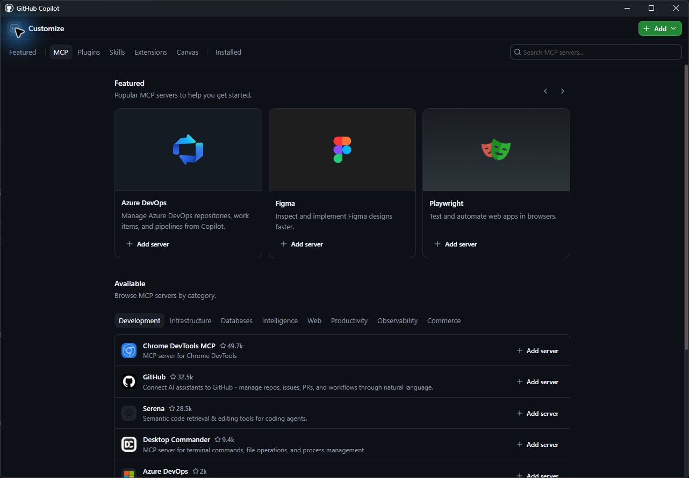
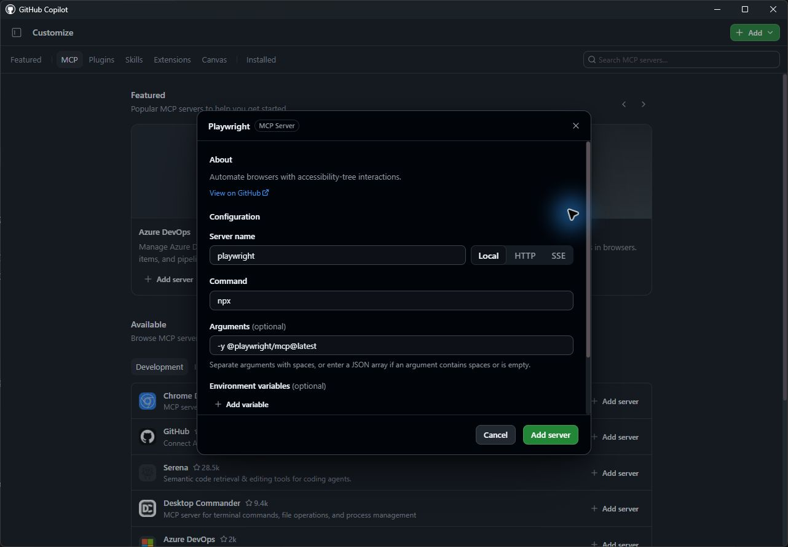

> **この章の確認範囲：** 2026年9月13日に Windows の App 1.1.20 実機にて、リポジトリ定義の信頼承認・設定形式修正・セッション再起動（`/restart-session`）を経て、Playwright MCP による絞り込み、解除、キーボード操作、および正常終了処理を確認済みです。後続の追加検証では、隔離したテスト用データベースを用いて0件表示の挙動も確認しました。また、カタログからの新規登録および別チャットからのタブ一覧取得も成功しています。詳細は [UI 確認表](../material/ui-check.md) を参照してください。

前章では、プロジェクトに組み込まれた自動テストスイート（単体テストや E2E テスト）を用いてフィルター機能を実装・検証しました。自動テストによる検証は不可欠ですが、エージェント自身が実際のブラウザー画面を視覚的・対話的に操作し、挙動をその目で確認できるようにすることも極めて効果的です。エージェントが実際の UI 上で表示崩れや操作の引っかかりに気づき、自律的に手直しできるようになるためです。

本レッスンでは、**Model Context Protocol (MCP)** を通じて AI エージェントに外部ツールの操作能力を付与する仕組みを学び、Copilot がローカル開発サーバー上の Web サイトを直接操作できるように **Playwright MCP server** を連携させます。

このレッスンでは、次の内容を学習します。

- Model Context Protocol (MCP) の概念と、GitHub Copilot app における活用方法を理解する
- アプリの設定を通じて Playwright MCP server を追加・有効化する
- エージェントに実際のブラウザーを操作させ、フィルター機能の挙動を手動テストさせる

## シナリオ

単体テストやスクリプト化されたエンドツーエンドテストは重要ですが、UI の更新を真に保証するには、実際のブラウザー上でのユーザー操作を通じた検証が欠かせません。検証作業を高度に自動化し、新機能が仕様通りに動作するという確信を深めるため、人間のテスターと同じ操作手段をエージェントに与えて開発中サイトを検証させます。

## Model Context Protocol (MCP) とは

[Model Context Protocol (MCP)][mcp-blog-post] は、AI エージェントが外部のツールやサービスと安全に双方向通信するためのオープンなプロトコルです。MCP を導入することで、AI エージェントは外部システムとリアルタイムに対話し、**リソース（resources）**を通じて最新情報を取得したり、**ツール（tools）**を通じてユーザーに代わる操作を実行したりできるようになります。

エージェントは、個別の外部サービスとの橋渡しを担う **MCP server** を経由してこれらのツールやリソースにアクセスします。MCP server はローカルで動作するプロセス（CLI ツールや NPM パッケージ）やリモート API とエージェント間の通信を仲介します。各 MCP server は、エージェントが利用可能な固有のツールセットとリソース群を提供します。

代表的な MCP server には次のようなものがあります。

- [**GitHub MCP Server**](https://github.com/github/github-mcp-server)：GitHub の各種 API にアクセスするツール群を提供します。エージェント自身によるリポジトリの作成・更新、Issue や pull request の管理などが可能になります。
- [**Playwright MCP Server**][playwright-mcp-server]：Playwright を用いたヘッドレス／有頭ブラウザーの自動操作機能を提供します。エージェント自身がページ遷移、フォーム入力、ボタンのクリック、DOM スナップショットの取得などを実行できます。

GitHub は、コミュニティによる発見と貢献を促進するため [MCP registry](https://github.com/mcp) をホストしており、多種多様な MCP server が公開されています。

> [!CAUTION]
> MCP server は、プロジェクトに導入する外部ライブラリや依存関係と同様に慎重に取り扱う必要があります。導入前にソースコードや発行元を精査し、セキュリティ上の影響を評価してください。信頼できる MCP server のみを利用し、機密情報や特権的な操作へのアクセス権限を安易に付与しないよう注意してください。

## Playwright MCP server を追加する

2026年9月10日の [公式ドキュメント](https://docs.github.com/en/copilot/how-tos/github-copilot-app/customize-github-copilot-app#configuring-mcp-servers) との照合に加え、9月13日の Windows App 1.1.20 実機において以下の設定画面と動作を確認しています。なお、プロジェクト未接続の状態であっても登録フォーム自体は開くことが可能です。

> **リポジトリ側に MCP 定義が存在する場合：**  
> 本教材用の修正済みテンプレートには、すでに `.mcp.json` 内の `mcpServers` フィールドに Playwright 等が定義されています。GitHub 連携プロジェクトを右クリック → **Settings** → **MCP servers** から確認できます。  
> 画面に **Trust repository** が表示された場合は、定義内容を確認のうえで利用者が信頼を承認してください（これは Repository configuration の Trusted 表示とは別の承認です）。二重登録を避けるため、既存の定義状態を確認したうえで以下の手順を参照してください。

### 既存設定が正しく読み込まれない場合の対処（復旧記録）

> [!NOTE]
> **以下は、過去に上流から直接作成した古いリポジトリコピーを復旧した際の記録です。**  
> 本教材用テンプレート（v2026.09.13.1）にはすでにこの設定修正が適用されているため、通常の受講者がこのファイルを直接編集する必要はありません。

実走検証時、ユーザーによる信頼承認を行った直後に **No MCP servers loaded** と表示される現象が発生しました。調査の結果、固定コミットから作成したコピーの `.mcp.json` では、ルートキーが誤って `"servers"` と記述されていました。[公式のリポジトリ別設定形式](https://docs.github.com/en/copilot/how-tos/copilot-cli/customize-copilot/add-mcp-servers#adding-per-repository-mcp-servers) に適合させるため、演習コピー側でこのキーを `"mcpServers"` へ修正したところ、正常に認識されました（サーバー自体の定義や接続先設定は変更せず、参照元リポジトリにも変更は加えていません）。

設定修正後、Settings 画面の **Refresh** をクリックすると、GitHub、Playwright、astro-docs の3件がすべて **Connected** 状態へ移行しました。

ただし、**すでに起動中だったフィルター機能のセッション側では、即座には Playwright のブラウザー操作ツールを呼び出せず停止する挙動**が確認されました。この場合、セッションの会話入力欄に **`/restart-session`** と入力して送信してください。これは会話履歴や未コミットの変更差分を保持したままセッションプロセスのみを再起動する[公式のスラッシュコマンド](https://docs.github.com/en/copilot/reference/github-copilot-app-reference/slash-commands)です。実機検証では、再起動後に未コミットの差分を保持したまま Playwright MCP のツール呼び出しが可能になることを確認しています。設定画面で Connected と表示されたことだけで完了と判断せず、セッションから実際にツールが実行できるかを確認してください。

### GUI からの新規登録手順

リポジトリ定義を使わず、アプリの GUI から手動登録する場合の手順は次の通りです。

1. サイドバーの **Customize** を開きます。
2. **Installed** タブの **MCP Servers** で既存の登録一覧を確認します。すでに登録済みの場合は重複して追加しないよう注意してください（検証初期状態では未登録でした）。
3. 未登録の場合は **MCP** タブを開きます。実走検証時、**Featured** セクションに **Playwright** が掲載されていました（見つからない場合は **Search MCP servers** から検索してください）。
4. **Playwright** カードを選択して登録フォームを開きます。実走時の既定値は、**Server name** が `playwright`、**Type** が `Local`、**Command** が `npx`、**Arguments** が `-y @playwright/mcp@latest` でした。
5. 入力内容を確認し、**Add server** をクリックして保存します。登録が完了すると表示が **Installed** に切り替わり、登録数が1件とカウントされます。  
   単に登録されたことだけで完了とせず、新しいチャットやセッションから実際のツール呼び出しを検証します。追加検証では、リポジトリ未接続の新規チャットから Playwright の `browser_tabs` ツールを呼び出してタブ一覧の取得に成功し、`about:blank` の応答が得られることを確認しました。これでカタログからの登録と動作確認が完了します。





> [!NOTE]
> 上記の画面キャプチャは2026年9月13日に Windows App 1.1.20 実機で撮影したものです。受講者の個人アカウント情報を保護するため、サイドバーを非表示にした状態で撮影しています（サイドバーは左上のトグルボタンまたは <kbd>Ctrl</kbd>+<kbd>B</kbd> で開閉できます）。  
> もし画面内に Customize や MCP のメニュー項目が見当たらない場合は、App のバージョン、組織ポリシーによる制限、および現在の画面状態を記録し、講師と一緒に確認してください。

## Playwright で機能を確認するよう Copilot に依頼する

前章から開いたままにしているフィルター機能の実装セッションに戻り、Playwright MCP server を使って新機能の動作を手動検証するよう Copilot に指示します。

1. 会話入力欄に次のプロンプトを入力して送信します。

   ```plaintext
   開発サーバーを起動し、Playwright MCP server で追加した機能を検証してください。Issue の詳細を使って、新しい動作が仕様に一致することを確認してください。
   ```

2. Copilot は Playwright MCP server を通じてブラウザーを自律起動し、検証ステップを順次実行して、その結果を会話欄に報告します。タスク実行中、環境によってはデスクトップ上で実際にブラウザーウィンドウが開き、自動操作される様子が視覚的に確認できます。
3. 報告された概要を Issue の受け入れ条件と照らし合わせてレビューします。もし挙動に問題があれば、pull request を作成する前に追加の指示を出してコードを修正させてください。
4. **【重要】次のレッスンで Agent Merge を実施するため、このセッションは開いたままにしておきます。**

### 実機検証における確認記録と注意点

2026年9月13日の実走検証では、エージェントが `browser_navigate`、`browser_snapshot`、`browser_click`、`browser_select_option`、`browser_find`、`browser_press_key` といった各種ツールを自律的に呼び出すことを確認しました。

検証時のデータ件数は次の通りでした。
- 通常データ（全21件）において、「Strategy」を選択すると4件に絞り込み。
- さらに「Puzzle」を追加選択すると8件に拡大。
- 続けてパブリッシャー「CodeForge Studios」を指定すると2件に絞り込み。
- 「Clear filters」をクリックすると全21件に正常復帰。
- パブリッシャー単独選択時は6件。
- キーボード操作（<kbd>Tab</kbd> および <kbd>Enter</kbd>）による絞り込み解除でも21件へ復帰。
- 全検証の完了後、`browser_close` によるブラウザー終了と開発サーバープロセスの正常停止を確認。

なお、通常データセットには全カテゴリーと全パブリッシャーの組み合わせに必ず該当ゲームが存在するため、通常の絞り込み操作のみでは「該当件数0件」の画面を再現できません。そこで追加実走検証では、本番用の通常 CSV データは一切変更せず、一時的な隔離データベースに2件の限定テストデータを用意したうえで、「Simulation」と「Ops Interactive」の組み合わせによって「該当ゲームが0件」となる画面表示を Playwright MCP 経由で確認しました（これは前章で実施した20件 fixture による E2E テストとは別の、MCP によるブラウザー実操作検証です）。検証完了後には一時 DB、ブラウザー、サーバーをすべて破棄・終了しています。講師は通常データとテストデータの件数および接続先を厳密に区別して管理し、0件表示を試すために本番用の通常 CSV を書き換えないよう指導してください。

これで、エージェント自身が実際のブラウザーをユーザーと同じように操作し、UI 機能の正常性を確認できました。

<a id="cli-fallback"></a>

> **講師向け：** 参加者の環境でトラブルが生じ、緊急に作業を保全する必要がある場合のみ [対応手順](../material/emergency-cli.md#chapter-5) を参照してください。なお、CLI 側で実装が完了しても、本章における App 操作の完了とは見なしません。

## まとめと次のステップ

GitHub Copilot app から Playwright MCP server を呼び出し、実際のブラウザー操作を通じて新機能の動的検証を実施しました。本章で実施した主な内容は次の通りです。

- Model Context Protocol (MCP) の基本構造と、アプリに外部ツール（tools / resources）を連携させる仕組みを理解した
- Playwright MCP server の設定・有効化を行い、設定変更時の `/restart-session` によるセッション再接続を実践した
- エージェントにブラウザーを自律操作させ、フィルター機能の絞り込み、複合条件、キーボード操作、解除、および0件表示を検証した

機能の構築とブラウザー検証が無事に完了しました。次は、**Agent Merge** を活用し、pull request の作成、CI 監視、競合解決、およびマージまでの一連のリリース作業をエージェントに自律実行させます。[レッスン 6「Agent Merge によるマージ」][next-lesson] へ進んでください。

## リソース

- [MCP とは何か、なぜ注目されているのか][mcp-blog-post]
- [Microsoft Playwright MCP Server][playwright-mcp-server]
- [GitHub Copilot app での MCP server の構成][customize-app]

[next-lesson]: 6-agent-merge.md
[mcp-blog-post]: https://github.blog/ai-and-ml/llms/what-the-heck-is-mcp-and-why-is-everyone-talking-about-it/
[playwright-mcp-server]: https://github.com/microsoft/playwright-mcp
[customize-app]: https://docs.github.com/copilot/how-tos/github-copilot-app/customize-github-copilot-app
