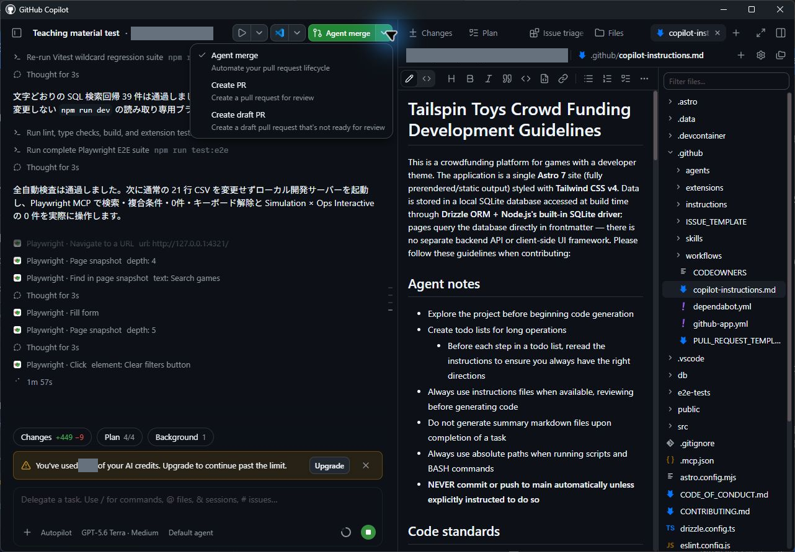
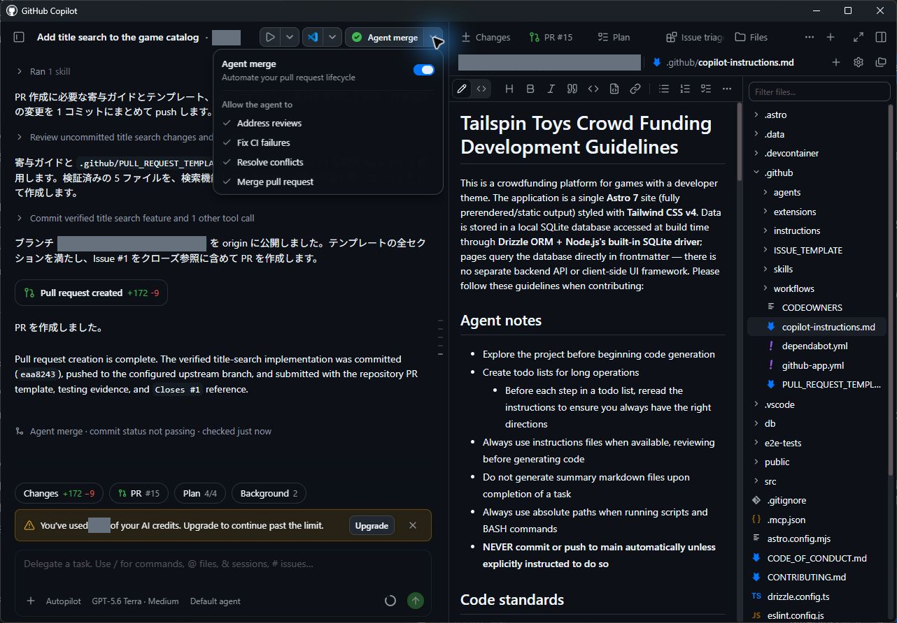

> **この章の進め方** 検証を終えたフィルター機能をAgent Mergeでマージします。任せる操作とマージ条件を確認してから開始し、CI全ジョブの成功と、App・GitHub双方のMergedを確かめます。

前章までで、フィルター機能の実装、単体・E2Eテスト、Playwright MCPによるブラウザー操作の検証を終えました。次は、この変更をmainブランチへマージし、後続の作業から利用できるようにします。mainへの統合と、本番環境への公開は別の工程です。本章では統合までを扱います。

このレッスンでは、次の内容を学習します。

- Agent Merge の役割と、マージのライフサイクルを自律管理する仕組みを理解する
- フィルター機能の実装セッションで Agent Merge を有効化する
- PR の自動作成、CI 実行の監視、全チェック通過後の自動マージの完了を確認する

自動化へ進む理由と振り返りの観点は、章末の[補足](#補足)で確認できます。

## 6.1 開始前にマージ条件を確認する

コードレビュー、自動テスト、UI 検証を終えたフィルター機能のコードをマージしましょう。Agent Merge を起動し、CI 監視からマージまでをエージェントに任せます。

**Agent Merge** は、pull request の作成からマージ完了までの最終工程をエージェントに自律実行させる機能です。

任せる範囲を広げても、要件を満たす変更かどうかを判断する責任は人に残ります。

Agent Mergeのメニューでは、次の4項目を確認します。それぞれのチェックは、今回どの操作をエージェントに許可するかを表します。

| 項目 | 任せる操作 | 人が確認すること |
| :--- | :--- | :--- |
| Address reviews | レビュー指摘への対応 | 指摘の意図を満たし、不要な仕様変更を加えていないか |
| Fix CI failures | CI失敗の調査と修正 | 検査を弱めて通していないか。修正後に必要な検査を実行したか |
| Resolve conflicts | 他の変更との競合解消 | 両方の変更意図を保っているか |
| Merge pull request | 条件を満たしたPRのマージ | 対象PRとマージ先が正しく、レビューと検証を終えているか |

GitHubで「マージ可能」であることと、この演習で求める「CIの全ジョブ成功」は同じとは限りません。必須チェックに指定されていないジョブが実行中でも、GitHubはマージを許可する場合があります。ブランチ保護には、必須チェックや管理者による回避の設定もあります。[GitHub公式の必須ステータスチェックと保護設定](https://docs.github.com/en/repositories/configuring-branches-and-merges-in-your-repository/managing-protected-branches/about-protected-branches#require-status-checks-before-merging)

Agent Mergeを開始する**前に**、講師と演習用リポジトリのマージ条件を確認し、次の経路を選んでください。設定の変更は本章の必須作業ではありません。

- **CI全ジョブの完了を待つ条件が適用されると確認できた場合**：以下の手順で、PR作成からAgent Mergeに任せます。条件が自分の権限にも適用されることを確認してください。
- **条件が未設定、または分からない場合**：先に通常の **Create PR** でPRを作成し、Agent Mergeを開始せず、対象PRの最新コミットに対するCI全ジョブの成功を待ちます。その後、同じセッション上部でAgent Mergeを有効にしてマージを任せます。この経路でも、自動マージの操作と結果を確認できます。

後者では待機を人が担当するため、どこまで自動化したかを説明しやすくなります。新しいコミットが追加された場合は、古い成功結果を使わず、そのコミットのCIを確認し直してください。エージェントによる追加修正を許可する場合も、変更後の検査を待てる条件を確認してから任せます。

> [!IMPORTANT]
> **Ready to mergeは、CI全成功の証拠にはなりません。** Agent MergeもGitHubが許可する条件に従って動作します。開始前に上記の経路を選び、CIの全ジョブ成功とMergedの表示を、それぞれ別に確認してください。Merge pull requestは初期状態で有効な場合があるため、開始後に解除することを前提にしないでください。

## 6.2 Agent Mergeを開始する

1. 前章まで作業していたフィルター機能の実装セッションを開きます。
2. PR作成から任せる場合は、画面右上にある **Create PR** ボタンの右側にあるドロップダウン矢印を選択します。先に通常のPRを作成した場合は、CI全成功を確認してから同じセッション上部のAgent Mergeの操作へ進みます。
3. メニューから **Agent merge** を選択します。

   

4. ボタンの表示が **Agent merge** に切り替わります。
5. **Agent merge** ボタンをクリックし、マージの自律プロセスを開始します。

PR作成から任せた場合は、エージェントがpull requestの作成と管理を開始します。対象PRで、フィルター機能とその検証に必要な差分が含まれ、演習用リポジトリのmainを向いていることを確認してください。PR作成後はCIワークフローの実行状態やレビューの状態を監視します。

6. **Agent merge** ボタン横のドロップダウンを再度開き、**Merge pull request** のチェックボックスを確認します。  
   もし未選択になっている場合は、クリックしてチェックを入れてマージ権限を許可してください（すでにチェックが付いている場合はそのままにします。再度クリックすると許可が解除されてしまうため注意してください）。

   

## 6.3 CIとマージ結果を確認する

1. テスト、lint、ビルドなど、今回のPRに対するCIの全ジョブが成功したことを確認します。GitHubのマージ条件だけに任せず、実行中や失敗のジョブが残っていないかも確認してください。
2. 自動マージ後、AppのセッションまたはPull requestsの画面と、GitHubのPR画面の双方が **Merged** になったことを確かめます。

3. エージェントがレビュー対応やCI修復のためにコードを変更した場合は、その差分と変更後の検査結果も確認します。修正が発生しなかった場合は、CIの監視とマージを任せたことまでを振り返り、利用していない修復機能と区別してください。

4. 次章へ進む前に、新しく作成する worktree にこのフィルター機能のマージ結果が正しく継承されていることを確認してください。

## 6.4 補足

### 6.4.1 手動マージからAgent Mergeへ進む理由

本ワークショップを通じて、コード生成、自動テスト、MCP による実ブラウザー操作と、段階的に自動化のレベルを引き上げてきました。Tailspin Toys では開発速度をさらに向上させるため、検証済みの pull request に対する機械的なマージ待機と最終処理を自動化する手法を検討しています。

ここまでのレッスンでは、星評価機能やドキュメント規約の pull request において人間が **Merge pull request** をクリックして手動マージを行いました。本レッスンでは、PR 作成から CI 監視、問題修正、そして最終マージに至る一連のライフサイクル管理をアプリ内の自律機能である **Agent Merge** に委ねます。

レッスン2で最初に手動マージしたのは、変更差分、CIの結果、マージ先を自分で確認するためです。その経験があれば、自動化するときも何を任せたかを説明できます。今回はレッスン4で計画と実装をレビューし、レッスン5で実画面を検証したうえで、CIを待ってマージする操作をエージェントへ渡します。任せる範囲を広げても、要件を満たす変更かどうかを判断する責任は人に残ります。

### 6.4.2 Agent Mergeの動作と品質確認

GitHub公式では、Agent MergeがセッションにPRを確認させ、マージを妨げる問題を修正し、GitHubが許可した時点でマージすると説明しています。バックグラウンドで動作し、Appの再起動後も継続して、マージ後に終了します。[公式説明「Merging a pull request」](https://docs.github.com/en/copilot/how-tos/github-copilot-app/managing-issues-and-pull-requests#merging-a-pull-request)

これまでの手動マージでは、人間がCIの完了を待ってボタンを押していました。Agent Mergeではこの待機と操作を任せられます。ただし、CIが成功しても、テストに含まれない要件までは確認できません。たとえば、カテゴリを2つ選んだときに片方の結果しか表示されない実装は、件数を十分に検査していないテストを通ることがあります。前章までのレビューで確認した条件を、自動化後も品質の基準として使ってください。

### 6.4.3 判断と結果の振り返り

完了を確認したら、「人が判断したこと」「Agent Mergeに許可したこと」「マージの証拠」を説明してみてください。チェックを付けたこと、CIが成功したこと、マージが完了したことを区別できれば、自動化の途中で問題が起きた場合にも確認箇所を絞れます。

実装と検証を終えた変更について、PR作成からmainへの統合までを自動化しました。本章で実施した主な内容は次の通りです。

- Agent Merge の概念と、PR の自律監視・マージ自動化の仕組みを理解した
- フィルター機能のセッションで Agent Merge を有効化し、マージ権限（Merge pull request）の設定を確認した
- PR 作成から CI 完了の監視、そして自律マージの成功を確認した

次は、エージェントと対話しながら複雑な作業を視覚的に計画・整理する高度な機能である**キャンバス（Canvases）**を活用します。[レッスン 7「キャンバスを使った計画」][next-lesson] へ進んでください。

[開始前にマージ条件を確認する手順へ戻る](#開始前にマージ条件を確認する)

## 6.5 リソース

- [GitHub Copilot app での Issue と pull request の管理][managing-issues-prs]
- [GitHub Copilot app について][about-copilot-app]

[next-lesson]: 7-canvases.md
[managing-issues-prs]: https://docs.github.com/copilot/how-tos/github-copilot-app/managing-issues-and-pull-requests
[about-copilot-app]: https://docs.github.com/copilot/concepts/agents/github-copilot-app
