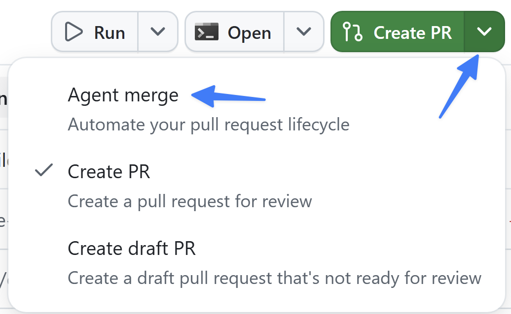
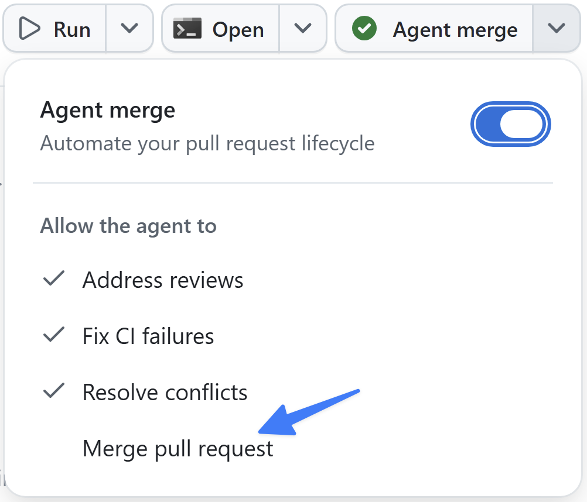

> **この章の進め方：** App を使える場合は以下の本文を進めます。UI で止まった場合は、[この章の CLI 代替手順](#cli-fallback)を使い、同じ章の合流条件を確認してください。

フィルター機能の構築と検証が完了し、ブラウザーで動作することも確認できました。最後のステップはマージです。このハーネスではすでに2回マージしており、どちらも pull request を作成して github.com で自分でマージしました。今回は、pull request のライフサイクル全体をアプリ内から管理する **Agent Merge** に処理を任せます。

このレッスンでは、次の内容を学習します。

- Agent Merge の概要と、マージのライフサイクルを自動化する仕組みを学ぶ。
- フィルター機能のセッションで Agent Merge を有効にする。
- pull request の作成、CI の実行、すべて成功した後のマージを確認する。

## シナリオ

ここ数回のモジュールでは、コードの作成から Copilot による UI の直接検証まで、さまざまなレベルの自動化を確認しました。開発をさらに高速化するために、Tailspin Toys は審査および検証済みの pull request を自動的にマージする方法を検討しています。

## Agent Merge の概要

**Agent Merge** を使うと、Copilot app で pull request をマージするまでの最終工程を自動化できます。有効にすると、アプリのセッションが pull request を読み取り、失敗した CI チェックの修正、レビューコメントへの対応、必要に応じたリベースなど、マージを妨げる問題に対処します。そして GitHub で許可され次第、pull request をマージします。バックグラウンドで動作し、アプリを再起動しても継続し、pull request がマージされると自動的に無効になります。

ここまでは、github.com で自分で **Merge pull request** を選択していました。Agent Merge はその責任をエージェントに移すため、エージェントが PR の完了までを管理している間に次のタスクへ進めます。作業のレビューと承認は引き続き自分で行い、エージェントには機械的な最終工程だけを任せます。

## Agent Merge で PR を管理する

コードを手動でレビューし、テストを実行し、Copilot による UI の検証も完了しました。新しいコードをコードベースにマージします。Agent Merge に PR を継続的インテグレーション (CI) のプロセスからマージまで管理させます。

1. 前のモジュールでフィルター機能を追加していたセッションに戻ります。
2. 右上隅にある **Create PR** の横のドロップダウンを選択します。
3. **Agent merge** を選択して Agent Merge を有効にします。

   

4. ボタンのテキストが **Agent merge** に変わります。
5. **Agent merge** ボタンを選択し、Agent Merge のプロセスを開始します。

Copilot app が PR の作成と管理を開始します。最初にプロジェクトを調査して PR の最適な作成方法を判断し、新しい PR を作成します。

しばらくすると、Copilot が再び作業を開始し、リポジトリ上ですべてのテストを実行する CI プロセスなど、PR の条件を確認します。ほかのチームメンバーによるレビュー、実行が必要なチェック (CI プロセス)、PR をマージできるかどうかのステータスを報告します。

6. **Agent merge** の横にあるドロップダウンを選択してから **Merge pull request** を選択し、Agent Merge に pull request のマージを許可します。

   

7. すべての CI プロセスが成功すると、つまりテストに合格すると、Copilot が pull request をマージします。

## CLI 代替手順：通常の PR レビューとマージ

Agent Merge 自体を CLI の通常操作で体験したことにはできません。この章は自分のコピーへの通常マージで統合を学び、Agent Merge は講師デモまたは後日実施とします。

1. 演習4・5の同じ作業ブランチで差分と quality-checks の結果を確認します。
2. [PR・合流の共通手順](../material/continuation.md)で自分のコピーに PR を作成します。すでに PR があればその PR を更新します。
3. base/head、差分、CI、レビュー指摘を確認します。失敗があれば同じブランチで修正・再検証し、PR を更新します。
4. 自分のコピーへの通常マージを行い、最新の既定ブランチでフィルターと星評価が残っていることを確認します。

**合流条件：** PR の必要な CI とレビューが成功し、自分のコピーへ統合されていること。マージできなければ PR の状態と残作業を記録し、演習7では「すべてマージ済み」と仮定しません。Agent Merge の機能体験は別欄に記録します。

## まとめと次のステップ

コードの生成、テストと検証、pull request のプロセスなど、開発プロセスの複数の部分を自動化しました。具体的には、次の作業を行いました。

- Agent Merge の概要と、マージのライフサイクルを自動化する仕組みを学習した。
- フィルター機能のセッションで Agent Merge を有効にした。
- pull request の作成、CI の実行、すべて成功した後のマージを確認した。

次は、エージェントと一緒に作業を計画して視覚化する、より高度な方法である**キャンバス**を確認します。[レッスン 7「キャンバスを使った計画」][next-lesson]に進んでください。

## リソース

- [GitHub Copilot app での Issue と pull request の管理][managing-issues-prs]
- [GitHub Copilot app について][about-copilot-app]

[next-lesson]: 7-canvases.md
[managing-issues-prs]: https://docs.github.com/copilot/how-tos/github-copilot-app/managing-issues-and-pull-requests
[about-copilot-app]: https://docs.github.com/copilot/concepts/agents/github-copilot-app