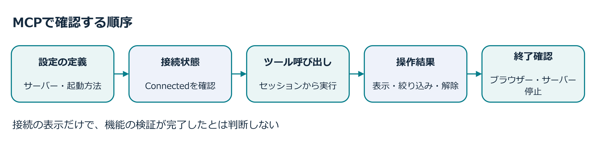
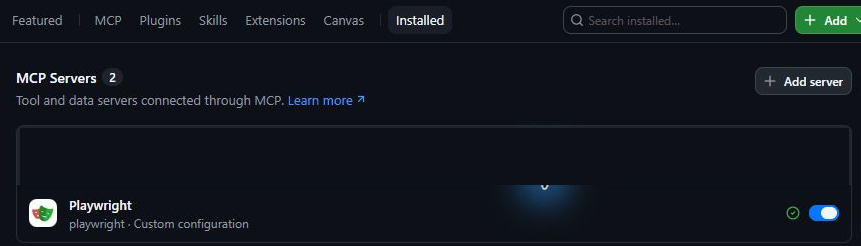
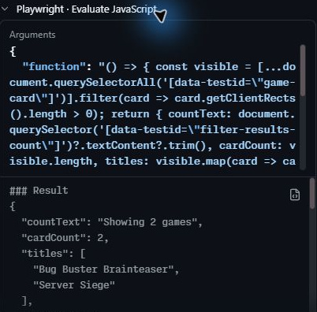
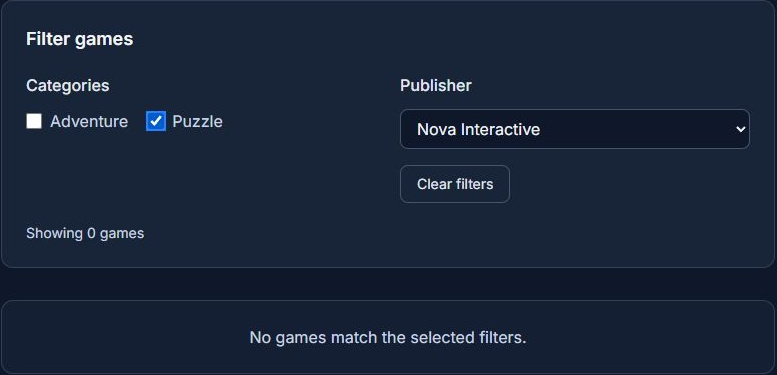
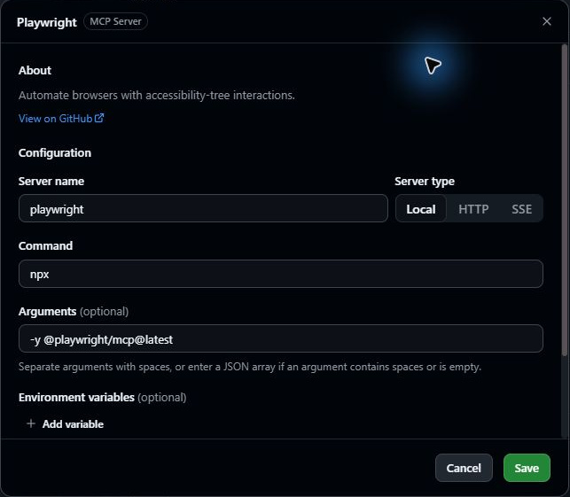

## 6.1 章の概要

自動テストで確認した条件に加え、利用者の操作に沿って画面を検証する方法を学びます。本章では、CopilotにMCPを通じてブラウザー操作を依頼し、操作履歴と観察結果を根拠に検証の十分さを判断します。

MCP（Model Context Protocol）は、AIエージェントと外部のツールやデータをつなぐ共通の通信方式です。Copilotでの役割は、[GitHub公式のMCP説明][mcp-overview]を参照してください。

Playwright MCPは、Copilotにブラウザーの操作と状態取得のツールを提供するプログラムです。Copilotはページを開き、ボタンのクリックやキー入力を行い、ページの文字や選択状態を読み取れます。[Microsoftの公式README][playwright-mcp-server]に、この仕組みとツールが説明されています。

受講者が操作条件と期待結果を伝えると、CopilotはPlaywright MCPのツールを呼び出し、操作後のページの状態を読み取って結果を報告します。受講者は会話に残るツールの履歴と報告を照合し、期待結果と比べます。Playwright MCPの**Connected**は接続状態の表示です。検証では、実際の操作と結果まで確かめます。



### 6.1.1 この章で学ぶこと

この章を終えると、Copilotへブラウザーでの検証を依頼し、ツールの呼び出しと操作履歴、観察結果を照合して、受け入れ条件を確認できたか判断できます。

| 学ぶこと | 到達した状態 |
| :--- | :--- |
| MCPの接続確認 | 設定の内容、接続表示、実際のツール呼び出しを区別できる |
| 探索的なブラウザー検証 | 条件を変えて操作し、期待結果と実際の表示を比べられる |
| 結果報告のレビュー | 観察結果を操作履歴と照合し、未実施の確認を補える |
| 検証環境の終了 | 残す成果物と片付ける一時ファイル・サーバーを区別し、検証環境を終了できる |

## 6.2 取り組む前に

Copilot Appで、第5章のフィルター実装セッションを開いたまま使います。フィルター機能の単体テスト、E2E、lint・型検査とbuildを確認し、Tailspin Toysの通常データ21件と、0件表示を試す隔離データ3件を区別できる状態から始めます。このフィルター機能のPR作成とマージは第7章で行います。

自分の演習用Tailspin Toysリポジトリにある`.mcp.json`には、テンプレートから引き継いだPlaywrightの定義が含まれています。すでに利用できる設定を確認してから進めましょう。MCP serverは外部のプログラムや接続先へ操作を渡す仕組みです。定義のコマンドと接続先を読み、信頼の承認を求められたら内容を確認します。演習では、フィルター実装セッションのworktreeで起動したTailspin Toysのサイトを検査対象にします。

フィルター機能の自動テストが成功していても、Playwright MCPで指定したブラウザー操作がすべて実行されたとは限りません。操作前にゲーム一覧の表示を予想し、Copilotの報告とツールの履歴を比べて確認します。

## 6.3 ケース

<a id="シナリオ"></a>

このケースの対象は、第5章で実装したTailspin Toysのフィルター機能です。同じ実装セッションからPlaywright MCPで検証します。

| 観点 | このケースで扱う内容 |
| :--- | :--- |
| 状況 | 単体テストやスクリプト化されたエンドツーエンドテストで、フィルター機能を検査した状態です。 |
| 課題と理由 | 自動テストの結果に加え、利用者がカテゴリ・出版社の選択欄や解除ボタンを操作したときに、フィルター機能が仕様どおりに動くかを確かめます。エージェントの報告を実際の操作履歴で裏付ける必要があります。 |
| 解決策 | CopilotにPlaywright MCPでブラウザーを操作させ、通常環境と隔離環境のTailspin Toysで絞り込みと解除を試します。受講者は、会話に残るツールの履歴と取得したページの状態を読み、件数・タイトル・選択状態を期待結果と比べます。未実施の操作や期待結果との食い違いがあれば、追加の確認を依頼します。 |

通常データ21件と隔離データ3件を分けて検査し、カテゴリ・出版社の選択、解除、0件表示とキーボード操作を確かめます。Copilotの報告に不足があれば追加の確認を依頼し、検証に使ったブラウザーとサーバーを最後に終了させてください。

<a id="playwright-mcp-server-の接続を確認する"></a>

### 6.3.1 Playwright MCPの接続を確かめる

[Copilot Appの公式ドキュメント][customize-app]では、リポジトリやCopilot CLIに設定したMCP serverをAppでも利用できると説明されています。登録済みのサーバーはCopilot AppのCustomize → Installedで管理します。

<a id="テンプレートの既存設定を確認する"></a>

1. Copilot Appのフィルター実装セッションの**Files**で`.mcp.json`を開き、`mcpServers`にある`playwright`の定義を読みます。`npx`でローカルプロセスを起動するコマンドと引数を確認してください。ほかの定義は、今回必要なPlaywrightと区別して読みます。
2. サイドバーの**Customize**を開き、**Installed**の**MCP Servers**で登録済みの**Playwright**を確認します。表示される設定の適用先も読み、既存の接続があれば重複して追加しません。設定画面が見つからなければ、講師に相談してください。

   

3. **Trust repository**などの承認を求められた場合は、実行するコマンドや接続先を読み、内容を確認して承認します。信頼状態とサーバーの接続状態をそれぞれ確かめてください。
4. フィルター実装セッションに戻り、次のプロンプトを送信します。

   ```plaintext
   このセッションで利用できるPlaywright MCP serverのbrowser_tabsを使って、ブラウザーのタブ一覧を取得してください。接続確認だけを行い、ファイルは変更しないでください。
   ```

5. 実装セッションの会話に表示されたPlaywrightのツール呼び出しと結果を開き、ブラウザーのタブ一覧が返ったことを確認します。`about:blank`は開いているタブの状態で、フィルターの検証結果ではありません。

Playwrightの**Connected**は接続状態の表示です。演習に必要なツールがフィルター実装セッションから使えるかは、実際の呼び出し結果で確かめます。呼び出せない場合は、[補足の再接続・追加登録](#既存設定が正しく読み込まれない場合の対処)を参照してください。

<a id="playwright-で機能を確認するよう-copilot-に依頼する"></a>

### 6.3.2 Playwrightでブラウザーを操作する

Copilot Appで第5章から開いたままにしているフィルター実装セッションに戻り、Playwright MCP serverを使ってTailspin Toysのフィルター機能を手動検証するようCopilotに指示します。

1. フィルター実装セッションの会話入力欄に次のプロンプトを入力して送信します。

   ```plaintext
   このセッションで実装したフィルター機能を、Playwright MCP serverで検証してください。今回のworktreeから開発サーバーを起動し、接続したURLを報告してください。
   前章で保存したテスト用CSVと準備スクリプトを使い、隔離テスト用の一時DBを作り直してください。通常CSVと通常DBは変更せず、テスト用DBを接続先に指定して隔離環境のサーバーを起動してください。
   Issueと承認済みの計画を使い、カテゴリの複数選択、出版社との組み合わせ、解除、キーボード操作を確認してください。通常データではStrategyのみ4件、StrategyとPuzzleのORで8件、そこへGitHub Gamesを加えると2件、解除で21件を確認してください。カテゴリ未選択のGitHub Gamesのみ5件、CodeForge Studiosのみ6件も確認してください。
   カテゴリをSpaceで選択・解除し、PublisherからTabでClear filtersへ移ってEnterで解除する操作を、クリックや直接フォーカス移動へ置き換えずに確認してください。前章で用意した隔離テストデータでは、初期3件、PuzzleとNova Interactiveで0件、解除で3件を確認してください。
   通常データと隔離データを分け、操作・期待結果・実際の件数とタイトル、選択状態を報告してください。
   検証後はbrowser_closeでブラウザーを閉じ、今回起動したサーバーを停止してください。今回作成した一時DBとMCP出力だけを片付け、テスト用CSV・テストコードや既存の成果物は残してください。実施できなかった項目も明記してください。PR作成・マージは次章まで待ってください。
   ```

2. CopilotはPlaywright MCP serverを通じてブラウザーを自律起動し、検証ステップを順次実行して結果を会話欄に報告します。タスク実行中、環境によってはデスクトップ上で実際にブラウザーウィンドウが開き、自動操作される様子が視覚的に確認できます。
3. Copilotが報告したフィルター機能の検証結果を、フィルター機能のIssueの受け入れ条件と照らし合わせてレビューします。挙動に問題があれば、その機能のPRを作成する前に追加の指示を出してコードを修正させてください。

   「問題ありませんでした」という概要だけでは、何を確認したか判断できません。どのカテゴリと出版社を選び、何件・どのゲームが表示されたか、どのキーで解除したかを確認します。ツール呼び出しと結果も開き、実際の操作から得た報告かを読み取ってください。コードを直した場合は、影響する自動テストとブラウザー操作を再確認します。報告が「未実施なし」でも、次節の受け入れ条件の表にある操作の履歴が見つからなければ、実際にその操作を行うよう補足してください。

   

4. 第7章のAgent Mergeでフィルター機能の変更を共有するため、この実装セッションは開いたままにします。

<a id="操作結果をレビューする観点"></a>

### 6.3.3 操作結果を受け入れ条件と比べる

フィルター実装セッションのPlaywright MCPの履歴から、Tailspin Toysのページへの移動、カテゴリ・出版社の選択欄や解除ボタンの操作、キー入力といった流れを読み取ります。確認の対象は、Issueの受け入れ条件に必要な操作と、その観察結果です。ツールの名前や順序を例と同じにする必要はありません。

Tailspin Toysの通常データ21件を表示するゲーム一覧で確認する操作と期待結果は、次のとおりです。

| 操作 | 期待結果 | 確認する意味 |
| :--- | :--- | :--- |
| 初期表示 | 21件 | 通常データのゲーム一覧を表示している |
| Strategyを選択 | 4件 | 一つのカテゴリで絞れる |
| Puzzleも追加選択 | 8件 | カテゴリ同士のOR条件で、両カテゴリが含まれる |
| GitHub Gamesも選択 | 2件 | カテゴリと出版社のAND条件で絞れる |
| Clear filtersで解除 | 21件 | カテゴリ・出版社の選択状態とゲーム一覧が初期状態へ戻る |
| カテゴリ未選択でGitHub Gamesを選択 | 5件 | 出版社だけでも絞れる |
| カテゴリ未選択でCodeForge Studiosを選択 | 6件 | 出版社名を変えた結果を区別できる |

上の表にある操作と、Playwright MCPが実行した操作の履歴を順に照合し、絞り込み条件ごとに表示されたゲームのタイトルも読みます。カテゴリをSpaceで変更した際には、チェック状態と表示の変化を両方確認してください。

Tailspin Toysの通常データが同じでも、フィルターで選択した出版社が異なれば期待件数は変わります。「出版社単独6件」のように名前を省かず、選択値と件数を一緒に記録してください。

Tailspin Toysのフィルターをキーボードで操作するときは、カテゴリをSpaceで変更できるか、現在の選択状態が分かるかも確認します。**Publisher**から<kbd>Tab</kbd>を使って**Clear filters**へ移り、<kbd>Enter</kbd>で解除して21件へ戻る操作も試してください。クリックで解除できることだけでは、キーボードでボタンへ到達して操作できることの確認にはなりません。

<a id="該当-0-件表示の検証について"></a>

#### 6.3.3.1 該当 0 件表示の検証について
Tailspin Toysの通常データセットには、全カテゴリーと全パブリッシャーの組み合わせに必ず該当ゲームが存在するため、通常の絞り込み操作のみでは「該当件数 0 件」の画面を再現できません。

第5章で用意したゲーム3件の専用CSVと隔離SQLiteを使い、Tailspin Toysの通常環境とは別ポートのサーバーで0件表示を検証します。まずテスト用の3件を表示し、PuzzleとNova Interactiveを組み合わせると0件となることを確認します。0件の説明と結果通知を読んだら、**Clear filters**でテスト用の3件へ戻ることまで確かめてください。通常環境へ戻ったときの21件と、隔離環境で解除した後の3件を混同しないでください。



Tailspin Toysの0件表示を検証するために、通常の`db/games.csv`や通常DBを変更しないでください。報告にデータの種類、接続URL、初期件数、選択した条件、解除後の件数があれば、別の環境を検査していないかを見分けやすくなります。

<a id="検証を終えたときの確認"></a>

### 6.3.4 検証に使った環境を片付ける

Playwright MCPのブラウザーを閉じても、検証用の開発サーバーや一時DBが残っている場合があります。次のフィルター検査が古いサーバーへ接続しないよう、今回の検証で起動したサーバーを終了させてください。`browser_close`、サーバー停止、一時DBとMCP出力の削除を確認し、今回使ったポートに待受が残っていないことも照合してください。テストを再実行するためのCSVやテストコードは成果物なので、片付ける一時ファイルと区別します。

最後にCopilot Appのフィルター実装セッションで**Changes**を開き、検証のためだけのDBやMCP出力が、フィルター機能のPRで共有する変更に混ざっていないかを確認してください。

<a id="まとめと次のステップ"></a>

## 6.4 結果の整理と振り返り

Tailspin Toysのフィルターに対して行った操作、期待結果、実際の表示、残る未確認項目を整理します。次の項目を、自分の実装セッションに残るPlaywright MCPの履歴とCopilotの報告に照らし合わせてください。

- Model Context Protocol (MCP) の基本構造と、アプリに外部ツール（tools / resources）を連携させる仕組みを理解した
- 既存のPlaywright MCP serverの設定と信頼状態を確認し、セッションから実際にツールを呼び出した。必要な場合の追加登録・再接続方法も確認した
- エージェントにブラウザーを自律操作させ、フィルター機能の絞り込み、複合条件、キーボード操作、解除、および0件表示を検証した

フィルター機能の受け入れ条件の確認と検証環境の後片付けを終えたら、第7章へ進みます。第7章では、自分でフィルター機能のPRを作成して最新のCIがすべて成功したことを確認し、Agent Mergeへマージを任せます。演習用リポジトリのmainへの統合結果を確認するところまでが、この演習の範囲です。[第7章「Agent Mergeによるマージ」][next-lesson] へ進んでください。

第7章へ進む前に、フィルター機能についてPlaywright MCPの操作で初めて気づいた点と、既存のE2Eテストでも確認していた点を比べてみてください。今回確認した操作・結果・残る未確認項目を整理すると、フィルター機能のPRをレビューする根拠として使えます。

<a id="補足"></a>

## 6.5 補足

<a id="探索的な検証とe2eテスト"></a>

### 6.5.1 探索的な検証とE2Eテスト

第5章では、Tailspin Toysのリポジトリに組み込まれた自動テストスイート（単体テストやE2Eテスト）を用いてフィルター機能を実装・検証しました。自動テストに加えて、エージェントが実際のブラウザーを対話的に操作し、その結果を読み取れるようにすると、テストにまだ書いていない操作順序や表示状態も調べられます。操作できない要素や期待と違う結果があれば、その場で原因を調べ、修正と再確認へ進めます。

本章のPlaywright MCPによるフィルター検証は、エージェントの観察結果から次の操作を決める探索的な検証です。一方、第5章で実行したフィルター機能のE2Eテストには、決めた操作と期待結果を保存して繰り返し検査する役割があります。MCPで一度成功した操作が、そのままテストコードとして残るわけではありません。新しい不具合を見つけて修正したら、今後も確認すべき条件をE2Eテストへ追加するか検討します。

<a id="model-context-protocol-mcp-とは"></a>

### 6.5.2 Model Context Protocol (MCP) とは

[Model Context Protocol (MCP)][mcp-blog-post]は、AIエージェントが外部のツールやサービスと情報をやり取りするためのオープンなプロトコルです。MCPを導入すると、エージェントは外部システムと対話し、リソース（resources）を通じて情報を取得したり、ツール（tools）を通じてユーザーに代わる操作を実行したりできます。実際に利用できる情報や操作は、接続先と付与された権限によって決まります。

エージェントは、MCP serverを経由してツールやリソースへアクセスします。MCP serverは、ローカルのプログラムやリモートAPIとの通信を仲介するプログラムです。各サーバーで利用できる操作や情報は異なります。

代表的なMCP serverには次のようなものがあります。

- [GitHub MCP Server](https://github.com/github/github-mcp-server)：GitHubの各種APIにアクセスするツール群を提供します。エージェント自身によるリポジトリの作成・更新、IssueやPRの管理などが可能になります。
- [Playwright MCP Server][playwright-mcp-server]：Playwrightを用いたヘッドレス／有頭ブラウザーの自動操作機能を提供します。エージェント自身がページ遷移、フォーム入力、ボタンのクリック、DOMスナップショットの取得などを実行できます。

GitHubは、コミュニティによる発見と貢献を促進するため [MCP registry](https://github.com/mcp) をホストしており、多種多様なMCP serverが公開されています。

<a id="playwrightが画面を読み取る仕組み"></a>

### 6.5.3 Playwrightが画面を読み取る仕組み

本演習で接続するPlaywright MCPは、主に構造化されたアクセシビリティスナップショットを使ってTailspin Toysのページを読み取ります。ボタンの名前や役割、選択状態などを調べ、クリックやキー入力のツールを呼び出します。[Microsoftの公式README][playwright-mcp-server]にこの動作が説明されています。画面のピクセルを見てすべての見た目を判定する仕組みではないため、色や配置などの見た目は、必要に応じてスクリーンショットや人間の画面確認でも確かめます。

[接続の確認手順へ戻る](#playwright-mcp-server-の接続を確認する)

<a id="既存設定が正しく読み込まれない場合の対処"></a>

### 6.5.4 接続できない場合に確認すること

Copilot Appで**No MCP servers loaded**と表示される場合は、自分の演習用リポジトリの信頼状態と`.mcp.json`の形式を確認してください。[公式のリポジトリ別設定形式](https://docs.github.com/en/copilot/how-tos/copilot-cli/customize-copilot/add-mcp-servers#adding-per-repository-mcp-servers)では、定義を`mcpServers`フィールドに記述します。`servers`など別のキーになっている場合は修正が必要ですが、教材テンプレートはこの形式になっているため、通常は編集不要です。

Playwrightの設定を修正した場合は、Copilot Appの**Customize**の**Installed**へ戻り、接続状態を確認します。上記の公式リンクは設定ファイル形式の参照先です。CLI用の設定コマンドと、Appの画面上の操作を混同しないようにしてください。

<a id="セッション再起動restart-sessionの活用"></a>

#### 6.5.4.1 セッション再起動（`/restart-session`）の活用

Copilot Appでリポジトリの信頼状態とPlaywrightの接続設定を確認しても、開いているフィルター実装セッションからツールを呼び出せない場合は、会話入力欄から`/restart-session`を送信して再接続を試せます。[App公式のスラッシュコマンド一覧](https://docs.github.com/en/copilot/reference/github-copilot-app-reference/slash-commands)では、履歴を保持して現在のセッションを再起動するコマンドと説明されています。ツールを呼び出せている場合、この操作は不要です。

<a id="gui-からの新規登録手順"></a>

### 6.5.5 Playwrightが未登録の場合に追加する

Copilot Appで既存のPlaywrightを利用できない場合に、Customizeの画面から追加する手順です。接続とツール呼び出しを確認済みなら追加は不要です。[App公式の手順][customize-app]も、CustomizeからMCPを探し、Installedで登録済みの設定を管理する流れを説明しています。

1. Copilot Appのサイドバーの **Customize**を開きます。
2. **Installed**タブの **MCP Servers**で既存の登録一覧を確認します。すでに登録済みの場合は重複して追加しないよう注意してください。
3. 未登録の場合は**MCP**タブを開き、**Playwright**を探します。**Featured**セクションに見つからなければ、**Search MCP servers**から検索してください。
4. **Playwright**カードを選択して登録フォームを開きます。ローカルで起動する設定例は、**Server name**が `playwright`、**Type**が `Local`、**Command**が `npx`、**Arguments**が `-y @playwright/mcp@latest` です。
5. 入力内容を確認し、**Add server**をクリックして保存します。**Installed**の一覧に追加されたことを確認してください。
6. Copilot Appのフィルター実装セッションへ戻り、Playwrightの実際のツール呼び出しを確かめます。たとえばPlaywrightの`browser_tabs`でタブ一覧を取得するよう依頼し、結果が返るかを確認します。応答に`about:blank`が含まれていても、それは開いているタブの状態です。接続できたら、[ブラウザー検証の手順](#playwright-で機能を確認するよう-copilot-に依頼する)へ戻ります。



上の画像は、Copilot Appに登録された既存のPlaywright設定の内容を読む例です。新規追加の手順では、保存後の**MCP Servers**の一覧と実際のツール呼び出し結果まで確認してください。

> [!NOTE]
> サイドバーは左上のトグルボタンまたは<kbd>Ctrl</kbd>+<kbd>B</kbd>で開閉できます。CustomizeやMCPのメニュー項目が見当たらない場合は、Appのバージョン、組織ポリシーによる制限、および現在の画面状態を記録し、講師と一緒に確認してください。

<a id="リソース"></a>

### 6.5.6 公式資料と参考情報

- [GitHub CopilotでのMCPの役割][mcp-overview]
- [MCPとは何か、なぜ注目されているのか][mcp-blog-post]
- [Microsoft Playwright MCP Server][playwright-mcp-server]
- [GitHub Copilot appでのMCP serverの構成][customize-app]

[next-lesson]: 7-agent-merge.md
[mcp-overview]: https://docs.github.com/en/copilot/concepts/context/mcp
[mcp-blog-post]: https://github.blog/ai-and-ml/llms/what-the-heck-is-mcp-and-why-is-everyone-talking-about-it/
[playwright-mcp-server]: https://github.com/microsoft/playwright-mcp
[customize-app]: https://docs.github.com/copilot/how-tos/github-copilot-app/customize-github-copilot-app
