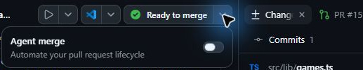
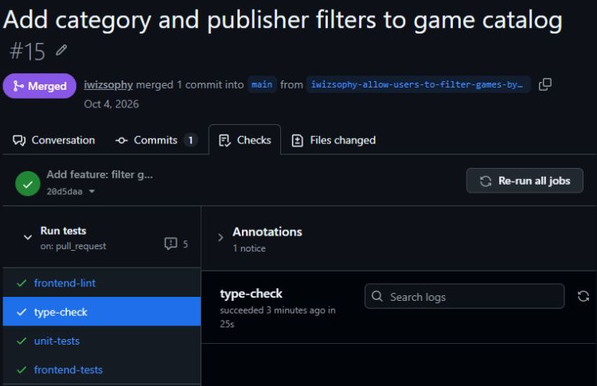
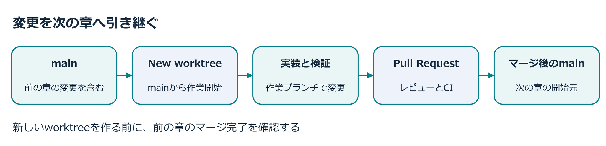

## 7.1 章の概要

変更をmainへ統合するときは、マージの操作と、変更の品質を判断する作業を分けて考えます。Agent Mergeでは対象PRの確認とマージの操作をエージェントへ任せられますが、何を満たしたらマージしてよいかは人の判断が必要です。

GitHubの「マージできる」という表示と、「必要な検証を終えた」という人の判断も別です。対象PRの差分、マージ先、最新コミットのCIを確認し、エージェントへ任せる範囲を決める方法を学びます。自動化するときも、統合を認めた条件とマージの完了を自分で説明できることが、この章の到達点です。

### 7.1.1 この章で学ぶこと

| 項番 | この章で行うこと | 到達した状態 |
| :---: | :--- | :--- |
| 1 | 手動マージとAgent Mergeを比べ、人が判断する作業と任せる操作を整理する | マージ操作の自動化と、品質判断・統合結果確認の責任を区別して説明できる |
| 2 | 対象PRの差分・マージ先・最新コミットのCI全ジョブの成功を確認し、Agent Mergeを有効にする | 差分・マージ先・CIを根拠に、Agent Mergeを開始してよいか判断できる |
| 3 | AppとGitHubで同じPRのMergedとマージ先を照合し、mainへの統合を確認する | Agent Mergeの開始、CI成功、mainへのマージ完了を区別できる |

## 7.2 取り組む前に

GitHub Copilot appで、前章まで使っていたフィルター機能の実装セッションを引き続き使います。フィルター機能の差分レビュー、単体・E2Eテスト、Playwright MCPによる画面検証と後片付けを終えておいてください。未対応の指摘が残っている場合は、エージェントへ修正を依頼し、修正後の検証結果を確認してから進みます。

GitHubで「マージ可能」であることと、この演習で求める「CIの全ジョブ成功」は同じとは限りません。必須チェックに指定されていないジョブが実行中でも、GitHubはマージを許可する場合があります。保護設定の考え方は[GitHub公式の必須ステータスチェックの説明][required-checks]で確認できます。

AppのAgent mergeは、有効にした直後にエージェントが対象PRの処理を始める機能です。マージ可能なPRでは、すぐにMergedへ変わることもあります。Agent mergeを有効にした後に操作許可を見直すことを前提にせず、対象PRの差分とCIを先に確認してください。

## 7.3 ケース

このケースでは、Tailspin Toysのゲーム一覧をカテゴリと出版社で絞り込むフィルター機能のPRを、自分の演習用リポジトリのmainへ統合します。手動でマージしていた工程のうち、今回エージェントへ任せる範囲を確かめましょう。

| 項番 | 観点 | このケースで扱う内容 |
| :---: | :--- | :--- |
| 1 | 状況 | 前章までにフィルター機能の実装と、単体・E2Eテスト、Playwright MCPによるブラウザー操作の検証を終えている。フィルター機能のPRはmainへ統合する前の段階にある。 |
| 2 | 課題と理由 | 後続の作業でもフィルター機能を使えるよう、PRをmainへ統合する必要がある。マージ可能の表示だけでは、必要な検証を終えたとは判断できない。 |
| 3 | 解決策 | フィルター機能のPRは、受講者が差分・マージ先・最新コミットのCI全ジョブ成功を確認してから、Agent Mergeで演習用リポジトリのmainへ統合する。マージの操作を任せても、品質条件の判断と統合結果の確認は受講者が担当する。 |

これまでの手動マージでは、対象PRのCI完了を待ち、マージを自分で実行しました。このケースでもCIの全ジョブ成功までは自分で確認し、以後のPR確認とマージの操作をエージェントへ任せます。本章ではmainへの統合までを扱い、本番環境への公開は含みません。

### 7.3.1 PRを作成し、最新のCI結果を確認する

1. Appで前章まで作業していたフィルター機能の実装セッションを開き、**Changes**で未対応の差分や不要な一時ファイルがないことを確認します。
2. フィルター機能の実装セッションで、通常の**Create PR**からPRを作成します。この時点では**Agent merge**を有効にしません。
3. 作成されたPRを開き、フィルター機能とその検証に必要な差分が含まれ、自分の演習用リポジトリのmainをマージ先にしていることを確認します。
4. GitHubのPR画面で、最新コミットに対するCIの全ジョブが成功するまで待ちます。テスト、lint、型検査などに実行中や失敗が残っていないかを見てください。

CIの完了を待つ前に、GitHubのフィルター機能のPRで実行されるジョブの一覧を見ておきましょう。完了後に同じ一覧を読むと、成功したジョブだけを見て判断していないかを確かめられます。PRに新しいコミットが追加された場合は、古い成功結果を使わず、そのコミットのCIを確認し直してください。

Appでフィルター機能のPRのCI表示が更新されない場合は、App内のPR画面を開き直して確認します。同じPRをGitHubでも開き、最新コミットのCI結果と照合してください。Appの**Ready to merge**だけで、CIの全ジョブ成功とは判断しません。

### 7.3.2 Agent Mergeを開始する

1. フィルター機能のPRの差分レビューと最新コミットのCI全成功を確認したら、Appでフィルター機能の実装セッションを開きます。セッション上部の**Ready to merge**横にあるメニューを開いてください。
2. 対象が今回のフィルター機能のPRであることを確認します。
3. **Agent merge**のスイッチを**Off**から**On**へ切り替えます。Onへの切り替えで、エージェントが対象PRの処理を始めるため、追加の開始ボタンを押す必要はありません。

GitHub公式では、Agent MergeがPRを確認し、マージを妨げる問題へ対応して、GitHubが許可した時点でマージすると説明しています。[公式説明「Merging a pull request」][agent-merge-docs]

### 7.3.3 CIとマージ結果を確認する

1. Appでフィルター機能の実装セッションまたはPR画面を開き、対象PRが**Merged**になったことを確認します。
2. GitHubでもフィルター機能の同じPRを開き、演習用リポジトリのmainへ**Merged**になったことと、最新コミットのCI全ジョブが成功したことを照合します。
3. エージェントがレビュー対応やCI修復のためにコードを変更した場合は、PRの追加差分と変更後の検査結果も確認します。
4. 本章のマージ完了を確認したら、第8章で使う開始元を確かめます。演習用リポジトリのmainにフィルター機能が含まれていることを確認してください。第8章では、そのmainから新しいworktreeを作成します。

画像はフィルター機能のPRをマージした後の表示例です。自分の演習用リポジトリのPR番号を確認し、画像の表示と自分のPRのマージ結果を照合してください。

この図は、第5・6章で実装・検証したフィルター機能を、第7章でmainへ統合し、第8章で使う流れです。作業用worktreeの変更は、別のworktreeへ自動的に引き継がれません。本章でフィルター機能のPRをmainへマージし、AppとGitHubで同じPRのMergedとマージ先を照合します。第8章では、フィルター機能を含むmainから新しいworktreeを作り、変更が含まれていることを確認します。

## 7.4 結果の整理と振り返り

フィルター機能のPRのマージが完了したら、次の3点を自分の言葉で説明してみてください。対象PRのAgent mergeをOnにしたこと、CIが成功したこと、mainへのマージが完了したことを区別できれば、途中で問題が起きた場合にも確認箇所を絞れます。

| 項番 | 振り返る問い | 今回の結果で確かめること |
| :---: | :--- | :--- |
| 1 | 人は何を判断したか | 要件を満たす差分、レビュー結果、マージ先、最新CIの全成功 |
| 2 | エージェントへ何を任せたか | CI確認後のPR確認とマージの操作。追加修正があれば、その内容も区別する |
| 3 | 完了を何で説明できるか | AppとGitHubのMerged、マージ先のmain、成功したCIの一覧 |

今回は、フィルター機能のPRのCI完了を待つ工程を自分で担当しました。エージェントによる追加修正が起きなかった場合は、CI失敗や競合の修復を体験したとは扱わず、実際に任せたPRの確認とマージの操作を振り返ります。Agent Mergeという機能名だけでなく、任せた範囲と確認したマージ結果を説明できることが到達点です。

次は、演習用リポジトリのIssueを同じ画面で比較し、エージェントと作業を計画するキャンバスを使います。[第8章「キャンバスを使った計画」][next-lesson]へ進んでください。

## 7.5 補足

### 7.5.1 手動マージの経験を自動化に生かす

本ワークショップでは、コード生成、自動テスト、MCPによる実ブラウザー操作と、段階的に任せる操作を広げてきました。星評価やコーディング標準を手動でマージしたのは、差分、CI、マージ先を自分で確認するためです。その経験があれば、自動化するときも何を任せたかを説明できます。

今回は第5章でフィルター機能の計画と実装をレビューし、第6章でTailspin Toysの実画面を検証したうえで、演習用リポジトリのmainへのマージをエージェントへ任せました。任せる範囲を広げても、フィルター機能の要件を満たす変更かどうかを判断する責任は人に残ります。

### 7.5.2 任せる範囲と品質確認

Agent Mergeはバックグラウンドで動作し、Appの再起動後も継続して、マージ後に終了します。待機やマージの操作を任せても、テストに含まれていない要件まではCIの成功だけで判断できません。[GitHub公式のAgent Mergeの説明][agent-merge-docs]

たとえば、Tailspin Toysでカテゴリを2つ選んだときに、一方のカテゴリに該当するゲームしか表示されない実装でも、件数を十分に検査していなければテストを通ることがあります。第5章と第6章で確認したフィルターの条件を、Agent Mergeを使うときも品質の基準として使ってください。

Agent Mergeの詳細な操作許可を選べる場合は、次の観点でエージェントへ任せる範囲を確認します。許可した操作と、対象PRでエージェントが実際に行った処理は区別してください。

| 項番 | 任せる操作 | 人が確認すること |
| :---: | :--- | :--- |
| 1 | レビュー指摘への対応 | 指摘の意図を満たし、不要な仕様変更を加えていないか |
| 2 | CI失敗の調査と修正 | 検査を弱めて通していないか。修正後に必要な検査を実行したか |
| 3 | 他の変更との競合解消 | 両方の変更意図を保っているか |
| 4 | 条件を満たしたPRのマージ | 対象PRとマージ先が正しく、レビューと検証を終えているか |

CIの待機も含めてAgent Mergeへ任せたい場合は、対象PRの必須チェックを待つ条件が、自分の権限でのマージにも適用されるかを先に確認します。条件が分からなければ、本章と同じく対象PRのCI全ジョブの成功を待ってから**Agent merge**を**On**にしてください。ブランチ保護や必須チェックの設定を理解すると、チームでどこまで任せるかを判断しやすくなります。[GitHub公式のブランチ保護の説明][required-checks]

### 7.5.3 参考資料

- [GitHub Copilot appでのIssueとpull requestの管理][managing-issues-prs]
- [GitHub Copilot appについて][about-copilot-app]

[開始前にマージ条件を確認する手順へ戻る](#開始前にマージ条件を確認する)

[next-lesson]: 8-canvases.md
[managing-issues-prs]: https://docs.github.com/copilot/how-tos/github-copilot-app/managing-issues-and-pull-requests
[agent-merge-docs]: https://docs.github.com/en/copilot/how-tos/github-copilot-app/managing-issues-and-pull-requests#merging-a-pull-request
[about-copilot-app]: https://docs.github.com/copilot/concepts/agents/github-copilot-app
[required-checks]: https://docs.github.com/en/repositories/configuring-branches-and-merges-in-your-repository/managing-protected-branches/about-protected-branches#require-status-checks-before-merging
