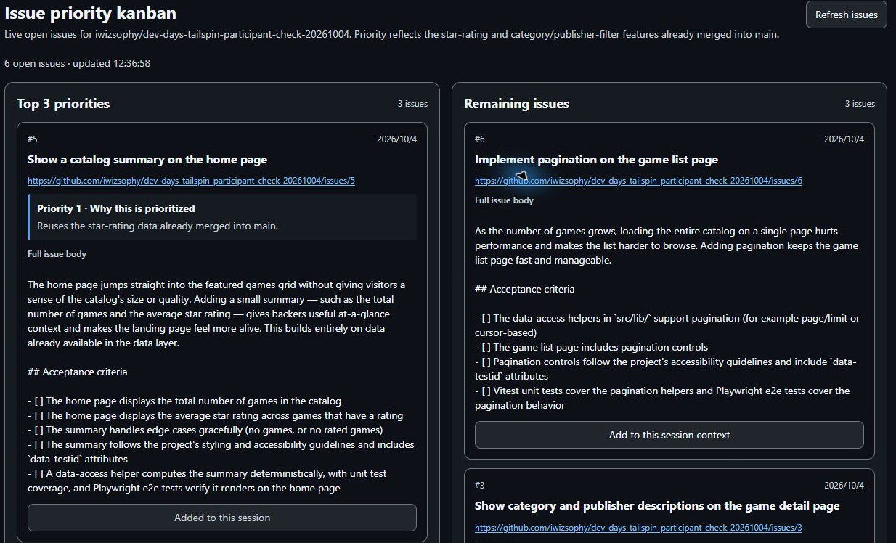
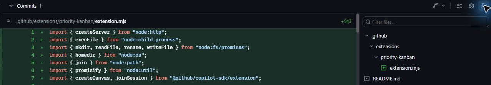
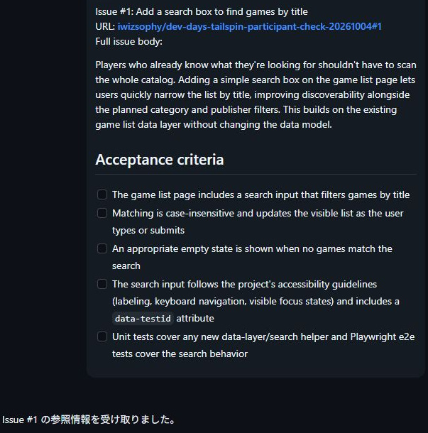
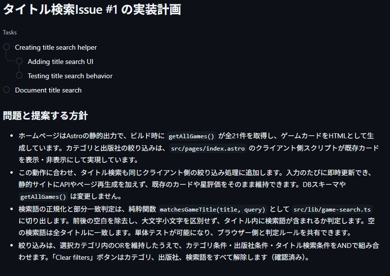
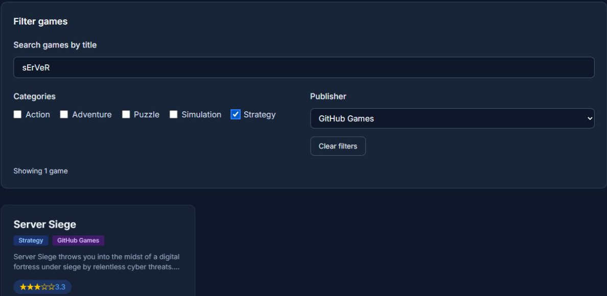
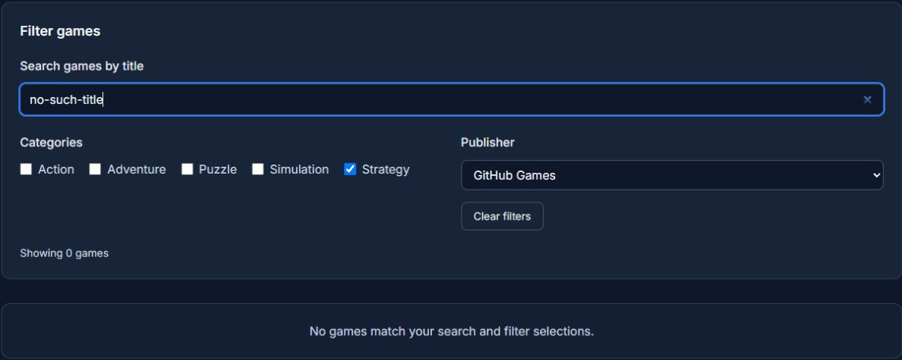
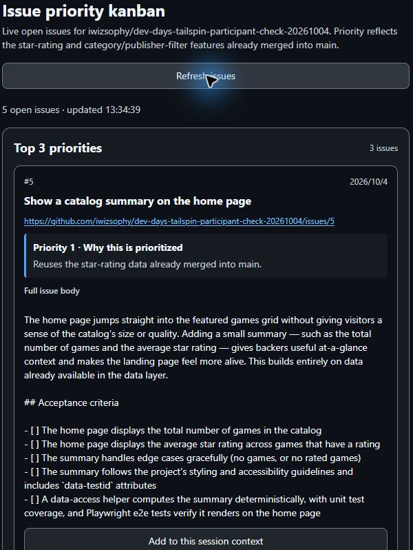

## 8.1 章の概要

星評価、コーディング標準、フィルター機能をmainへ統合しましたが、バックログにはまだ対応すべきIssueが残っています。チャットだけで課題を比べると、一覧や優先理由が会話の中へ埋もれがちです。そこで、課題を並べて比較し、次の作業へ渡せるキャンバスを作成します。

キャンバスは、人とエージェントが同じ成果物を見て操作する領域です。本章ではGitHubのOpen Issueを表示するカンバンボードを作り、チームで再利用できる形でリポジトリへ保存します。別のセッションで開き直し、タイトル検索のIssueを選んで、計画・実装・検証・マージまで進めましょう。

課題の本文をセッションへ渡すことと、実装を始めることは分けて扱います。ボタンを押した後の動作を観察し、意図どおりに作業を区切れているかに注目してください。

## 8.2 この章で学ぶこと

| 学ぶこと | できるようになること |
| :--- | :--- |
| キャンバスとチャットの使い分け | 要件の相談と、課題の一覧・比較・操作を組み合わせられる |
| 共有する成果物の管理 | Canvasをリポジトリへ保存し、別のセッションで再利用できる |
| 作業開始の区切り | Issue本文の受領を確認してから計画を依頼し、承認後に実装へ進める |
| 結果の更新と照合 | 検索の動作を検証し、マージ後のOpen一覧をGitHubと照合できる |

## 8.3 取り組む前に

前章のフィルター機能がmainへマージされていることを確認します。本章では、Canvasを共有するセッションと、検索を実装するセッションを分けます。どちらもNew worktreeとmainを選び、それぞれの開始時点のmainを引き継いでください。

タイトル検索Issueの本文と、ゲームデータのタイトル・カテゴリ・出版社を参照できる状態で取り組みます。検索を追加しても星評価と既存のフィルターを維持することが、今回の要件です。画面の操作例にあるIssue番号や件数は、自分のリポジトリの最新情報と照合しましょう。

Canvasの表示やボタンは、指示に応じて生成されます。表示名が操作例と違っていても、一覧の取得、本文の追加、実装の開始を区別できるかで確認します。

## 8.4 体験すること

<a id="作業を追跡するキャンバスを作成する"></a>

### 8.4.1 作業を追跡するキャンバスを作成する

最初に、現在のOpen Issueから自分ならどの3件を優先するかを考えてみましょう。Canvasが示す優先理由と比較するための予想になります。このセッションではCanvasを完成させ、検索機能の実装は別のセッションで始めます。

1. サイドバーのProjectsで演習用プロジェクトを右クリックし、New sessionを選択します。
2. 入力欄下部で演習用リポジトリ、New worktree、mainが選ばれていることを確認します。作成されたworktreeに、前章のマージ結果が反映されていることも確認してください。
3. 次のプロンプトを入力し、カンバンボードの作成を指示します。

   ```plaintext
   作業の優先順位を整理するカンバンボードのcanvasを作ってください。
   この演習リポジトリのGitHubから最新のOpen Issue一覧を取得し、上位3件と残りを分けて表示してください。Issueを固定配列に埋め込まず、再取得できるRefreshボタンを付けてください。
   上位3件には内容と優先理由を記載し、mainへマージ済みの星評価とフィルター機能を理由に反映してください。文字と背景を読み分けやすくし、キーボードで操作するときのフォーカスも見えるようにしてください。
   すべてのIssueカードに、番号・タイトル・URL・本文全体を現在のセッションのコンテキストへ1回だけ追加するボタンを付けてください。送信内容は「Issue本文を追加しました」という事実と、本文の受領だけを1回返す指示にしてください。受け取ったエージェントは実装や新しいセッションの作成を始めない仕様にしてください。
   同じセッションへの重複送信を防ぎ、Refreshしても送信済み状態を保ってください。別のセッションでは独立して本文を追加できるようにしてください。
   今回はCanvasの作成と確認までです。カードのIssueの実装やPR作成はまだ行わないでください。
   ```

作成したキャンバスの表示先は右パネルです。作成の入口が分からない場合は、セッション内で`/create-canvas`に続けて必要な操作を伝える方法もあります。[GitHub公式の作成手順][creating-canvas]



古いIssue一覧を固定表示すると、完了済みの作業をもう一度選ぶおそれがあります。本演習ではRefreshで最新一覧を取得します。Canvasの一覧が常時自動同期されると考えず、どの操作で最新情報を取得するかを確かめてください。

<a id="作成したボードをレビューする"></a>

### 8.4.2 作成したボードをレビューする

1. GitHubのOpen Issueと、Canvasの番号・タイトル・本文を照合します。Refreshが固定配列を再描画するだけになっていないか、一覧を取得する処理も確認してください。
2. 上位3件と優先理由を、自分の予想と比べます。星評価とフィルター機能をこれから作る前提にしている場合は、mainの状態を確認させ、理由を修正します。
3. 文字が背景に埋もれず、操作するボタンを見分けられるかを確認します。Tabで移動したときに、どこを選んでいるかも見てください。
4. 本文追加ボタンを1回押し、Issue本文全体が会話へ1回追加され、エージェントが受領だけを1回返すことを確認します。同じカードの再クリックやRefreshで、通知が増えないことも確かめます。

本文追加は、次の計画へ要件を渡す操作です。実装を始める操作として生成されていた場合はStopで止め、途中の変更を保全してからボタンの送信内容を修正します。1回目の生成で不足があっても、観察した結果を具体的に伝え、修正後に同じ条件で確かめてください。

<a id="キャンバスを保存してリポジトリにマージする"></a>

### 8.4.3 キャンバスを共有保存してマージする

Canvasの保存と検索機能の実装を別のPRにすると、ボードの動作を先にレビューできます。新しいworktreeで同じCanvasを開けることを確認してから、カードにあるIssueへ進みましょう。元のセッションにしかない一時ファイルへ依存していないかも確かめられます。

1. 同じセッションで、次のプロンプトを入力します。

   ```plaintext
   開発チームと共有できるよう、このcanvasをプロジェクト共有スコープの
   .github/extensions/priority-kanban/extension.mjsに保存し、READMEへ別セッションで開く手順を追加してください。必要な補助ファイルも保存してください。
   最新のOpen Issue取得、Refresh、全カードの本文追加ボタン、1回の本文送信と1回の受領応答、重複送信防止を確認してください。ボタンの確認でIssueの実装を始めないでください。
   保存前にこのセッションで追加済みのIssueも、保存後に重複送信しないようにしてください。別のセッションの追加済み状態とは分けて管理してください。
   差分はCanvasと再利用手順の範囲にしてください。PRはレビュー後に作成します。
   ```

2. Changesで、Canvasが`.github/extensions/priority-kanban/extension.mjs`へ保存され、READMEに再利用手順があることを確認します。
3. 保存前に本文を追加したカードが送信済みのままであることと、Refresh後も通知が増えないことを確認します。未送信のカードを使う場合も、本文1回・受領1回で止まり、実装を始めないことを確かめてください。
4. 差分がCanvasと再利用手順の範囲に収まっていることをレビューします。関連する検査も依頼し、結果を確認します。
5. 通常のCreate PRで作成し、最新コミットのCI全ジョブ成功を待ちます。その後、[レッスン7の開始操作](7-agent-merge.md#agent-mergeを開始する)と同じくAgent mergeをOnにします。
6. AppとGitHubの同じPRがMergedになったことを確認します。



公式では`.github/extensions`をチームで共有するプロジェクトスコープ、`~/.copilot/extensions`を個人用スコープとして説明しています。`priority-kanban`は本演習の拡張名です。個人用の場所や一時領域にしかない場合は、共有保存を依頼してください。[GitHub公式の保存先とファイル構成][canvas-structure]

<a id="別のセッションでキャンバスを開く"></a>

### 8.4.4 別のセッションでキャンバスを開く

1. ProjectsからNew sessionを作り、New worktreeとmainを指定します。共有Canvasのマージを含むmainを継承していることを確認してください。
2. 新しい拡張の承認画面が出た場合は、Repository trustのReview repository contentから内容を確認します。前節でレビューした保存先とファイルであることを確かめてから、Accept for new sessionsで承認します。
3. 次のプロンプトで保存したCanvasを開きます。

   ```plaintext
   リポジトリに保存したIssueの優先順位を整理するcanvasを開いてください。
   まだIssueの実装は始めず、最新のOpen Issueを表示してください。
   ```

4. 右パネルにCanvasが表示され、最新のOpen Issueを取得していることを確認します。前のセッションで追加したカードでも、新しいセッションには本文を追加できることを確かめます。
5. タイトル検索Issueのカードで、本文を現在のセッションへ追加するボタンを1回押します。Add to current sessionなど、ボタン名は生成した実装によって異なります。
6. Issueの番号・タイトル・URL・本文全体が会話へ1回送られ、受領だけが返ることを確認します。まだ検索の実装は始めません。



前のセッションで作ったものを開けただけでは、再利用の確認は完了しません。最新データの取得と、そのセッションへの本文追加まで試すことで、見た目と操作の両方を再利用できるかが分かります。

<a id="検索の計画を確認して実装する"></a>

### 8.4.5 検索の計画を確認して実装する

1. 本文の受領を確認したら、入力欄下部のモードをPlanに切り替え、次のプロンプトを送信します。モードの選択と計画承認の操作は、レッスン5で使ったものと同じです。

   ```plaintext
   Canvasから追加したタイトル検索Issueの実装計画を作成してください。
   既存のデータ取得とフィルター処理を確認し、検索をどの層に追加するかとその理由を説明してください。星評価を維持し、検索条件と既存のカテゴリ・出版社フィルターをANDで組み合わせてください。
   大文字小文字、前後の空白、部分一致、検索結果0件、キーボードでの入力と解除をどう確認するか、実データから期待するタイトルと件数を示してください。
   計画の承認前には実装を始めず、承認後も差分レビューとMCP検証を終えるまではPRを作成・マージしないでください。
   ```

2. 質問が出た場合は、既存フィルターとの関係を考えて回答します。Clear filtersで検索語も解除するかという質問なら、検索・カテゴリ・出版社を一緒に解除する方針を選びます。
3. Review planで、検索を追加する場所と理由、星評価の維持、AND条件、入力の扱い、テストの期待値を確認します。足りない点は修正を依頼してください。
4. 計画を確認できたらApprove and implement this planを選択します。この選択で承認が送られます。承認後はAutopilotによる実装を確認します。



画像は計画を読むための例です。承認の操作は、計画を読んだ後にReview planで行います。ボタンを押す前に、どのタイトルが残るかを実データから予想しておきましょう。

<a id="検索を検証してマージする"></a>

### 8.4.6 検索を検証し、ボードの結果を更新する

1. 実装完了後、Changesで差分をレビューし、単体・E2Eテストなどの検査とPlaywright MCPによるブラウザー検証を依頼します。次の表から期待するタイトルと件数を決め、実際の表示と比べてください。

| 操作・条件 | 期待する結果の決め方 | 確認する理由 |
| :--- | :--- | :--- |
| 条件を指定せず一覧を開く | 検索前のタイトルと総件数を確認する | 比較の基準を決める |
| `sErVeR`を入力する | `server`を含むタイトルを探す。Server SiegeとVirtual Server Simulatorがあれば両方を対象にする | 大文字小文字を区別せず、部分一致できるか |
| `" sErVeR "`を入力する | 前後の空白を除いた`sErVeR`と同じタイトルを期待する | 計画どおりに入力を整えているか |
| 検索にStrategyとGitHub Gamesを併用する | 検索結果のうちカテゴリ・出版社の両方に合うタイトルだけを残す | 検索と既存フィルターをANDで適用できるか |
| どのタイトルにも含まれない検索語を入力する | 0件と空状態の説明を表示する | 結果が空でも利用者へ状態が伝わるか |
| PublisherからTabでClear filtersへ移動しEnterを押す | 検索・カテゴリ・出版社が解除され、検索前の一覧に戻る | キーボードで元の状態へ戻れるか |

検索結果の星評価と詳細リンクも確認します。件数だけでなくタイトルを比較すると、実装の不具合と、テストの期待値の誤りを切り分けやすくなります。画像のゲームデータが自分のコピーと異なる場合は、自分の実データから期待値を決めてください。





2. 報告された条件が実際のMCPの履歴にあるか、ツールの入力と結果を確認します。未実施の条件があれば追加の検証を依頼し、結果を確かめてください。
3. MCP検証の終了後はブラウザーと開発サーバーを停止し、検証用の一時出力を片付けます。Changesでもう一度、差分に関係のないファイルが入っていないかを確認します。
4. 問題がなければ通常のCreate PRで作成し、最新コミットのCI全ジョブ成功を待ってからAgent mergeをOnにします。AppとGitHubのMerged、検索IssueのClosedを確認してください。
5. CanvasのRefreshまたは一覧を更新を押します。その時点のGitHubのOpen一覧と照合し、Closedになった検索Issueがボードから除外されることを確かめます。



マージ通知が届いても、Canvasの一覧が再取得されたとは限りません。更新前後を比較すると、「GitHubで作業が完了したこと」と「表示を最新にしたこと」が別の操作だと分かります。件数だけを正解とせず、完了したIssueが除外されたかを確認してください。

<a id="作業の区切りと結果の振り返り"></a>

## 8.5 結果の整理と振り返り

この章では、課題の比較、共有保存、別セッションでの再利用、検索の計画・実装・検証、完了後の一覧更新を体験しました。次の問いを、自分の操作と結果を使って説明してみてください。

| 振り返る問い | 結果から考えること |
| :--- | :--- |
| 自分とCanvasの優先順位は同じだったか | mainにある機能とIssueの内容をどう優先理由へ反映したか |
| なぜ本文追加と実装開始を分けたか | 要件を読む時間と、計画を承認する判断を確保できたか |
| なぜCanvasだけを先に共有したか | 元のセッションへ依存せず、別のworktreeで同じ操作ができたか |
| 検索の予想と実際の結果は一致したか | 入力の扱い、AND条件、星評価、キーボード操作を検証できたか |
| なぜマージ後にRefreshしたか | GitHubの完了状態とCanvasの取得時点を区別できたか |

チームで使うCanvasを考えるときも、「誰がどの操作で何を変えるか」から必要な機能を決められます。次の[レッスン9「振り返りと次のステップ」][next-lesson]では、繰り返す調査をAutomationへ保存し、ワークショップ全体で学んだ機能の使い分けを振り返ります。

<a id="補足"></a>

## 8.6 補足

<a id="キャンバスとチャットの使い分け"></a>

### 8.6.1 キャンバスとチャットの使い分け

実際の開発で共有する成果物は、カンバンボード、設計ドキュメント、リリースチェックリストなどです。チャットは意図や曖昧な要件の相談に使い、Canvasでは構造のある成果物を同じ画面で確認・操作できます。

人は画面のボタンやカードを操作し、エージェントは生成された機能を呼び出して内容を更新できます。最初の画面を作った後も、対話で操作やレイアウトの変更を依頼できます。ただし、使える操作は生成した拡張によって異なります。本演習では一覧更新と本文追加を作りました。カードの移動やGitHubのIssue更新も、必要なら別に仕様を伝えて実装・検証します。[GitHub公式のCanvasの説明][canvas-about]

| 活用例 | 同じ画面で扱うもの |
| :--- | :--- |
| Markdown canvas | 開発計画、IssueやPRの優先順位 |
| カンバンボード | カードと作業フェーズ |
| Issueの分類用ボード | 重要なIssue、繰り返し現れる課題、優先理由 |

<a id="キャンバスをチームで共有する価値"></a>

### 8.6.2 キャンバスをチームで共有する価値

会話で「次に何をするか」を相談した後、ボードに上位3件と優先理由が残っていれば、選ばれなかったIssueとも比較できます。別のセッションでも同じ表示と操作を使えると、チームは同じ手順で判断をやり直せます。

共有する価値は見た目だけではありません。参照するデータ、優先する理由、作業を開始するタイミングもそろえられます。会話ログを読み直すだけでは分かりにくい進捗を、成果物の変化として確認できることも利点です。

<a id="既存の構成に合わせた検索の設計"></a>

### 8.6.3 既存の構成に合わせた検索の設計

検索をどこに実装するかは、既存の構成を読んで決めます。ブラウザー内に検索対象のデータがそろっているなら、`trim`、`toLowerCase`、`includes`などで入力を整え、文字列の部分一致で比較する方法が考えられます。サーバー側の取得やページ分割がある構成では、検索対象の範囲を決めることが先です。

SQL検索を使う場合は、`%`や`_`を通常の文字として扱うか、ワイルドカードとして扱うかも仕様に含めます。ブラウザー内の文字列比較なら、その処理に対応する観点を選びます。実装方法を読まずにテストだけを追加せず、入力をどこで整え、何を一致と判断するかを計画と照合してください。

### 8.6.4 生成結果を修正するときの観点

Canvasの生成には数分かかり、最初の結果が求めた操作性を満たさないこともあります。見づらい画面なら、読めない文字や選択箇所を示して修正を依頼します。古い一覧なら、取得元と更新処理を確認してください。

同じIssueの通知が繰り返される場合は、Stopで止めて途中の変更を保全します。「このIssueを追加してください」という命令を繰り返す通知になっていないかを確認し、追加済みの事実と受領だけを求める内容へ修正します。送信中・送信済みの状態を同一セッションで管理し、保存後やRefresh後も重複を防げるかを検査してください。

修正後は1クリックで本文1回・受領1回になり、再クリックやRefreshで増えないことを確認します。別セッションでは独立して本文を追加できることも試します。問題の説明と同じ条件で確かめ、修正が意図を満たしたかを判断してください。

<a id="リソース"></a>

### 8.6.5 参考資料

- [GitHub Copilot appでのCanvas extensionの操作][canvas-docs]
- [Awesome CopilotのCanvases][awesome-copilot-canvases]
- [GitHub Copilot appについて][about-copilot-app]

[作業を追跡するキャンバスを作成する手順へ戻る](#作業を追跡するキャンバスを作成する)

[next-lesson]: 9-review.md
[canvas-docs]: https://docs.github.com/copilot/how-tos/github-copilot-app/working-with-canvas-extensions
[creating-canvas]: https://docs.github.com/en/copilot/how-tos/github-copilot-app/working-with-canvas-extensions#creating-a-canvas
[canvas-structure]: https://docs.github.com/en/copilot/how-tos/github-copilot-app/working-with-canvas-extensions#how-canvas-extensions-are-structured
[canvas-about]: https://docs.github.com/en/copilot/how-tos/github-copilot-app/working-with-canvas-extensions#about-canvas-extensions
[awesome-copilot-canvases]: https://awesome-copilot.github.com/extensions/
[about-copilot-app]: https://docs.github.com/copilot/concepts/agents/github-copilot-app
