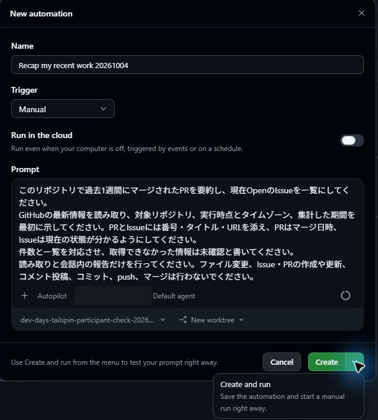
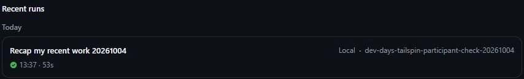
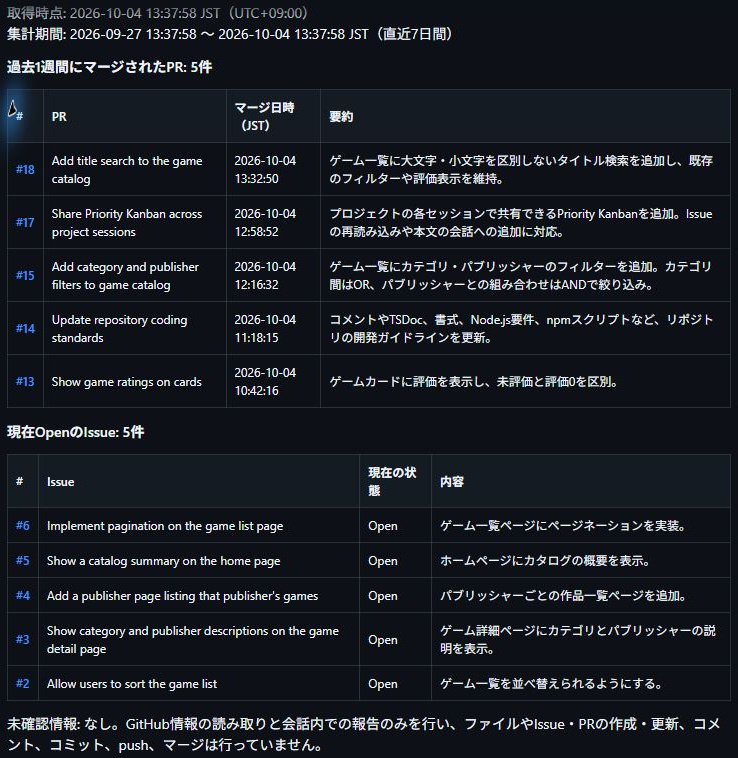

## 9.1 章の概要

最後に、同じ調査を繰り返すAutomationを体験し、ワークショップ全体で使った機能を振り返ります。毎回チャットへ指示を書き直すと、対象期間や数える状態が少しずつ変わることがあります。条件を保存し、同じ方法で調べられるようにしましょう。

この章では、最近マージしたPRと現在OpenのIssueを読み取り、会話内に報告するAutomationを作成します。Manual・Localで1回実行し、GitHubの実データと照合します。成功の表示だけで報告を正しいと判断せず、期間・一覧・件数を読むことに注目してください。

## 9.2 この章で学ぶこと

| 学ぶこと | できるようになること |
| :--- | :--- |
| 調査条件の保存 | 対象リポジトリ、期間、状態、報告の根拠をそろえて繰り返せる |
| Automationの実行と照合 | 手動でLocal実行し、終了状態と報告内容を別々に確かめられる |
| 機能の使い分け | Instructions、Skills、MCP、Canvas、Agent Merge、Automationを作業に合わせて選べる |
| 日々の開発への応用 | 小さな課題の完了条件と、人が行う判断を決めて試せる |

## 9.3 取り組む前に

前章の検索機能をマージし、検索IssueのClosedとCanvasの最新Open一覧を確認しておきます。Automationの対象には、同じ演習用リポジトリを指定します。GitHubのPRとIssueをブラウザーでも確認できる状態にしてください。

今回は読み取りと会話内の報告だけを行います。ファイルやIssueを変更する自動化へ進む前に、何を調べ、どの結果を得るかを1回の実行で確かめるためです。Manualは実行タイミング、Localは実行場所を表す別々の設定として読みます。

## 9.4 体験すること

<a id="読み取り専用のautomationを設定する"></a>

### 9.4.1 読み取り専用のAutomationを設定する

GitHub Copilot appのAutomationsでは、繰り返す作業の指示を保存し、手動または設定したトリガーで実行できます。新しいIssueの調査や、PRのレビュー状況確認などが公式の用途例です。本演習では、過去1週間の開発状況を調べる作業を保存します。[GitHub公式のAutomationsの説明](https://docs.github.com/en/copilot/how-tos/github-copilot-app/using-automations#about-automations)

定期実行へ進む前に、1回の調査で何を読み、どのような報告が得られるかを確かめます。結果を自分で読めるタイミングで実行するため、Manualを選択します。

1. サイドバーで **Automations** を選択し、画面内の **New automation** をクリックします。
2. 名前欄に `Recap my recent work` などの分かりやすい名称を入力します。
3. **Trigger**で **Manual** を選択し、**Run in the cloud**はオフにします。Dailyなど別の値が選ばれている場合はManualに変更してください。公式には時刻やIssue・PRのイベントを使うトリガーもありますが、本演習では手動実行の結果を確認します。[公式の設定手順](https://docs.github.com/en/copilot/how-tos/github-copilot-app/using-automations#creating-an-automation)
4. リポジトリに変更を加えないよう、次のような読み取り専用のプロンプトを入力します。

   ```plaintext
   このリポジトリで過去1週間にマージされたPRを要約し、現在OpenのIssueを一覧にしてください。
   GitHubの最新情報を読み取り、対象リポジトリ、実行時点とタイムゾーン、集計した期間を最初に示してください。PRとIssueには番号・タイトル・URLを添え、PRはマージ日時、Issueは現在の状態が分かるようにしてください。
   件数と一覧を対応させ、取得できなかった情報は未確認と書いてください。
   読み取りと会話内の報告だけを行ってください。ファイル変更、Issue・PRの作成や更新、コメント投稿、コミット、push、マージは行わないでください。
   ```

5. **Select project** で自身の演習用Tailspin Toysリポジトリを選択します。GitHub連携とローカルフォルダーの両方が登録されている場合は、`owner/repository`表記で対象を確認してください。



<a id="automationを実行して結果を確認する"></a>

### 9.4.2 Automationを実行して結果を確認する

1. **Create** ボタン横のメニューを展開し、**Create and run** を選択して保存と同時に即時実行します。保存のみを行う場合はCreateを選び、後から一覧の実行ボタンでも開始できます。
2. **Recent runs**で今回の実行を開き、実行場所がLocal、ステータスが **Succeeded** になったことを確認します。報告内容の照合は、次の小節で行います。

Succeededは処理の終了状態です。調査対象を取り違えたり、マージ日時の範囲を誤ったりしても、文章を出力する処理自体は完了する場合があります。PRは「その期間にマージされたもの」を数えているか、Issueは「現在Openのもの」を取得しているかをそれぞれ確認してください。URLから個別の項目を開くと、件数が同じでも対象が違う場合に気づけます。



画像は今回の実行行を読むための例です。自分が作成したAutomationの名前、対象リポジトリ、実行場所、成功状態を確認してください。

### 9.4.3 報告をGitHubの情報と照合する

レポートを読む前に、GitHubで期間内のマージ済みPRと現在のOpen Issueを確認し、何が含まれるかを予想してみましょう。次の観点で出力と照合します。

| 照合する情報 | 確認すること |
| :--- | :--- |
| 対象と取得時点 | 自分の演習用リポジトリで、実行時点とタイムゾーンが示されているか |
| PRの対象期間 | 開始・終了日時が分かり、その期間にマージされたPRを数えているか |
| Open Issue | 現在OpenのIssueが並び、前章でClosedになった検索Issueが除外されているか |
| 件数と項目 | 件数と一覧が対応し、番号・タイトル・URL・日時・状態がGitHubと一致するか |
| 調査の範囲 | 取得できなかった情報を未確認とし、不要な変更や投稿をしていないか |



集計結果は、実行時点と演習の進み具合によって変わります。第8章でマージした検索PRが期間内なら要約に含まれ、そのIssueがClosedならOpen一覧の対象外です。実行日が変われば「過去1週間」の範囲も変わるため、画像の件数を正解とせず、自分の結果に書かれた期間と実行時点を基準に確認してください。

一致しない項目があれば、対象と期間を確かめて指示を修正し、もう一度Manualで実行します。処理の成功と報告の正しさを別々に確認できたところで、今回のAutomationは完了です。


## 9.5 結果の整理と振り返り

保存した条件どおりに情報を取得でき、GitHubとの照合で一致を説明できたでしょうか。実行の成功と、調査の正しさを分けて確認した経験を、これまでのCIやMCPの検証とも比べてみてください。

<a id="ワークショップで実践した開発の流れ"></a>

### 9.5.1 ワークショップで実践した開発の流れ

本ワークショップの全レッスンを通じて、GitHub Copilot appを活用した機能の企画立案から実装・検証・マージに至るエンドツーエンドの開発フローを実践してきました。これまで習得した主な内容は次の通りです。

| 作業の段階 | 実践したこと |
| :--- | :--- |
| 準備 | リポジトリを接続し、worktreeの構造と用意されたIssueを把握した |
| 計画と実装 | プロンプトやIssueからセッションを開始し、PlanとAutopilotで作業の進め方を制御した |
| 規約と検査手順 | カスタム指示と再利用可能なスキルで規約と手順を共有し、生成物と実行結果を確認した |
| 画面の検証 | Playwright MCPの実行を確認し、実ブラウザーでUIの動作を検証した |
| 課題の比較と共有 | Canvasで課題を比較し、別セッションで同じ表示と操作を再利用した |
| mainへの統合 | 手動マージとAgent Mergeを使い、品質を確認して変更を統合した |

<a id="作業に合わせた機能とモードの使い分け"></a>

### 9.5.2 作業に合わせた機能とモードの使い分け

本ワークショップでは、エージェントへ要件を渡す方法、進め方を決める方法、結果を検証する方法を段階的に学びました。指示ファイル、スキル、MCP、Canvas、Automationは、それぞれ違う課題に使います。今回の作業で足りない情報や確認手段を考え、必要な機能を組み合わせて選んでください。

| 機能 | どのような場面で使うか | 人が確認すること |
| :--- | :--- | :--- |
| Instructions | リポジトリ共通の規約を伝える | Issueが求めるコメントと、生成されたコード例が一致するか |
| Skills | 繰り返す検査手順をまとめて使う | 必要な検査が実際に実行され、結果が成功したか |
| MCP | エージェントから外部ツールを操作する | 接続表示に加え、実ブラウザーで目的の操作ができたか |
| Canvas | 課題や成果物を同じ画面で比較・操作する | 最新一覧か、本文追加が実装を勝手に始めないか、別セッションでも使えるか |
| Agent Merge | レビュー後のPR監視とマージを任せる | 許可した操作、CI全ジョブの成功、AppとGitHubのMerged |
| Automations | 保存した調査条件で作業を繰り返す | 実行終了に加え、期間・一覧・件数がGitHubと一致するか |

指示ファイルやスキルを保存すると、次のセッションへチームの進め方を渡せます。ただし、書いた指示が期待どおりに適用されたかは、生成物と実行結果で確認します。公式の[カスタマイズの説明](https://docs.github.com/en/copilot/how-tos/github-copilot-app/customize-github-copilot-app)も、指示、スキル、MCPを個別に説明した資料です。規約を伝えたいのか、手順を再利用したいのか、外部の情報や操作が必要なのかを先に整理すると選びやすくなります。

セッションのモードも、作業の段階に合わせて使います。Planでは、実装前に条件や影響範囲を読み、質問へ回答して計画を承認します。Interactiveでは、差分を見ながら修正の意図を細かく伝えられます。Autopilotへ進むときは、要件と検証方法に加えて、「ここまで進めたら止める」という範囲も示してください。たとえば第5章の実装を依頼するときは、第6章のMCP検証を終えるまでPRを作らないと指定します。工程の区切りを伝えることで、人が実画面を確認する時間を確保できます。[公式のモード説明](https://docs.github.com/en/copilot/how-tos/github-copilot-app/agent-sessions#choosing-a-session-mode)

次に別の機能を作るときは、「何を作るか」「なぜ必要か」「既存の何を維持するか」「どの結果なら完了か」を伝えてみてください。検索機能なら、検索対象はタイトルで、カテゴリ・出版社の条件とANDにし、既存の星評価を残すという要件がそれに当たります。期待する件数を実データから決め、テストと実画面の両方で確認する方法も再利用できます。

<a id="日々の開発への取り入れ方"></a>

### 9.5.3 日々の開発への取り入れ方

日々の開発業務や個人プロジェクトで使い続けると、AIエージェントへ伝える要件や、確認が必要な場面を学べます。保守、趣味のプログラミング、新しいアイデアのプロトタイプなどに活用し、知見をチームの指示ファイルやスキルへ反映してください。

最初の実践では、小さな課題を1つ選び、完了条件と検証方法を言葉にしてから着手してください。作業後には、最初の指示で伝わったこと、レビューで補ったこと、次回も使える指示や確認手順を振り返ります。自動化できた操作だけでなく、どの判断を人が行ったかも残すと、次に任せる範囲を決めやすくなります。

同じ調査を繰り返すならAutomation、チームで課題を比較するならCanvas、実ブラウザーで再現する必要があるならMCPが候補です。今回もっとも手戻りした場面を1つ選び、その原因に合う機能と確認方法を説明できれば、自分の作業にも応用できます。

GitHub Copilotエコシステムの全容をさらに深く学ぶには、以下の関連教材も合わせて参照してください。

- [VS Codeハーネス](https://github-samples.github.io/copilot-workshops/vscode/)
- [Copilot CLIハーネス](../cli/README.md)（本教材の参考コース）
- [Cloud agentハーネス](https://github-samples.github.io/copilot-workshops/cloud/)

[Automationを実行して結果を確認する手順へ戻る](#automationを実行して結果を確認する)

<a id="補足"></a>

## 9.6 補足

<a id="同じ調査条件で作業を繰り返す理由"></a>

### 9.6.1 同じ調査条件で作業を繰り返す理由

毎回チャットへ指示を書き直すと、ある日はマージ済みPR、別の日は作成したPRを数えるなど、調査の条件が変わりがちです。Automationに対象リポジトリ、期間、対象の状態、報告する証拠を保存すれば、同じ範囲を繰り返し調べられます。結果を比較するときにも、作業が進んだから件数が変わったのか、集計条件を変えたのかを見分けやすくなります。

### 9.6.2 件数や項目が一致しないとき

件数が一致しない場合は、リポジトリ名、集計開始・終了日時、マージ済みとClosedの区別、一覧取得の漏れを確認してください。権限不足や取得失敗がある場合は、0件と断定せず未確認として報告されているかも読みます。プロンプトを修正したら再びManualで実行し、同じ確認をしてください。

照合中に別のPRがマージされたり、Issueの状態が変わったりした場合は、その変更時刻も見ます。日時、番号、URLを出力に含めるのは、件数の違いを調査条件の誤りと判断する前に、どの情報をいつ取得したかを追えるようにするためです。

<a id="定期実行とcloud実行への発展"></a>

### 9.6.3 定期実行とCloud実行への発展

> [!TIP]
> 公式ではCloud実行も案内されており、端末の電源が入っていない間にも実行できます。利用にはリポジトリや組織の設定などの前提があり、Toolsで作業に必要な操作を選びます。定期実行とCloud実行は発展課題です。試す場合は、[公式の前提条件と設定方法](https://docs.github.com/en/copilot/how-tos/github-copilot-app/using-automations#prerequisites-for-using-cloud-automations)を確認し、Manualで検証した調査範囲と結果の確認方法を引き継いでください。

<a id="さらに確認する価値のある機能"></a>

### 9.6.4 さらに確認する価値のある機能

本教材で扱った流れを自分の仕事に適用するときは、次の機能も検討できます。以下は公式情報に基づく紹介で、本演習の完了条件には含めません。

- [**Chats**](https://docs.github.com/en/copilot/how-tos/github-copilot-app/agent-sessions#using-chats)：専用ブランチやworktreeを作る前に、疑問や要件を整理する会話。実装セッションに渡す前提を明確にするときに使えます。
- [**Rubber duck**](https://docs.github.com/en/copilot/how-tos/github-copilot-app/agent-sessions#using-the-rubber-duck-agent)：現在の計画、実装、テストへ具体的な批評を求める機能。指摘を受けた後は、要件と実データに照らして修正するかを判断します。
- [**Custom agents**][custom-agents]：特定の専門役割、専用ツール、個別指示をパッケージ化し、繰り返し呼び出せるカスタムエージェント
- [`/chronicle`][chronicle]：セッション履歴から最近の作業を振り返るためのコマンド。本章のAutomationはGitHubのPRとIssueを調べましたが、こちらはセッションでの作業履歴を調べる入口です。
- [**Cloud sandboxes**][sandboxes]：GitHubがホストする分離されたLinux環境でセッションを実行する機能。ローカルの開発環境から実行場所を変えたい場合に、利用条件と必要なツールを確認して検討します。
- [**Deep links**][deep-links]：特定のリポジトリ、セッション、初期プロンプトを指定したURLリンクからアプリを直接起動する機能

<a id="リソース"></a>

### 9.6.5 リソース

- [GitHub Copilot appについて][about-copilot-app]
- [GitHub Copilot appの概要][getting-started]
- [GitHub Copilot appのカスタマイズ][customize]
- [Automationsの使用][using-automations]
- [Canvas extensionsの操作][canvas-docs]
- [クラウドサンドボックスとローカルサンドボックスについて][sandboxes]

[about-copilot-app]: https://docs.github.com/copilot/concepts/agents/github-copilot-app
[getting-started]: https://docs.github.com/copilot/how-tos/github-copilot-app/getting-started
[customize]: https://docs.github.com/copilot/how-tos/github-copilot-app/customize-github-copilot-app
[using-automations]: https://docs.github.com/copilot/how-tos/github-copilot-app/using-automations
[canvas-docs]: https://docs.github.com/copilot/how-tos/github-copilot-app/working-with-canvas-extensions
[sandboxes]: https://docs.github.com/en/copilot/concepts/security-governance-and-network-settings/about-cloud-and-local-sandboxes
[chronicle]: https://docs.github.com/en/copilot/how-tos/github-copilot-app/agent-sessions#using-chronicle-with-app-sessions
[custom-agents]: https://docs.github.com/copilot/concepts/agents/cloud-agent/about-custom-agents
[deep-links]: https://docs.github.com/copilot/how-tos/github-copilot-app/open-with-deep-links
