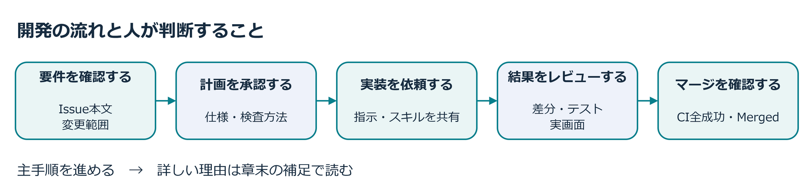

## この教材セットの進め方

本教材は、GitHub Copilot App を使った開発フローと操作体験を一連の流れで学ぶ本編コース です。演習 1〜9 を順番に進めます。

単にコードを完成させることだけが目的ではありません。次のAppの機能を、実際に手を動かして体験・確認します。

| Appの機能 | 体験すること |
| :--- | :--- |
| エージェントセッション | セッションを立ち上げ、作業を管理する |
| 差分レビュー | 生成されたコードと要件を照合する |
| MCP（Model Context Protocol） | 外部ツールとの連携を確かめる |
| Agent Merge | Pull Requestの自動マージを進める |
| キャンバス | 設計やタスクを整理する |
| Automation | 定型作業を自動化する |

### この演習で身につける判断

題材となるTailspin Toysは、ゲームを紹介するクラウドファンディングサイトです。利用者が支援したいゲームを探せるように、カードの星評価、カテゴリーとパブリッシャーによる絞り込み、タイトル検索を順に追加します。前の章で作った機能を残したまま次の変更を加えるため、既存の振る舞いを確かめることも各章の課題になります。

この順番には学習上の理由があります。最初は小さな星評価の変更を通じて、要件を伝え、差分を読み、テストと画面を確認してからマージする一連の判断を経験します。その後、指示ファイルで共通の前提を共有し、Planで仕様の曖昧さを解消してから、自律的な実装へ進みます。人が確認する観点を理解したうえで、Agent MergeやAutomationに任せる範囲を広げます。

各章では「何ができたか」に加えて、「なぜその方法を選んだか」を説明できることを目指してください。

| 学ぶ判断 | 演習で確かめること |
| :--- | :--- |
| 依頼する範囲を決める | Issueの要件、変更してよい範囲、作業を止める位置を伝える |
| 必要な前提を共有する | 会話だけでなく、指示ファイル・スキル・Issue本文を使い分ける |
| 結果を根拠で評価する | 応答の「完了」と、差分・テスト・実際の画面・CIの結果を照合する |
| 自動化の範囲を決める | 人が承認する仕様と、エージェントに任せる繰り返し作業を区別する |

本文のプロンプトは、これらの判断を練習するための出発点です。出力されるコードやテスト件数は毎回同じとは限りません。期待した結果と違う場合は、違いを具体的に伝えて修正を依頼し、再度確認してください。公式にも、変更をレビューし、フィードバックを返して改善する流れが示されています。出典：[GitHub Copilot Appの開発フロー](https://docs.github.com/en/copilot/concepts/agents/github-copilot-app#github-copilot-app-workflow)。

### 画面画像と操作手順の注意点

GitHub Copilot Appは最新版を使用してください。

- 掲載画像について：画像は操作位置の参考です。画面が異なる場合は、本文の操作対象と項目名を確認してください。画像内の所有者名、リポジトリ名、Issue番号は入力例です。自分の演習コピーと本文の課題名を照合してください。
- UI が異なる場合：操作ボタンが見当たらない場合は、本文の操作対象と項目名を確認し、講師に相談してください。
- リポジトリの分離：演習は教材用テンプレートの Use this template から各自が作成したTailspin Toysのコピーで行います。演習先を間違えないよう、セッション開始時とPR作成時に所有者とリポジトリ名を確認してください。参照元リポジトリへのpush、Pull Request、Issue作成は行いません。

### 各章の読み方

| 読む場所 | 確かめること |
| :--- | :--- |
| 章の概要 | 全体像と具体的な問題を知り、何に注意するかを考える |
| この章で学ぶこと | 学ぶ価値と、章を終えたときにできることを確かめる |
| 取り組む前に | 前の章の成果、必要な知識・環境、作業の開始条件をそろえる |
| 体験すること | 動作を予想し、操作の結果を観察・比較して、必要な修正を行う |
| 結果の整理と振り返り | 結果の理由と、できるようになったことを自分の言葉で説明する |
| 補足 | ほかの場面での使い方、適用条件や限界、発展的な説明を読む |

節番号は「章.節」、小節番号は「章.節.小節」です。操作の番号は、独立した手順ごとに1から始まります。体験の前に予想を立て、作業後に予想と結果を比べます。詳しい背景を知りたい場合は、主手順から補足へのリンクを使い、関連手順へ戻ってください。

## レッスン一覧

| レッスン | トピック | 学習内容 |
| :--- | :--- | :--- |
| [1. 前提条件][ex0] | セットアップ | Node.js の準備と Tailspin Toys 演習用コピーの作成 |
| [2. Copilot app のインストール][ex1] | セットアップ | アプリの導入、リポジトリの接続、ワークスペースの確認 |
| [3. 最初のエージェントセッションの実行][ex2] | 最初の変更 | セッション開始、星評価の実装、最初の PR 作成と通常マージ |
| [4. カスタム指示による Copilot のガイド][ex3] | コンテキスト | Issue に基づくドキュメント標準（TSDoc）の追加とマージ |
| [5. Autopilot による機能の構築][ex4] | コア機能 | Plan / Autopilot モードによるフィルター実装とスキル検証 |
| [6. Playwright MCP によるテスト][ex5] | 外部ツール | Playwright MCPの接続・実行を確認し、ブラウザー操作で機能を検証 |
| [7. Agent Merge によるマージ][ex6] | マージ | Agent Mergeの開始条件とmainへの自動マージ |
| [8. キャンバスを使った計画][ex7] | コラボレーション | 共有キャンバスを作成し、Issue の計画・追跡と実装連携を実行 |
| [9. 振り返りと次のステップ][ex8] | まとめ | 開発プロセスの振り返り、手動 Automation による要約実行 |

## 前提条件

ワークショップに参加する前に、次の環境を用意してください。

- [ ] GitHub アカウント：有効な Copilot プラン（Free を含む）が設定されていること。全演習を完走するのに十分な利用枠があるか事前に確認してください。
- [ ] PC 環境：macOS、Linux、Windows のいずれかが動作すること。
- [ ] Git：PC に[インストール済み][install-git]であること。

> [!TIP]
> 有料プランを利用していない場合でも、認証済みの学生は [GitHub Education][callout-student-plan-education] を通じて GitHub Copilot を無料で利用できます。Copilot Student プランには、本ワークショップで使用するエージェント、MCP、コードレビュー、Copilot CLI の各機能が含まれています（演習の完走に必要な利用枠は別途確認してください）。

> [!NOTE]
> Copilot app はクラウド上の Codespaces ではなくローカル PC 上で直接実行します。そのため、[レッスン 1][ex0] ではアプリをインストールする前に Node.js をインストールし、プロジェクトの演習用コピーを準備します。

> [!NOTE]
> Copilot Business または Copilot Enterprise を利用している組織では、アプリを使用するために組織管理者が GitHub Copilot app ポリシー（CLI のポリシーとは別個）を有効化している必要があります。

利用条件は[Appの利用可能範囲](https://docs.github.com/en/copilot/concepts/agents/github-copilot-app#availability)と[Copilotプランの公式案内](https://docs.github.com/en/copilot/get-started/plans)を参照してください。参加前に、使用するアカウントで接続できることと、利用枠や組織のポリシーを確認します。

## 補足：GitHub Copilot Appの概要

[GitHub Copilot app](https://docs.github.com/copilot/concepts/agents/github-copilot-app) は、Copilot CLI を基盤とするデスクトップアプリケーションです。エージェント主導の開発環境をひとつのワークスペースに統合します。

Appでは、次の機能を使って作業を進められます。

- 並列エージェントセッション：独立した複数の作業を同時に進行
- セッションモードの切り替え：計画立案（Plan）や自律実装（Autopilot）を用途に応じて選択
- GitHub ネイティブ管理：Issue や Pull Request をアプリ内で直接操作
- Agent Merge：許可した範囲でレビュー指摘やCI失敗への対応、競合の解消、マージを進める
- 共有キャンバス：アイデアやタスクを視覚的に整理

本コースでは、アプリの導入と演習用リポジトリの接続から始め、バックログに用意されたIssueに沿って開発を進めます。

- 星評価の追加：小さな機能改修を通じて、セッション開始から PR 作成・マージまでの基本サイクルを体験
- カスタム指示の標準化：コーディング規約やドキュメント標準を指示ファイルに定義し、プロジェクトへ反映
- フィルター機能の自律実装：Plan モードと Autopilot モードを使い分け、スキルを活用して品質を検証
- 外部ツール連携（MCP）：Playwright MCPの接続とツール実行を確認し、エージェントが実際のブラウザーを操作して動作を検証
- 段階的マージの自動化：差分とCIをレビューし、条件がそろったPRのマージをAgent Mergeに任せる
- 協調作業と自動化：共有キャンバスでタスクを整理し、繰り返し発生する作業をAutomationで自動化

アイデアの具体化から機能のマージに至る、AI 支援開発の包括的なライフサイクルを体験できます。

機能の概要は[GitHub公式のApp紹介](https://docs.github.com/en/copilot/concepts/agents/github-copilot-app#what-can-i-do-with-the-github-copilot-app)、モードごとの役割は[セッションモードの説明](https://docs.github.com/en/copilot/how-tos/github-copilot-app/agent-sessions#choosing-a-session-mode)を参照してください。本文では、その機能をTailspin Toysのどの課題に使い、どこで人が判断するかを具体的に扱います。

## はじめる

[レッスン 1「前提条件」から始める →][ex0]

[ex0]: 1-prerequisites.md
[ex1]: 2-install-copilot-app.md
[ex2]: 3-add-star-rating.md
[ex3]: 4-custom-instructions.md
[ex4]: 5-build-filtering.md
[ex5]: 6-mcp-playwright.md
[ex6]: 7-agent-merge.md
[ex7]: 8-canvases.md
[ex8]: 9-review.md
[install-git]: https://github.com/git-guides/install-git
[callout-student-plan-education]: https://github.com/education/students
