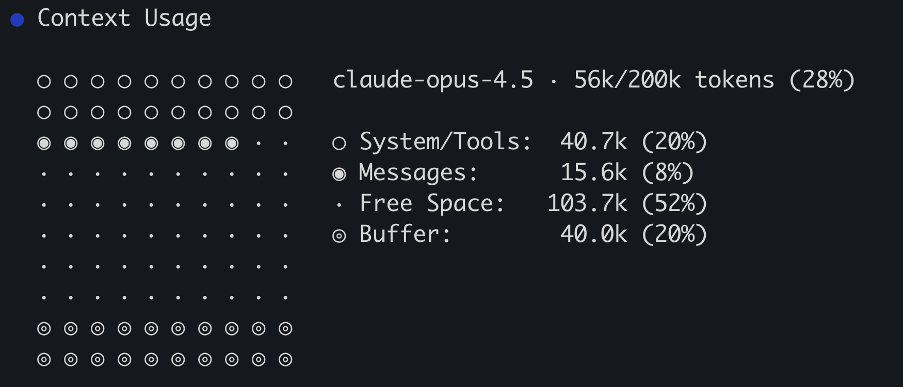

完成度の高い CLI ツールと同様に、GitHub Copilot CLI には多様な**スラッシュコマンド（Slash commands）**が用意されています。これらのコマンドを使用することで、高度な機能の呼び出し、内部動作ステータスの可視化、環境設定の動的変更が可能になります。

これまでの演習でも、会話リセットの `/clear` や MCP サーバー設定の `/mcp` を使用してきました。本演習では、コンテキスト管理（`/context`、`/compact`）、モデル選択（`/model`）、セッション共有（`/share`）、および Cloud agent への委任（`/delegate`）といった強力なコマンド群の活用法を学びます。

## シナリオ

中核的な開発フローは完了しました。本演習では応用機能として、チームとのセッション共有、LLM モデルの柔軟な切り替え、および時間のかかるタスクを [Copilot cloud agent][about-cloud-agent] へオフロードする委任フローを体験します。

この演習では、次の内容を学習します。

- `/share` コマンドを用いてセッションログを GitHub gist またはローカルファイルとして出力・共有する
- `/context` コマンドでエージェントが現在消費しているトークン使用率と内訳を確認する
- `/model` コマンドで利用可能な LLM モデル一覧を確認し、必要に応じて切り替える
- `/delegate` コマンドを用いて、長時間のタスクを非同期動作の Cloud agent へ委任する（※Cloud agent は Copilot Free を除く有料プランまたは Student プランで利用可能）

## セッションを共有する

AI ツールを使いこなすノウハウをチーム全体で蓄積・共有することは、開発組織全体の生産性とコード品質を向上させる最善のアプローチです。Copilot CLI の `/share` コマンドを使用すると、投入したプロンプト、エージェントの思考プロセス、ツールの実行結果を含む完全な対話履歴を、Markdown ファイルまたは GitHub gist としてエクスポートできます。

チームメンバーと知見を共有するための GitHub gist を作成してみましょう。

> [!NOTE]
> **外部へ共有せずローカルに保存する場合の代替手順**  
> 組織のポリシー等により外部へ会話ログを公開できない場合は、後述の `/share gist` の代わりに `/share file /tmp/dev-days-cli-session.md` を実行し、Codespace 内にローカル Markdown ファイルとして保存してください（手元の PC の場合は任意のローカルパスを指定します）。  
> なお、CLI 1.0.83 において引数なしで `/share` を単独実行すると、ログイン・同期済みのアカウント環境では GitHub 上に公開共有リンクが自動生成されます。共有を解除するコマンドは `/share off` です。出力先と公開範囲を明示して実行するよう留意してください（詳細は [公式のセッション記録ドキュメント](https://docs.github.com/ja/copilot/how-tos/copilot-cli/use-copilot-cli/chronicle) を参照してください）。

> [!TIP]
> **Copilot CLI セッションの開始方法**  
> Codespace のターミナルで、次のオプションを指定して Copilot CLI を起動します。
>
> ```bash
> copilot --yolo --enable-all-github-mcp-tools
> ```
>
> 既存のセッションを引き継ぐ場合は `copilot --yolo --enable-all-github-mcp-tools --continue` を実行します。すでに起動中の場合は `/clear` を送信して新しい会話を開始してください。

> [!CAUTION]
> `--yolo` オプションは、ツール実行やファイル変更時の確認ダイアログをすべて省略する完全自動化フラグ（`--allow-all-tools`、`--allow-all-paths`、`--allow-all-urls`）を有効にします。Codespace や仮想マシンのような分離された安全な環境でのみ使用し、日常的なローカル開発の既定エイリアスとして設定しないよう注意してください。詳しくは [ツールの許可と拒否に関するドキュメント][allow-all-warning] を参照してください。

[allow-all-warning]: https://docs.github.com/copilot/how-tos/copilot-cli/use-copilot-cli/allowing-tools

1. Copilot CLI のプロンプトで次のコマンドを入力して送信します。

   ```plaintext
   /share gist
   ```

2. 処理が完了すると、Copilot CLI が秘密の gist を生成し、アクセス用 URL リンクを表示します。
3. 表示された URL をコピーします。
4. Web ブラウザーの新しいタブでその URL を開き、gist の内容を確認します。送信したプロンプト、利用されたスキルやエージェント、Copilot の思考ログ、実行されたコマンドとその標準出力が漏れなく構造化されて記録されていることを確認してください。

このログは、AI を活用した実装プロセスの記録や、チーム内での効果的なプロンプティング手法の共有資料として活用できます。

## Copilot CLI のコンテキストを確認する

複雑な実装や長時間の対話を進めると、モデル固有のコンテキストウィンドウ上限に近づくことがあります。コンテキスト上限に達した場合、Copilot CLI は自動的に履歴の要約（コンパクション）を実行し、重要度の低い古い情報を破棄して空き領域を確保します。スラッシュコマンドを使用すれば、現在のコンテキスト消費状況を可視化したり、手動で要約を実行したりできます。

1. Copilot CLI のプロンプトで次のコマンドを送信します。

   ```plaintext
   /context
   ```

2. 現在のコンテキスト内訳がターミナル上に視覚的に出力されます。

   

3. 使用中のモデル名およびトークン使用率（パーセンテージ）を確認します。内訳の各項目は以下の通りです。

   | 項目名 | 内容説明 |
   |---|---|
   | **System/Tools** | 指示ファイル、参照されたファイル内容、MCP ツール定義 |
   | **Messages** | ユーザーと Copilot 間の会話履歴 |
   | **Buffer** | Copilot CLI が次の応答を生成するために予約している出力枠 |
   | **Free space** | 現在利用可能な残りの空きトークン枠 |

4. 次のコマンドを送信し、会話履歴を手動で要約・圧縮（compact）します。

   ```plaintext
   /compact
   ```

5. 圧縮完了後、再度コンテキスト統計を表示して変化を確認します。

   ```plaintext
   /context
   ```

6. Messages の消費量が削減され、Free space が回復していることを確認します（対話履歴がまだ短い場合は顕著な変化が現れないこともあります）。

> [!NOTE]
> Copilot CLI は、コンテキスト容量が上限に近づくとバックグラウンドで自動的に compact を実行します。容量が 100% に近づくと警告表示が出現します。通常は非同期で実行されるため対話を継続できますが、一時的に数秒間応答待ちとなる場合があります。

### コンテキスト管理のベストプラクティス

通常、Copilot CLI はコンテキストを自律的かつ効率的に管理するため、人間が頻繁に手動操作する必要はありません。ただし、次のような局面では手動介入が有効です。

- **作業対象のコンテキスト切り替え**：  
  全く無関係な新しい機能開発やバグ修正に着手する際は、古いコードの残骸によるハルシネーション（幻覚）を防ぐため、`/clear` でクリーンなセッションを開始する。
- **長大なタスクの節目**：  
  コンテキストが逼迫してきた段階で、適切なタイミングで `/compact` を明示実行して履歴を整理する。

## モデルを選択する

LLM にはそれぞれ異なる強み（推論力、コード生成速度、トークンコスト等）があり、開発者の好みやタスクの性質に応じた使い分けが可能です。Copilot CLI では、セッション内で使用するモデルを自由に切り替えることができます。

1. 次のスラッシュコマンドを入力して送信します。

   ```plaintext
   /model
   ```

2. 利用可能なモデルの一覧メニューが表示されます（表示内容は CLI のバージョンや契約プランにより異なります。CLI 1.0.83 ではモデル名、コンテキスト長、推論設定などが表示されます）。
3. 矢印キーで任意のモデルを選択するか、変更せずそのまま終了する場合は <kbd>Esc</kbd> キーを押します。

> [!CAUTION]
> CLI 1.0.83 において `/model` で選択した設定は**現在のセッションにのみ適用**されます。以降の全セッションに恒久適用する既定値を設定したい場合は、別途 `/config model` を使用します。本演習では一覧を確認するに留め、不要な既定値の変更は避けてください。

## Cloud agent に委任する（任意ステップ）

ローカルターミナルでの作業を止めずに、完了まで時間を要する重たいタスクをバックグラウンドで実行させたい場合があります。`/delegate` コマンドを使用すると、現在のタスクを GitHub のクラウド基盤（[Copilot cloud agent][about-cloud-agent]）へ引き渡すことができます。Cloud agent は非同期にコードの生成やテストを行い、完了すると自動的に pull request を起票してくれます。

> [!NOTE]
> `/delegate` の利用には Copilot cloud agent へのアクセス権が必要です。これは Copilot Free を除く有料プラン（Pro、Pro+、Business、Enterprise）および Student プランで利用可能です。対象プランをお持ちでない場合は、本セクションの内容を一読したうえで手順自体はスキップして構いません。

1. これまでの会話履歴が混入しないよう、まずセッションをクリアします。

   ```plaintext
   /clear
   ```

2. 独立した明確なタスクをプロンプトとして送信します（例: ページネーションの実装）。

   ```plaintext
   ゲーム一覧を1ページあたり固定件数で表示し、Previous と Next で移動するページネーションを実装して、テストを追加してください。
   ```

3. 次のコマンドを送信し、タスクを Cloud agent へ委任します。

   ```plaintext
   /delegate
   ```

4. Web ブラウザーで [Copilot agents（github.com/copilot/agents）](https://github.com/copilot/agents) を開き、クラウド上でタスクが非同期に進行する様子を確認します。
5. 本演習では PR の完了まで待機する必要はありません。非同期エージェントの詳細な運用フローを学びたい場合は、[Cloud agent ハーネス][cloud-harness-link] も合わせて参照してください。

## まとめと次のステップ

Copilot CLI の豊富なスラッシュコマンドを活用し、環境設定の確認、セッション共有、コンテキスト管理、モデル切り替え、およびクラウド委任を体験しました。本演習で実施した主な内容は次の通りです。

- `/share` コマンドを用いて、対話ログや思考過程を GitHub gist またはローカルファイルとして出力した
- `/context` および `/compact` コマンドにより、トークン消費の可視化と手動整理を実施した
- `/model` コマンドにより、利用可能な LLM モデルの選択肢とセッション単位の適用方法を確認した
- `/delegate` コマンドにより、長時間のタスクを非同期の Cloud agent へ引き渡す委任フローを理解した

次はいよいよ最終レッスンです。CLI コース全体で習得した技術と概念を振り返り、実践に向けたロードマップを総括します。[演習 8 - 振り返り][next-lesson] へ進んでください。

## リソース

- [Copilot CLI を使う][using-copilot-cli]
- [Copilot CLI について][about-copilot-cli]
- [Copilot CLI のコンテキスト管理][context-management]
- [Copilot CLI でセッションを共有する][share-sessions]
- [Copilot CLI でモデルを選択する][selecting-models]

[previous-lesson]: 6-custom-agents.md
[next-lesson]: 8-review.md
[using-copilot-cli]: https://docs.github.com/copilot/how-tos/use-copilot-agents/use-copilot-cli
[about-copilot-cli]: https://docs.github.com/copilot/concepts/agents/about-copilot-cli
[about-cloud-agent]: https://docs.github.com/copilot/concepts/agents/cloud-agent/about-cloud-agent
[context-management]: https://docs.github.com/copilot/how-tos/use-copilot-agents/use-copilot-cli#context-management
[share-sessions]: https://docs.github.com/copilot/how-tos/use-copilot-agents/use-copilot-cli#share-sessions
[selecting-models]: https://docs.github.com/copilot/how-tos/use-copilot-agents/use-copilot-cli#select-an-llm
[cloud-harness-link]: https://github-samples.github.io/copilot-workshops/cloud/
